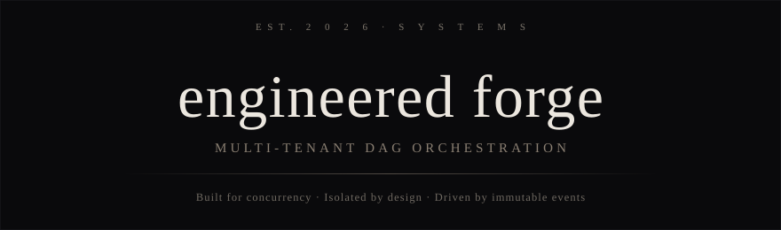
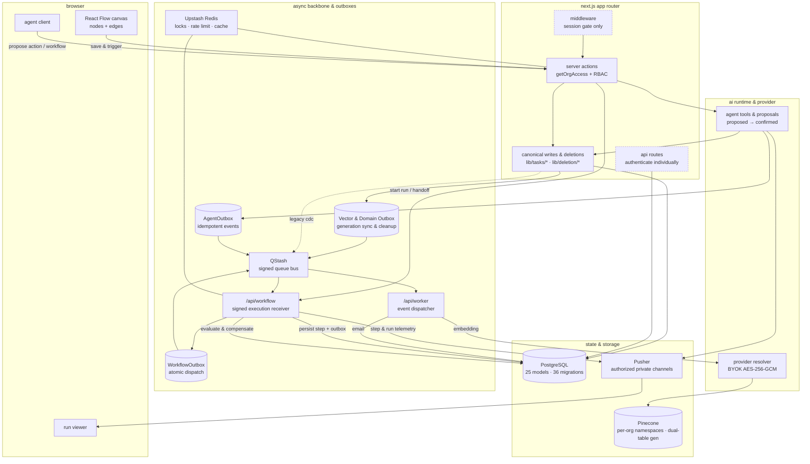

<p align="center">
  <picture>
    <source media="(prefers-color-scheme: dark)" srcset="./.github/assets/hero-dark.svg">
    <source media="(prefers-color-scheme: light)" srcset="./.github/assets/hero-light.svg">
    
  </picture>
</p>

<p align="center">
  
  
  
  
  
  
</p>

<p align="center">
  
  
  
  
</p>

<p align="center">
  
  
  
  
  
  
</p>

---

This is not a CRUD demo. It is a multi-tenant SaaS platform where the interesting
work lives in the parts that are usually hand-waved: a **durable DAG workflow
engine** with forward retry and saga backward-compensation, transactional outboxes
that prevent state-queue divergence, an **AI agent runtime** whose proposals are
enforced and confirmed rather than trusted, and a **tenant boundary** that holds on
every write path including model-generated mutations.

The thesis is narrow and deliberate:

> **An LLM proposes. The backend disposes.**
> Organization identity is never taken from model output, and no tool invocation
> bypasses the same authorization the UI uses.

Everything below is described as it is implemented — including the parts that
do not work yet. See [Status & Known Limitations](#status--known-limitations)
and the authoritative [Product Completion Tracker](forge/docs/product/PRODUCT_COMPLETION_TRACKER.md).

---

## the four hard parts

<table>
<tr><td width="25%" valign="top">

**durable DAG execution & saga compensation**

A React Flow canvas compiles to a validated graph with semantic action version pinning (`@1.0.0`). The evaluator advances one node at a time via a transactional outbox and signed QStash deliveries. Step failures trigger deterministic saga rollbacks (`ROLLING_BACK` &rarr; `ROLLED_BACK`) with idempotent action compensation.

- transactional workflow outbox (`WorkflowOutbox`) enclosing `StepRun` transitions and dispatch intent in a single DB transaction
- CAS batch claiming, lease token fencing, and colon-free SHA-256 deduplication
- compare-and-set context merge with an optimistic `contextVersion`
- 5s distributed Redis run lock with heartbeat to serialize deliveries
- forward retry (`MAX_RETRIES = 3`) before falling back into backward saga compensation
- exclusive compensation claim leases (`compensationClaimedBy`, `compensationClaimExpiresAt`)
- safe task reversal (`createTaskAction.compensate()`) with row-level `FOR UPDATE` locking and cascade protection
- immutable workflow definition contract (`definitionSnapshot`, canonical SHA-256 `definitionHash`) captured under `SELECT ... FOR SHARE` row locks and enforced by PostgreSQL BEFORE UPDATE triggers
- per-step `ExecutionAuditLog` with structured receipts

</td><td width="25%" valign="top">

**the agent is not trusted**

Bounded Gemini loops over task and workflow tools. Write tools do not execute on model authority — they are proposed, parked, and require human confirmation with an expiry. The runtime holds itself to invariants that are tested rather than asserted.

- transactional agent outbox (`AgentOutboxEvent`), so a commit and its publish cannot diverge
- Redis locks + heartbeats around session execution
- idempotency keys and exponential backoff on the outbox
- a reaper that closes abandoned sessions with a recorded terminal reason
- a persisted `promptVersion`, so a prompt change cannot corrupt live sessions
- workflow proposal compiler, reference validator, and materialization with execution handoff

</td><td width="25%" valign="top">

**tenancy that holds on write paths**

`getOrgAccess` is the single tenant boundary, used at every call site that resolves a user-supplied identifier. It returns a *trusted* `{ organization, membership, userId }` — the org is loaded from the slug and re-checked, never read out of the request.

- `ADMIN` / `MANAGER` / `MEMBER` RBAC, enforced per action
- canonical write helpers that re-resolve project, task, and assignee against the trusted org id
- per-organization Pinecone namespaces as defense in depth
- tenancy enforced *inside* queries for run views and Pusher channel authorizations (`private-agent-*`, `private-org-*`, `private-workflow-*`)

</td><td width="25%" valign="top">

**durable vector lifecycle & storage cleanup**

Dual-table generation state and transactional outboxes (UPPR Rev 4.1 / Phase B) prevent RAG index corruption and stale retrieval.

- dual-table generation state (`VectorEntityHead`, `VectorGeneration`) tracking active vs staging generations
- transactional mutation outbox (`VectorOutboxEvent`) committed in the same database transaction as task and attachment writes
- distributed worker pipeline with crash-safe `EventLog` leases and cross-delivery deduplication
- physical Pinecone readback verification before activating new generations
- atomic domain deletion service (`deleteTaskTransactionally`, `deleteAttachmentTransactionally`) with `DomainOutboxEvent` for asynchronous storage and vector cleanup

</td></tr>
</table>

---

## architecture

Two delivery surfaces sit behind the bus. Status codes are load-bearing: a `2xx`
from `/api/workflow` means the work is done **or durably scheduled**, and
nothing else.



The dashed nodes are the ones worth reading twice: **`middleware` is a session
gate, not a tenant gate**, and it excludes `/api` entirely — so every API route
must authenticate itself. That is a deliberate boundary, but it means the
invariant lives in each route, not in one place.

---

## data model

25 models, 21 enums, PostgreSQL. Every tenant-scoped table hangs off
`Organization` directly or reaches it by relation.

| | model | role |
|---|---|---|
| **tenant** | `Organization` | root. unique `slug`, `storageUsed` / `storageLimit` quota, billing fields |
| | `User` | email, name, role relations, created API keys |
| | `Membership` | `@@unique([userId, orgId])`, carries `Role` (`ADMIN`, `MANAGER`, `MEMBER`) |
| | `Invitation` | unique token, role, expiry, status |
| **work** | `Project` | `@@unique([name, orgId])` |
| | `Task` | status, priority, assignee &rarr; project &rarr; org |
| | `Comment`, `Attachment` | discussion and UploadThing `fileKey` |
| **workflow** | `Workflow` | `uiNodes`, `uiEdges`, compiled `definition`, `isActive` |
| | `WorkflowRun` | status, shared `context` + `contextVersion`, `lastAdvancedAt`, immutable `definitionSnapshot`, `definitionHash` |
| | `StepRun` | `@@unique([runId, stepId])`, attempts, compensation attempts, `compensationClaimedBy`, `compensationClaimExpiresAt` |
| | `WorkflowOutbox` | transactional outbox for reliable queue dispatch: dedupe key, status, lease token, lease expiry, retry count |
| | `ExecutionAuditLog` | per-step trace: level, payload, latency, compensation receipts |
| **agent** | `AgentSession` | `currentStep`, `terminalReason`, `promptVersion` |
| | `AgentToolExecution` | proposal + result, confirmation and expiry audit trail |
| | `AgentMessage` | transcript rows keyed by step |
| | `AgentOutboxEvent` | idempotency key, `messageId`, attempts, `availableAt` backoff |
| **vector & storage** | `VectorEntityHead` | dual-table generation head: tracks active generation, source entity type/id, version |
| | `VectorGeneration` | generation record: status, Pinecone chunk count, content hash, physical verification digest |
| | `VectorOutboxEvent` | atomic mutation capture for task & attachment vector embeddings |
| | `DomainOutboxEvent` | transactional cascading domain deletions for tasks and attachments |
| **infra** | `EventLog` | consumer dedup by `messageId`, worker lease token fencing |
| | `AnalyticsEvent`, `RazorpayEvent` | analytics rows; webhook dedup keyed on event id |
| **security** | `OrganizationApiKey` | `@@unique([orgId, provider, purpose])`, AES-256-GCM ciphertext, IV, tag, `keyVersion`, `status` |

The schema's inline comments are load-bearing — `contextVersion`,
`definitionSnapshot`, `WorkflowOutbox`, `VectorEntityHead`, `AgentOutboxEvent`, and
`AgentToolExecutionStatus` each document the specific bug they exist to prevent.

---

## module map

| path | owns |
|---|---|
| `src/lib/workflow/` | engine: `execution/{evaluator,resolver,state,mutex,wrapper,trigger,compensation-claim,outbox}`, `actions/core/{create-task,send-email,generate-report}`, `validation/canonical-hash`, `graph-ui/compiler`, `maintenance` |
| `src/lib/workflow-types/` | contracts: `action-registry`, `snapshot`, `type`, `workflow-proposal` |
| `src/lib/ai/agent/` | agent runtime, tools, registry, policy, outbox, session service |
| `src/lib/ai/` | provider binding, organization-aware resolver (BYOK), `semantic-cache`, prompts |
| `src/lib/vector/` | text extraction, semantic chunking, Pinecone client, generation state, retriever, outbox |
| `src/lib/deletion/` | transactional cascading deletions for tasks, projects, attachments, and domain cleanup outbox |
| `src/lib/events/` | event schemas, queue, router, worker factory, domain cleanup |
| `src/lib/tasks/` | canonical task/project writes (`createTaskInOrg`, `updateTaskInOrg`) — the shared write path |
| `src/lib/locking/` | token-checked Redis lock primitive + heartbeat |
| `src/lib/prisma/` | driver-adapter client (`db.ts`), event-dispatching `extended.ts` |
| `src/lib/security/` | credential vault (AES-256-GCM BYOK), zero-downtime rotation, distributed rate-limiting, upload validation |
| `src/lib/redis/`, `src/lib/pusher/`, `src/lib/emails/` | clients |
| `src/app/actions/` | server actions; the UI's write surface |
| `src/app/api/` | route handlers; each authenticates itself |
| `src/tests/` | 122 suites, 1,978 tests, node environment, in-memory Prisma double, db-guard, real-DB suites |

Tests run against an in-memory Prisma double, and a setup guard makes that
structural rather than conventional: `jest.setup-db-guard.ts` fails any suite that
tries to construct a real `PrismaClient` without explicit authorization. Dedicated
acceptance suites (`*.realdb.test.ts`) exercise Neon PostgreSQL triggers, row locks,
and immutability constraints.

---

## quickstart

Requires Node 20+ (CI verified on Node 22) and a PostgreSQL database.

```bash
git clone https://github.com/Mayur11code/Forge.git
cd Forge/forge

npm install
cp .env.example .env        # then fill it in
npm run dev
```

The app is served from **`Forge/forge`**, not the repository root — the repo
root holds the README, the assets, and the documentation.

### database

```bash
npx prisma migrate deploy   # 36 applied migrations (including outbox, saga & vector models)
npm run build               # runs `prisma generate` first
```

Seeding is optional and creates a usable login:

```bash
npx prisma db seed          # ts-node prisma/seed.ts
```

Seeding only needs `DATABASE_URL`. The seed prints its credentials.

### environment

`forge/.env.example` is committed and documents every variable with the
`file:line` that reads it, so you can tell what a missing value actually breaks.
Nothing in it is a real secret.

Only two variables are needed to boot:

| variable | read by |
|---|---|
| `DATABASE_URL` | `src/lib/prisma/db.ts:5`, `prisma/seed.ts:6` |
| `AUTH_SECRET` | `src/lib/auth/auth.ts:18`, `auth.config.ts:5` |

Everything else is feature-scoped — the app starts without it and fails when you
use that feature. Three worth knowing about up front:

- **`GEMINI_API_KEY` is the default model credential.** Gemini is the primary provider
  (`src/lib/ai/provider.ts:7`), complemented by organization-level BYOK keys.
- **`QSTASH_URL` and `QSTASH_TOKEN` are required for async dispatch.** `src/lib/events/queue.ts:22`
  and `:26` throw if either is missing, so the event bus and outbox dispatchers require them.
- **`UPSTASH_REDIS_REST_URL` and `UPSTASH_REDIS_REST_TOKEN` power distributed locks and rate limits.**

### tests & CI

```bash
npm test                    # 122 suites, 1,978 tests
npm run test:watch
npm run test:rate-limit:live # Live Upstash Redis rate-limit verification
```

Continuous integration is enforced via **GitHub Actions** (`.github/workflows/ci.yml`)
on every push and pull request to `main`. The pipeline runs under Node 22:
- `npx prisma generate`
- `npx next typegen`
- `npx tsc --noEmit` (strict compile-time verification)
- `npm test` (all 122 test suites / 1,978 tests)
- `npm run lint` (zero ESLint errors)

---

## production hardening & security milestones

The codebase has undergone systematic production-grade hardening passes:

1. **H1 — Environment Isolation & Airgap:** Strict compile-time and runtime `server-only` airgap. On-demand subsystem validation preventing unrelated build failures while strictly redacting credential values in error diagnostics.
2. **H2 — Zero-Downtime Credential Rotation:** Dynamic primary-to-fallback failover for Gemini, Pinecone, and QStash with non-retryable error classification and secret-redacting audit telemetry.
3. **H3 — Distributed Rate Limiting & AI Admission Control:** Multi-tier sliding-window rate limiting for public/auth API routes and token-bucket admission control for resource-intensive AI operations, backed by distributed Upstash Redis.
4. **BYOK Phase 1 & 1.1 — Secure Credential Vault:** Server-only authenticated encryption (`AES-256-GCM`) with contextual Authenticated Additional Data (AAD) binding tenant identity, provider, and purpose. Strict 32-byte key validation (64-hex / 44-base64), versioned keyrings, `PENDING_VALIDATION` lifecycle invariants, and reviewable offline Prisma migration.
5. **BYOK Phase 2 & 3 — Key Management, Validation & Organization-Aware Provider Resolution:** Admin settings UI (`ApiKeyManagementCard`) and server actions (`apiKeyActions.ts`) for independent `GENERATION` and `EMBEDDING` Gemini slots. Safe staged key replacement lifecycle with CAS concurrency serialization. Dynamic tenant-isolated provider resolver (`resolveOrganizationLanguageModel`, `resolveOrganizationEmbeddingModel`, `resolveOrganizationGenerativeAiClient`) wired across Chat RAG, Triage, Agent Loop, Stream Audit, Embedding Worker, and Vector Retrieval.
6. **Vector Phase B & UPPR 4.1 — Durable Generation State & Transactional Outbox:** Dual-table generation state (`VectorEntityHead`, `VectorGeneration`), transactional outbox (`VectorOutboxEvent`), worker lease fencing (`EventLog`), physical Pinecone readback verification, hierarchical deletion locking, and domain deletion outbox (`DomainOutboxEvent`).
7. **Workflow F-01 & F-05A — Saga Compensation Dispatch & Ownership Foundation:** Worker terminal guard dispatching `COMPENSATE` during `ROLLING_BACK` phase, exclusive compensation claim leases (`compensationClaimedBy`, `compensationClaimExpiresAt`) preventing split-brain rollback execution.
8. **Workflow F-02 — Fail-Safe Compensation Contract & Task Reversal:** Idempotent `createTaskAction.compensate()` with row-level `FOR UPDATE` locking, genuine no-op detection, cascading deletion guards (preventing task deletion when dependent comments/attachments exist), vector head tombstoning, outbox cancellation, and durable `COMPENSATION_TASK_DELETED` audit trail receipts.
9. **Workflow F-03 — Immutable Workflow Definition Contract & Action Version Pinning:** Capture immutable definition snapshots (`definitionSnapshot`, canonical SHA-256 `definitionHash`) under `SELECT ... FOR SHARE` row locks at workflow ignition. Enforce physical immutability via PostgreSQL `BEFORE INSERT` and `BEFORE UPDATE` database triggers. Strict action versioning registry (`formatActionKey(id, version)`) with pinned core actions (`@1.0.0`).
10. **Workflow F-04 — Transactional Workflow Outbox & Reliable Queue Dispatch:** PostgreSQL transactional outbox pattern enclosing `StepRun` state transitions and `WorkflowOutbox` dispatch intents in a single database transaction. Colon-free SHA-256 deduplication identifiers for QStash compliance, atomic CAS batch claiming, lease token fencing, expired lease recovery, bounded exponential backoff with dead-letter parking, tenant-scoped operator re-drive, and maintenance sweeper drainage.

---

## status & known limitations

This is a work-in-progress systems portfolio piece, and the following are true
today. They are listed because a README that only shows the wins is not
documentation.

**Security, Tenancy & Execution Integrity**

| issue | detail | status |
|---|---|:---:|
| **`I6` — cross-tenant workflow execution** | `startWorkflow` requires verified `orgId` in predicate; `triggerWorkflowRun` enforces `getOrgAccess` session RBAC. | **Resolved** |
| **Unauthenticated billing order creation** | `create-order` route enforces session `auth()` and requires `membership.role === "ADMIN"`. | **Resolved** |
| **Unauthenticated workflow test route** | `test-run` route enforces session `auth()`, derives `orgId` from membership, and applies `REQUEST_WORKFLOW_TEST_RUN` rate limit. | **Resolved** |
| **Attachment deletion scope & cascade** | `deleteAttachmentTransactionally` verifies caller membership in the task's project organization and transactionally enqueues domain cleanup. | **Resolved** |
| **RAG index staleness on task mutation/deletion** | Dual-table generation state (`VectorEntityHead`, `VectorGeneration`), `VectorOutboxEvent` for task mutations, and `DomainOutboxEvent` for cascading task deletions. | **Resolved** |
| **Attachment vector ingestion** | Transactional `createAttachment` writes attachment records and captures `VectorOutboxEvent` intents atomically in the same database transaction. | **Resolved** |
| **Live run streaming channel authorization** | `api/pusher/auth/route.ts` authorizes `private-workflow-${runId}` after verifying caller membership in the workflow's organization. | **Resolved** |
| **Step transition and queue divergence** | F-04 transactional workflow outbox (`WorkflowOutbox`) commits step updates and dispatch intents atomically, eliminating crash-after-commit delivery loss. | **Resolved** |
| **Workflow definition mutation mid-execution** | F-03 captures immutable definition snapshots under `FOR SHARE` locks; PostgreSQL triggers reject definition changes during active runs. | **Resolved** |
| **Google sign-in cannot persist** | `PrismaAdapter` is mounted, but the schema has no `Account` / `VerificationToken` model. Credentials sign-in works; OAuth does not. | Open |
| **`/members` is mock data** | No membership check, and it renders an `Owner`/`Editor`/`Viewer` vocabulary that does not exist in the `Role` enum. | Open |

**Correctness and Wiring**

| issue | detail |
|---|---|
| **Workflow triggers from events** | Workflows are triggered manually via the UI canvas Run button, test API, or agent proposal materialization handoff. Event triggers (such as `TASK_CREATED` CDC auto-triggering workflows) are not yet routed into `startWorkflow`. |
| **`ANALYTICS_EVENT` unhandled in worker router** | When `ANALYTICS_EVENT` is dispatched, the worker router has no configured handler for it, returning `500` by design to trigger QStash retry backoff. |
| **10 of 23 declared event types have no consumer** | `PROCESS_FILE`, `AI_SUMMARY_REQUESTED`, `CREATE_DEFAULT_ORG`, `SEND_WELCOME_EMAIL`, and others are declared in `EventTypes` but unhandled in the worker switch. |
| **Two dead-end routes** | `/router` redirects to `/onboarding` and `/select-org`; neither page exists yet. |
| **Invitations are not emailed automatically** | The invitation link must be copied by hand; email delivery worker currently targets configured development addresses. |

**Verification & Codebase Health**

- **Automated Test Matrix:** 122 test suites, 1,978 tests passing (100% pass rate) with in-memory Prisma double (`jest.setup-db-guard.ts`).
- **Real-Database Acceptance:** Dedicated Neon PostgreSQL test suites (`*.realdb.test.ts`) verify physical trigger immutability, outbox concurrency, lease token stealing, and saga compensation rollbacks.
- **Static Analysis & Types:** Strict TypeScript compilation (`npx tsc --noEmit`) passes cleanly; 0 ESLint errors across the entire codebase.
- **Live Rate Limiting:** Live distributed sliding-window and token-bucket rate limiting verified against Upstash Redis (`npm run test:rate-limit:live`).
- **Dependencies:** `OPENAI_API_KEY` and `ioredis` are retained dependencies; `TaskBoxv1`, `analytics-worker`, and `ai-worker` are orphaned modules.
- **URL Casing:** Inconsistent URL casing (`/Tasks`).

---

## documentation

The architecture is documented separately from the code, and the docs are the
source of truth for intent.

**product completion** — [Release 1 Product Completion Tracker](forge/docs/product/PRODUCT_COMPLETION_TRACKER.md)
(authoritative single source of truth for all Release 1 capabilities, milestones, acceptance criteria, and status)

**workflows** — [architecture](forge/docs/architecture/workflows/README.md) ·
[historical assignment 37 archive](forge/docs/archive/workflows/assignment-37/)

**agent** — [entry point](forge/docs/architecture/agent/README.md) ·
[security boundaries](forge/docs/architecture/agent/security.md) ·
[runtime](forge/docs/architecture/agent/runtime.md) ·
[tools](forge/docs/architecture/agent/tools.md) ·
[task tools](forge/docs/architecture/agent/task-tools.md) ·
[decisions](forge/docs/architecture/agent/decisions.md) ·
[historical roadmap archive](forge/docs/archive/agent/roadmap.md)

**dev log** — [M1 owner manual acceptance](forge/docs/dev-log/2026-11-26-m1-owner-manual-acceptance.md) ·
[F-04 transactional workflow outbox](forge/docs/dev-log/2026-11-10-f04-transactional-workflow-outbox.md) ·
[F-03 immutable workflow definition contract](forge/docs/dev-log/2026-11-10-f03-immutable-workflow-definition-contract.md) ·
[F-02 compensation contract & task rollback](forge/docs/dev-log/2026-11-10-f02-compensation-contract-and-task-rollback.md) ·
[F-01 compensation dispatch & ownership](forge/docs/dev-log/2026-11-09-f01-compensation-dispatch-and-ownership.md) ·
[I6 real-db acceptance](forge/docs/dev-log/2026-10-20-i6-real-db-acceptance.md) ·
[execution handoff](forge/docs/dev-log/2026-10-21-phase-37.12-execution-handoff.md) ·
[full test matrix](forge/docs/dev-log/2026-10-21-phase-37.15-full-test-matrix.md) ·
[CI & lint](forge/docs/dev-log/2026-10-01-lint-and-ci.md)

**security & hardening** — [security audit](forge/docs/architecture/security/2026-10-20-security-audit.md) ·
[credential vault & BYOK](forge/docs/security/credential-vault.md) ·
[distributed rate limiting & AI admission control](forge/docs/security/rate-limiting.md) ·
[zero-downtime credential rotation](forge/docs/security/key-rotation.md)

**archive** — [documentation archive](forge/docs/archive/README.md)

**methodology** — [Universal Prompt Patterns Registry (UPPR) Rev 4.1](docs/pp.md)

---

<p align="center">
  <sub>
    Built with Next.js, Prisma, QStash, Upstash, Pinecone and Gemini ·
    <a href="./forge/prisma/schema.prisma">schema</a> ·
    <a href="./forge/src/lib/workflow">engine</a> ·
    <a href="./forge/src/lib/ai/agent">agent</a>
  </sub>
</p>
