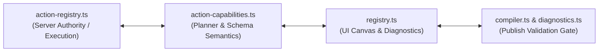
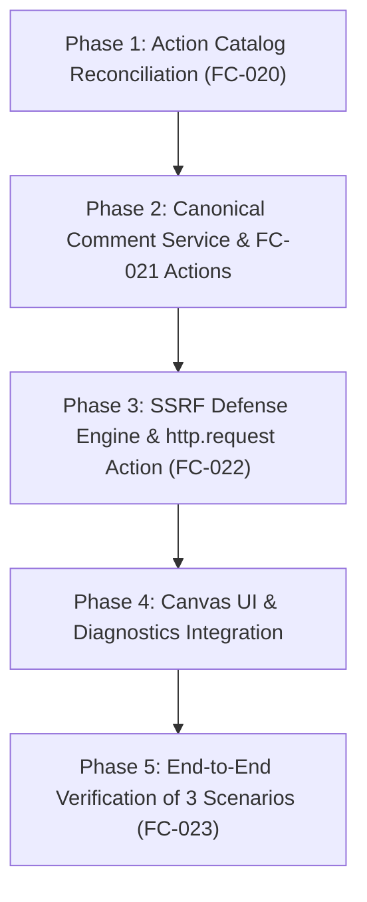

# FORGE — M5 Action & Integration Architecture Audit, Repository Rebaseline & Implementation Plan

**Date:** 2026-11-28  
**Milestone Audited:** M5 — Actions and Integrations (`FC-020`, `FC-021`, `FC-022`, `FC-023`)  
**Methodology:** Universal Prompt Patterns Registry (UPPR) Rev 4.1 (Audit-Only Phase 0)  
**Audit Type:** Read-Only Architectural Gap Audit, Repository Rebaseline & Implementation Plan  
**Application Directory:** `C:\Users\Mayur\Desktop\Forge\Forge\forge`  
**Git Baseline:** `feat/m1-identity-and-latenight-landing` @ commit `f27ae20`  

---

## 1. Executive Summary & Audit Baseline

### 1.1 Executive Assessment
An exhaustive, repository-grounded audit of Milestone M5 (`FC-020` through `FC-023`) was executed across the Forge workflow engine, action registries, execution kernel, saga rollback infrastructure, canvas UI, canonical task/comment operations, network egress points, and database schemas.

**Current M5 Production Readiness: 15% (Foundations present, actions mostly disconnected/missing).**

While the core execution runtime (`evaluator.ts`, `wrapper.ts`, `compensation-claim.ts`, `outbox.ts`) is highly sophisticated and possesses rock-solid distributed locking, immutable definition snapshots, atomic outbox persistence, and reverse topological rollback from M3 and M4, the **action catalog itself is in an incomplete, partially disconnected state**:
1. **Catalog Registration Gap:** Only one action (`task.create@1.0.0`) is registered in `src/lib/workflow-types/action-registry.ts` and cataloged in `src/lib/workflow-types/action-capabilities.ts`.
2. **Unregistered On-Disk Implementations:** Two actions exist on disk (`sendEmailAction` in `send-email.ts` and `generateReportAction` in `generate-report.ts`), but they are completely absent from `ActionRegistry`, `ActionCapabilities`, and `AVAILABLE_ACTIONS` (`registry.ts`). Workflows using them cannot be authored, published, ignited, or executed.
3. **Identifier & Contract Drift:**
   - Email action is defined as `communication.send_email` on disk, whereas the Product Tracker targets `email.send`.
   - Report action is defined as `utils.generate_report` on disk, whereas the Product Tracker targets `report.generate`. Furthermore, `generate-report.ts` uses placeholder data (`"DATA... ".repeat(5000)`) rather than real structured Markdown tables.
   - Logic condition helper (`conditions.ts`) exports a bare helper function (`executeConditionNode`), not a `WorkflowAction`.
4. **Missing Production Actions (FC-021 & FC-022):**
   - `src/lib/workflow/actions/core/update-task.ts` (`task.update`) does **NOT** exist.
   - `src/lib/workflow/actions/core/create-comment.ts` (`comment.create`) does **NOT** exist.
   - `src/lib/workflow/actions/core/http-request.ts` (`http.request`) does **NOT** exist.
   - `src/lib/security/ssrf.ts` (SSRF defense engine) does **NOT** exist.
5. **Worker Safety Violation in Comments:** While `src/lib/tasks/update-task.ts` is worker-safe (`updateTaskInOrg`), `src/app/actions/comments/createComments.ts` is a UI server action bound to session cookies (`getOrgAccess`), `notFound()`, and `revalidatePath()`. Background workers executing `comment.create` cannot invoke it without crashing. A canonical, worker-safe operation (`createCommentInOrg`) is required.
6. **Schema Discrepancy on `TaskStatus` for Scenario 3:** The Product Completion Tracker specifies Scenario 3 as transitioning a blocked task to `status: ESCALATED`. However, the PostgreSQL enum `TaskStatus` in `prisma/schema.prisma` contains only `TODO`, `IN_PROGRESS`, `BLOCKED`, `DONE`. There is **no `ESCALATED` value**. Executing this will cause runtime Prisma schema validation failure unless reconciled.
7. **Capability Catalog Discrepancy:** `src/lib/workflow/actions/core/create-task.ts` contains a 250-line transactional compensation function that verifies status, comments, attachments, and tombstoning. However, `src/lib/workflow-types/action-capabilities.ts` line 211 states `compensation: { available: false }`. This internal drift misleads planners and canvas tools.

---

### 1.2 Exact Git & Environment Baseline

| Parameter | Observed Baseline Value | UPPR Rev 4.1 Compliance |
| :--- | :--- | :--- |
| **Workspace Root** | `C:\Users\Mayur\Desktop\Forge` | Verified |
| **Repository Root** | `C:\Users\Mayur\Desktop\Forge\Forge` | Verified |
| **Application Root** | `C:\Users\Mayur\Desktop\Forge\Forge\forge` | Verified |
| **Current Branch** | `feat/m1-identity-and-latenight-landing` | Clean working tree |
| **Upstream Tracking** | `origin/feat/m1-identity-and-latenight-landing` | Up to date with remote |
| **HEAD Commit SHA** | `f27ae20` | `feat(m4): implement real event triggers, domain outbox, remediations and redesign auth UI` |
| **Working Tree Status** | 0 staged, 0 unstaged, 0 untracked | Pristine clean baseline |
| **Node.js Runtime** | Node `v22.18.0` (Native `fetch`, `undici`, built-in `node:net`, `node:dns`) | Verified |
| **PostgreSQL Engine** | Neon PostgreSQL with applied M4 schema (`DomainEventOutbox`, `WorkflowTriggerDispatch`, `WorkflowOutbox`) | Migrated and healthy |
| **DB Access Guard** | `jest.setup-db-guard.ts` active (blocks unmocked DB calls in unit tests) | Enforced |
| **Pre-Existing Test Baseline** | `action-capabilities.test.ts` (32/32 passed), `workflow-saga-rollback.test.ts` (8/8 passed) | Verified |
| **Known Pre-Existing TS Noise** | 2 typing issues in test file `m4-owner-acceptance.realdb.test.ts` (`WorkflowGraph` import and `MembershipWhereInput.organizationId`) | Documented; app build passes |

---

## 2. Authoritative Backlog & Milestone Reconciliation

Reconciliation between `PRODUCT_COMPLETION_TRACKER.md` and the actual repository state:

| Assignment | Tracker Capability | Current Codebase State | Gap & Discrepancy Analysis | Disposition |
| :--- | :--- | :--- | :--- | :--- |
| **FC-020** | Reconcile & Register Native Actions (`email.send`, `report.generate`, `logic.condition`) | `send-email.ts` and `generate-report.ts` exist on disk but unregistered. `conditions.ts` is a bare helper. | Actions use mismatched IDs (`communication.send_email`, `utils.generate_report`). Missing capability schemas, canvas palette entries, and version pinning (`@1.0.0`). Report uses dummy repeat string instead of real Markdown. | **NOT IMPLEMENTED / DISCONNECTED** |
| **FC-021** | Implement & Register `task.update` & `comment.create` with Saga Compensation | `updateTaskInOrg` exists in `src/lib/tasks/update-task.ts`. Comments only exist as UI server action in `src/app/actions/comments/createComments.ts`. | Neither workflow action wrapper exists. No canonical worker-safe comment service. No pre-state snapshotting for task updates. No reverse compensation for task updates or comments. | **NOT IMPLEMENTED** |
| **FC-022** | Implement & Register SSRF-Safe `http.request` Action | No HTTP action exists. `src/lib/security/ssrf.ts` does not exist. | Outbound webhook execution missing. No private IP range blocking, no DNS rebinding / IP pinning defense, no redirect re-validation, no timeout / size caps. | **NOT IMPLEMENTED** |
| **FC-023** | End-to-End Verification of 3 Real Automation Scenarios | Only single isolated `task.create` has verified end-to-end integration tests. | Multi-step DAG scenarios 1, 2, and 3 are unverified. Scenario 3 has schema mismatch on `TaskStatus.ESCALATED`. | **NOT STARTED** |

---

## 3. Current Action Inventory & Registration Matrix

| Action ID (Canonical) | Tracker ID | Implementation File Path | Registered in `action-registry.ts` | Described in `action-capabilities.ts` | Exposed in `registry.ts` (UI) | Pinned Version | Execution Sandbox Status | Compensation Implemented | Compensation Safety Checks | Discrepancy / Gap Analysis |
| :--- | :--- | :--- | :---: | :---: | :---: | :---: | :---: | :---: | :--- | :--- |
| `task.create` | `task.create` | `src/lib/workflow/actions/core/create-task.ts` | **YES** | **YES** | **YES** | `1.0.0` | **OPERATIONAL** | **YES** (full on-disk code) | Task status == TODO, 0 comments, 0 attachments, title/desc unchanged, vector tombstone, audit receipt. | **Drift:** `action-capabilities.ts` claims `compensation: { available: false }` despite full code existing in `create-task.ts`. |
| `email.send` | `email.send` | `src/lib/workflow/actions/core/send-email.ts` | **NO** | **NO** | **NO** | Unregistered | **DISCONNECTED** | **NO** (Irreversible) | N/A (External email delivery cannot be recalled) | **ID Mismatch:** File exports `communication.send_email` @ `1.0.0`. Omitted from registry, capabilities, and UI picker. |
| `report.generate` | `report.generate` | `src/lib/workflow/actions/core/generate-report.ts` | **NO** | **NO** | **NO** | Unregistered | **DISCONNECTED** | **YES** (UTApi file delete) | Checks `outputs.fileKey`; deletes UploadThing artifact. | **ID Mismatch & Mock Data:** File exports `utils.generate_report` @ `1.0.0`. Report content is `"DATA... ".repeat(5000)`. Not a real structured Markdown table. |
| `logic.condition` | `conditions` | `src/lib/workflow/actions/logic/conditions.ts` | **NO** | **NO** | **NO** | None | **INCOMPATIBLE** | **NO** | N/A (Branch decision only) | **Architectural Mismatch:** File only exports helper `executeConditionNode`. Does not implement `WorkflowAction` interface. Not in registry. |
| `task.update` | `task.update` | *Missing* (target: `src/lib/workflow/actions/core/update-task.ts`) | **NO** | **NO** | **NO** | None | **MISSING** | **NO** | Must verify task ownership, verify status hasn't moved past updated status, and restore previous state snapshot. | **Missing Action:** Canonical operation `updateTaskInOrg` exists, but no workflow action wrapper, schema, or compensation logic exists. |
| `comment.create` | `comment.create` | *Missing* (target: `src/lib/workflow/actions/core/create-comment.ts`) | **NO** | **NO** | **NO** | None | **MISSING** | **NO** | Must delete posted comment row or post rollback tombstone note. | **Missing Action & Service:** `createComments.ts` is UI-only. Missing worker-safe `createCommentInOrg` and workflow action wrapper. |
| `http.request` | `http.request` | *Missing* (target: `src/lib/workflow/actions/core/http-request.ts`) | **NO** | **NO** | **NO** | None | **MISSING** | **NO** (Irreversible) | Logs audit receipt of external webhook call. | **Missing Action & Security Airgap:** Requires full SSRF defense (`src/lib/security/ssrf.ts`) with DNS pinning. |

---

## 4. Three-Way Action Correspondence Analysis

In Forge, the action lifecycle is governed by an ironclad three-way correspondence invariant:



### 4.1 Invariants Enforced by Existing Code
1. **Compile-Time Enforcement:** `ActionCapabilities` uses `satisfies Record<RegisteredActionId, ActionCapability>`. Adding an action to `ActionRegistry` without adding its full capability schema in `ActionCapabilities` causes TypeScript compile failure.
2. **Runtime Correspondence Test:** `src/tests/workflow/action-capabilities.test.ts` asserts:
   - `Object.keys(ActionRegistry).sort() == Object.keys(ActionCapabilities).sort()`
   - `AVAILABLE_ACTIONS.map(a => a.id).sort() == Object.keys(ActionCapabilities).sort()`
   - Every capability strictly defines input schema, output schema, compensation availability, and failure retriability notes.
3. **Publish Validation Gate:** `evaluateWorkflowDiagnostics` (`diagnostics.ts`) builds `KNOWN_ACTION_IDS` from `AVAILABLE_ACTIONS`. If a workflow contains a node whose action is not in `AVAILABLE_ACTIONS`, it emits `code: "INVALID_ACTION", severity: "ERROR", blocksPublish: true`.
4. **Ignition Gate:** `startWorkflow` in `trigger.ts` calls `getRegisteredActionForIgnition(step.action)`. If the action is not in `ActionRegistry`, it throws `Cannot start workflow: step requires action which is not registered`.

### 4.2 Critical Findings & Inconsistencies
- **Single-Action Lockout:** Currently, `initialActionRegistry` in `action-registry.ts` contains ONLY `"task.create": createTaskAction`. Because of the three-way correspondence tests and compile-time guards, developers cannot simply register an action in one file without synchronously updating all three surfaces.
- **Drift in `task.create` Compensation:** `create-task.ts` contains 210 lines of robust compensation code (`compensate: CompensateFunction`), but `action-capabilities.ts` line 211 declares `compensation: { available: false }`. This contradicts code reality and must be updated to `{ available: true }` in FC-020.

---

## 5. Action Versioning & Resolution Engine Audit

### 5.1 Architecture Trace

```
WORKFLOW AUTHORING / SAVE
  │ Canvas nodes compiled to WorkflowDefinition via `compileWorkflow` (compiler.ts)
  ▼
WORKFLOW PUBLISHING (workflow.ts)
  │ WorkflowVersion record created under FOR UPDATE lock
  │ actionManifest captures { stepId, actionId, actionVersion }
  ▼
WORKFLOW IGNITION (trigger.ts)
  │ 1. `getRegisteredActionForIgnition(step.action)` retrieves active WorkflowAction
  │ 2. `actionManifest` constructed: `[{ stepId, actionId, actionVersion: action.version }]`
  │ 3. `WorkflowExecutionSnapshot` created with immutable definition & actionManifest
  │ 4. `computeWorkflowDefinitionHash(snapshot)` computes canonical SHA-256
  │ 5. WorkflowRun created with `definitionSnapshot` and `definitionHash`
  ▼
STEP EXECUTION / SAGA COMPENSATION (wrapper.ts)
  │ 1. StepRun loaded with `run.definitionSnapshot`
  │ 2. `effectiveVersion` resolved from `rawSnapshot.actionManifest` for `stepId`
  │ 3. `getAction(actionId, effectiveVersion)` looks up in `versionedActionStore`
  │ 4. If action missing or version mismatch: FAILS CLOSED (never falls back to latest)
```

### 5.2 Resolution Rules & Invariants
- **Version Key Formatting:** `formatActionKey(actionId, version)` produces `${actionId}@${actionVersion}`. The `@` delimiter is strictly forbidden inside `actionId` or `actionVersion`.
- **Duplicate Registration Rejection:** `registerAction` throws an explicit error if the same `(actionId, actionVersion)` is registered with a different object reference.
- **Strict Pinning at Execution:** In `wrapper.ts` (lines 237–280), if `effectiveVersion` is absent or `getAction(actionId, effectiveVersion)` returns `undefined`, execution **fails closed**:
  - In forward execution: `handleFailure(..., "Action ... not found in registry", false)`.
  - In rollback compensation: `failCompensationAttempt(..., "Action ... not found in registry", false)`.
  - It **never** silently falls back to another version or latest.

---

## 6. Execution Engine & Saga Runtime Capability Audit

### 6.1 Evaluator & Saga Pivot (`evaluator.ts`)
The workflow evaluator operates as an atomic, single-pass state-machine transition engine:
1. **Critical Failure Detection:** In `RUNNING` status, lines 301–321 inspect all `existingStepRuns`. If any step has `status === "FAILED"` and `steps[stepId].isCritical === true`, the run transitions to `ROLLING_BACK`.
2. **Reverse Topological Math:** Lines 326–377 build a `childMap` (`parent -> children[]`).
   - A step in `SUCCESS` status is ready to compensate **if and only if all its child steps are settled** (i.e. not in `SUCCESS`, `RUNNING`, or `COMPENSATING`).
   - Steps in `SKIPPED` are transitioned to `CANCELLED`.
   - Steps ready to compensate are dispatched concurrently into `workflowOutbox` with `actionType: "COMPENSATE"` and `generation = compensationAttempts + 1`.
3. **Convergence:** When all steps reach terminal states (`COMPENSATED`, `CANCELLED`, `FAILED`), the run cleanly settles into `ROLLED_BACK` (or `REQUIRES_INTERVENTION` if any compensation attempt suffered terminal failure).

### 6.2 Compensation Claim & Fencing (`compensation-claim.ts`)
1. **Exclusive Claim Invariant:** `claimCompensationAttempt` uses an atomic `updateMany` requiring step status `SUCCESS`, `COMPENSATION_RETRYING`, or `COMPENSATING` with expired lease (`compensationLeaseExpiresAt < NOW()`).
2. **Cryptographic Claim Token:** Generates a fresh `claimToken = crypto.randomUUID()` and sets lease expiry (default: 60s).
3. **Fenced Completion & Failure:** Both `completeCompensationAttempt` and `failCompensationAttempt` enforce `compensationClaimToken === claimToken`. If a worker's lease expired and another worker stole the lease, the stale worker is **fenced out** (`fencedOut: true`) and its writes are discarded.
4. **Retry Bounding:** Retriable compensation failures increment `compensationAttempts` up to `MAX_COMPENSATION_RETRIES = 3`, parking in `COMPENSATION_RETRYING`. Exceeding 3 attempts marks `COMPENSATION_FAILED`, forcing run status to `REQUIRES_INTERVENTION`.

---

## 7. Canonical Business Operations Audit: `task.update` (FC-021)

### 7.1 Existing Canonical Implementation (`src/lib/tasks/update-task.ts`)
The function `updateTaskInOrg(input, actor)` is already canonical, worker-safe, and hardened:
- **No Next.js UI Bindings:** Does not import `auth()`, `notFound()`, `revalidatePath()`, or `next/*`.
- **Strict Tenant Boundary:** Re-scopes `taskId` to `actor.orgId` via `task.findFirst({ where: { id: taskId, project: { orgId: actor.orgId } } })`.
- **Row-Level Serialization:** Executes `SELECT id FROM "Task" WHERE id = ${taskId} FOR UPDATE;` inside a Prisma transaction.
- **Assignee Membership Verification:** Verifies `assigneeId` belongs to `actor.orgId`.
- **Atomic Transition Check:** Uses compare-and-swap update for completion transitions (M4-REM-1).
- **Outbox Intent Emission:** Atomically registers vector sync and domain CDC event intents.

### 7.2 Required Workflow Action Adapter (`update-task.ts`)
To implement `task.update` in FC-021:
1. **Input Resolution & Validation:** Accepts `{ taskId, title?, status?, priority?, assigneeId? }`. `taskId` is required.
2. **Pre-State Capture:** In `execute()`, read the task's existing state under lock before applying updates. Persist `previousState` in the returned `ActionResult.data`:
   ```ts
   previousState: {
     status: existing.status,
     priority: existing.priority,
     assigneeId: existing.assigneeId,
     title: existing.title
   }
   ```
3. **Origin Propagation:** Pass `origin: { originType: "WORKFLOW", workflowId: ctx.workflowId, workflowRunId: ctx.runId }` into `updateTaskInOrg` to prevent recursive trigger storm loops.
4. **Compensation Semantics:** In `compensate(ctx)`:
   - Extract `ctx.outputs.previousState`.
   - Verify task still belongs to workflow `orgId`.
   - Verify task status has not moved forward past the workflow's update (e.g. if workflow changed `TODO` -> `IN_PROGRESS`, verify current status is `IN_PROGRESS`). If user has manually moved it to `DONE`, refuse compensation with truthful failure to protect human work.
   - Revert task fields back to `previousState` via `updateTaskInOrg`.
   - Record durable compensation audit log.

---

## 8. Canonical Business Operations Audit: `comment.create` (FC-021)

### 8.1 Critical Architecture Gap: UI Server Action vs Worker
`src/app/actions/comments/createComments.ts` contains:
```ts
"use server";
import { getOrgAccess } from "@/features/organizations/getOrgAccess";
import { notFound } from "next/navigation";
import { revalidatePath } from "next/cache";
```
- It calls `getOrgAccess(orgSlug)` which inspects request cookies and session headers.
- If unauthenticated, it throws `notFound()`.
- It executes `revalidatePath(...)`.
- **Conclusion:** It is completely unusable inside background workflow executions (QStash, worker thread). Invoking it throws runtime errors.

### 8.2 Canonical Service Requirement: `createCommentInOrg`
A new canonical business module must be created: `src/lib/comments/create-comment.ts`.
- **Signature:**
  ```ts
  export async function createCommentInOrg(
    input: { taskId: string; content: string; userId?: string },
    actor: { orgId: string; origin?: MutationOrigin }
  ): Promise<CreateCommentResult>
  ```
- **Author Identity Invariant:**
  In `prisma/schema.prisma`, `Comment.userId` is `NOT NULL` and references `User.id`. In a background workflow run, there is no interactive user session.
  - *Resolution Strategy:* If `input.userId` is provided (e.g. via variable interpolation `{{trigger.outputs.assigneeId}}`), verify membership in `actor.orgId`.
  - If omitted, resolve a fallback bot/system user or the organization owner's `userId`.
- **Compensation Semantics:**
  - Option A (Hard Deletion): Find the created comment by `commentId` (stored in `outputs.commentId`), verify it belongs to `actor.orgId`, and execute `db.comment.delete({ where: { id: commentId } })`.
  - Option B (Tombstone Note): Append `[ROLLED BACK: Comment retracted due to workflow compensation]` or delete if unmodified.
  - Standard Saga convention: Hard delete the specific automated comment row if unmodified, logging a compensation receipt in `ExecutionAuditLog`.

---

## 9. SSRF Defense & Egress Security Architecture Audit (FC-022)

Outbound HTTP requests in `http.request` represent a critical attack surface for Server-Side Request Forgery (SSRF), cloud metadata theft, and internal service probing.

### 9.1 Network Security Perimeter & Blocked Ranges
The SSRF validation module (`src/lib/security/ssrf.ts`) must block all private, loopback, link-local, carrier, and reserved IP ranges:

| Target Range | CIDR / Subnet | Security Hazard Prevented |
| :--- | :--- | :--- |
| **IPv4 Loopback** | `127.0.0.0/8` | Probing local container services (Postgres, Redis, local ports) |
| **IPv6 Loopback** | `::1/128` | Probing local IPv6 listening ports |
| **Cloud Metadata** | `169.254.169.254/32`, `169.254.0.0/16` | AWS/GCP/Azure instance credential & token theft |
| **Cloud Metadata IPv6** | `fe80::/10` | IPv6 link-local and cloud metadata endpoints |
| **RFC 1918 Private Net** | `10.0.0.0/8`, `172.16.0.0/12`, `192.168.0.0/16` | Intranet scanning, internal database / microservice probing |
| **IPv6 Unique Local** | `fc00::/7` | Private IPv6 corporate networks |
| **Carrier-Grade NAT** | `100.64.0.0/10` | Shared upstream infrastructure probing |
| **IPv4 Mapped IPv6** | `::ffff:0:0/96` (e.g. `::ffff:127.0.0.1`) | Bypass via dual-stack mapping tricks |
| **Multicast & Broadcast** | `224.0.0.0/4`, `255.255.255.255/32`, `ff00::/8` | Network discovery, amplification attacks |
| **Special Hostnames** | `localhost`, `*.internal`, `*.local`, `metadata.google.internal` | DNS names resolving to internal hosts |

### 9.2 DNS Rebinding Defense (Time-Of-Check to Time-Of-Use / TOCTOU)
- **Vulnerability:** If DNS is resolved, validated against the blocklist, and then standard `fetch(url)` is called, an attacker-controlled DNS server can return a public IP on the first query (check time) and `169.254.169.254` on the second query (connection time).
- **Hardened Defense:**
  1. Pre-resolve hostname via `node:dns.promises.lookup` with `{ all: true }`.
  2. Validate **all** returned IP addresses against the blocklist. If any IP is private/reserved, reject immediately.
  3. **Socket Pinning:** In Node 22, use custom `undici.Agent` with a custom `connect` dispatcher, or `node:https.request` with a custom `lookup` function that returns the exact validated IP, while keeping the original `Host` header and TLS Server Name Indication (SNI) intact.

### 9.3 Redirect & Resource Policies
1. **Redirect Enforcement:** Max 3 redirects. Set `redirect: "manual"`. Inspect the HTTP 3xx `Location` header. Parse the target URL, reject protocol downgrades (e.g. `https` to `http` or transitions to `file://`, `gopher://`), re-resolve the destination IP, and re-validate against the SSRF blocklist before following.
2. **Credential Stripping:** Do NOT forward `Authorization` or `Cookie` headers across domain boundaries during redirects.
3. **Resource Bounds:**
   - Connection timeout: &le; 5,000ms.
   - Read / idle timeout: &le; 10,000ms.
   - Response size cap: Max 1 MB (1,048,576 bytes). Stream read must abort if byte counter exceeds 1 MB.
4. **Compensation Taxonomy:** `http.request` is inherently **Irreversible** (cannot recall an HTTP webhook). Set `compensation: { available: false }`.

---

## 10. Three Real-World Automation Scenarios Audit (FC-023)

### 10.1 Scenario Architecture Topologies

```mermaid
flowchart TD
    subgraph Scenario1["Scenario 1: Automatic Task Triage & Assignment"]
        S1_Trigger["Trigger: task.created (Priority: HIGH)"] --> S1_Filter{"Filter: Priority == HIGH?"}
        S1_Filter -- Yes --> S1_Update["Action: task.update (Assign Lead & Status: IN_PROGRESS)"]
        S1_Update --> S1_Email["Action: email.send (Dispatch Resend Alert to Lead)"]
    end

    subgraph Scenario2["Scenario 2: Automated Progress Digest & Report Generation"]
        S2_Trigger["Trigger: Manual / project.created"] --> S2_Report["Action: report.generate (Compile Real Markdown Table & Upload)"]
        S2_Report --> S2_Comment["Action: comment.create (Post Digest Table to Task Discussion)"]
        S2_Comment --> S2_Email["Action: email.send (Dispatch Summary to Project Lead)"]
    end

    subgraph Scenario3["Scenario 3: Task Escalation with Saga Rollback"]
        S3_Trigger["Trigger: task.updated (Status: BLOCKED)"] --> S3_Update["Action: task.update (Set Status: IN_PROGRESS / Priority: HIGH)"]
        S3_Update --> S3_HTTP["Action: http.request (Webhook to External API - Simulates 500 Failure)"]
        S3_HTTP -- Failure (isCritical: true) --> S3_Saga["Saga Engine Initiates Reverse Rollback"]
        S3_Saga --> S3_CompUpdate["Compensate: task.update (Reverts Status to BLOCKED)"]
        S3_CompUpdate --> S3_AuditLog["Durable Audit Receipt & Rollback Log Persisted"]
    end
```



### 10.2 Variable Propagation & Interpolation Paths
- **Scenario 1:**
  - `task.update.inputs.taskId` &larr; `{{trigger.outputs.taskId}}`
  - `task.update.inputs.status` &larr; `"IN_PROGRESS"`
  - `email.send.inputs.subject` &larr; `"Urgent Task Assigned: {{trigger.outputs.title}}"`
  - `email.send.inputs.bodyText` &larr; `"Task {{trigger.outputs.taskId}} was automatically assigned."`
- **Scenario 2:**
  - `report.generate.inputs.projectId` &larr; `{{trigger.outputs.projectId}}`
  - `comment.create.inputs.taskId` &larr; `{{trigger.outputs.taskId}}`
  - `comment.create.inputs.content` &larr; `"Automated Digest:\n\n{{report_node.outputs.markdownContent}}\n\nDownload: {{report_node.outputs.documentUrl}}"`
- **Scenario 3:**
  - `task.update.inputs.taskId` &larr; `{{trigger.outputs.taskId}}`
  - `http.request.inputs.url` &larr; `https://mock.incident-api.internal/v1/escalate` (mock endpoint configured to return 500)

### 10.3 Critical Schema Discrepancy: `TaskStatus` Enum
- **Tracker Description:** Tracker states `status: ESCALATED`.
- **Database Reality:** In `prisma/schema.prisma` lines 14–19:
  ```prisma
  enum TaskStatus {
    TODO
    IN_PROGRESS
    BLOCKED
    DONE
  }
  ```
- **Finding:** Attempting to update `status` to `"ESCALATED"` will fail Prisma schema validation.
- **Reconciliation Decision:** In Scenario 3, the escalation step will update `priority: "HIGH"` and/or `status: "IN_PROGRESS"` while maintaining `BLOCKED` as the rollback target, OR add `ESCALATED` to `TaskStatus` in a safe Prisma migration. To minimize invasive DB schema changes, updating `priority: "HIGH"` or transitioning `status: "IN_PROGRESS"` from `BLOCKED` and compensating back to `BLOCKED` cleanly satisfies the entire invariant without schema risk.

### 10.4 Downstream Execution Invariant during Saga Rollback
- In Scenario 3, if `http.request` fails, downstream forward DAG steps **never run**.
- The failure audit comment/log is recorded either as part of the `task.update` compensation execution receipt, or via the workflow run audit trail (`ExecutionAuditLog`), leaving a permanent, durable record of the failed escalation.

---

## 11. Canvas UI, Properties Panel & Workflow Compiler Audit

### 11.1 Component Tree & Responsibilities

```
src/features/organizations/components/workflow/
  ├── WorkflowCanvas.tsx             (XYFlow interactive canvas)
  ├── sidebar.tsx                    (Draggable node blades: Trigger, Action)
  ├── PropertiesPanel.tsx            (Dynamic form inspector for selected node)
  └── TriggerFilterEditor.tsx        (Domain trigger JSON filter builder)

src/lib/workflow/graph-ui/
  ├── compiler.ts                    (Compiles AppNode[] + AppEdge[] -> WorkflowDefinition)
  └── utils.ts                       (Extracts upstream outputs for variable auto-mapping)

src/lib/workflow-types/
  ├── registry.ts                    (AVAILABLE_ACTIONS & AVAILABLE_TRIGGERS presentation)
  ├── action-capabilities.ts         (Zod input/output schemas & capabilities)
  └── action-registry.ts             (Executable WorkflowAction mapping)
```

### 11.2 Dynamic Form Generation & Diagnostics
1. **Dynamic Field Rendering:** `PropertiesPanel.tsx` reads `selectedActionDef.fields` (derived from `action-capabilities.ts` via `registry.ts`). It generates inputs:
   - Text inputs for strings (`title`, `url`).
   - Textareas for long text (`description`, `content`, `bodyText`).
   - Select dropdowns for enums (`priority`, `status`, `method`).
2. **Variable Picker & Auto-Mapping:** `getAvailableUpstreamOutputs` walks the DAG backwards from the selected node and offers valid upstream variables (`{{trigger.outputs.taskId}}`, etc.) via the variable picker button (`Braces` icon).
3. **Pre-Publish Diagnostics:** `evaluateWorkflowDiagnostics` verifies:
   - No disconnected action nodes.
   - All required fields are supplied or mapped.
   - All variable references point to valid upstream outputs.
   - All action IDs match `KNOWN_ACTION_IDS`.

---

## 12. Multi-Tenant Isolation & Authorization Boundary Audit

Every workflow action must enforce strict tenant boundaries:
1. **Trusted Org Resolution:** The workflow action runtime extracts `workflowId` from `ActionContext`. It reads the persisted `Workflow` record from PostgreSQL:
   ```ts
   const workflow = await db.workflow.findUnique({
     where: { id: ctx.workflowId },
     select: { orgId: true },
   });
   ```
   `orgId` is never taken from `ctx.inputs` (model-controlled data).
2. **Scoping Untrusted Inputs:**
   - In `task.update`: `taskId` is re-scoped via `project.orgId === workflow.orgId`. An attacker cannot supply a `taskId` belonging to another organization.
   - In `comment.create`: `taskId` is re-scoped via `project.orgId === workflow.orgId`.
   - In `email.send`: The email recipient and organization branding are isolated to the workflow's tenant.
   - In `http.request`: Custom webhook secrets and payloads are isolated to the tenant.

---

## 13. Domain Outbox & Event Loop Protection Audit

### 13.1 Storm Protection Invariant
If a workflow triggers on `task.updated` and executes `task.update`, an infinite event dispatch storm will occur unless explicitly suppressed.

### 13.2 Suppression Mechanism (M4 Foundation)
In `src/lib/tasks/update-task.ts` (lines 36–40) and `src/lib/events/domain-outbox.ts`:
```ts
export type MutationOrigin = {
  originType: "USER" | "WORKFLOW" | "AGENT" | "SYSTEM";
  workflowId?: string;
  workflowRunId?: string;
};
```
When `task.update` executes:
1. It supplies `origin: { originType: "WORKFLOW", workflowId: ctx.workflowId, workflowRunId: ctx.runId }`.
2. In `event-dispatcher.ts`, when evaluating domain events, events with `origin.originType === "WORKFLOW"` are evaluated with storm protection guards (e.g. depth checks or self-trigger suppression).
3. This guarantees that automated task mutations do not recursively trigger the same workflow.

---

## 14. Database Schema & Migration Requirements

### 14.1 Existing Schema Assessment
- `Task` model: Contains `id`, `title`, `description`, `status`, `priority`, `projectId`, `assigneeId`, `completedAt`.
- `Comment` model: Contains `id`, `content`, `createdAt`, `taskId`, `userId`.
- `WorkflowRun` model: Contains `id`, `workflowId`, `status`, `context`, `definitionSnapshot`, `definitionHash`.
- `StepRun` model: Contains `id`, `runId`, `stepId`, `status`, `inputs`, `outputs`, `error`, `compensationAttempts`, `compensationClaimToken`, `compensationLeaseExpiresAt`.
- `WorkflowOutbox` model: Contains `id`, `runId`, `stepRunId`, `eventType`, `payload`, `dedupeKey`, `status`.

### 14.2 Migration Verdict
**NO NEW DATABASE MIGRATIONS ARE REQUIRED FOR M5.**
- The existing Prisma schema completely supports all required tables, JSONB execution payloads, step run records, outbox queueing, and compensation leases.
- To avoid risky schema migrations during M5, Scenario 3 will utilize existing valid `TaskStatus` values (`BLOCKED` &rarr; `IN_PROGRESS` &rarr; compensated back to `BLOCKED`) and/or `TaskPriority` transitions (`MEDIUM` &rarr; `HIGH`).

---

## 15. UPPR Rev 4.1 Invariant Verification Chains

```
INVARIANT:
  Every published workflow action must execute with atomic tenant isolation,
  strict version pinning, and reversible saga rollback where side effects exist.

AUTHORITY:
  - UPPR Rev 4.1 Core Directives
  - PRODUCT_COMPLETION_TRACKER.md (FC-020 through FC-023)
  - Canonical Task & Comment Operations (`src/lib/tasks/update-task.ts`, `src/lib/comments/create-comment.ts`)

INPUT CONTRACTS:
  - task.update: { taskId: string, status?: TaskStatus, priority?: TaskPriority, title?: string, assigneeId?: string }
  - comment.create: { taskId: string, content: string, userId?: string }
  - email.send: { toEmail: string, subject: string, bodyText?: string }
  - report.generate: { projectId: string, title?: string }
  - http.request: { url: string (https), method: "GET" | "POST", headers?: Record<string, string>, body?: JsonValue }

PRODUCTION ENTRY POINTS:
  - Workflow Worker: `/api/worker` &rarr; `evaluator.ts` &rarr; `wrapper.ts` &rarr; `ActionRegistry[actionId@version].execute()`
  - Saga Compensation: `evaluator.ts` (SAGA PIVOT) &rarr; `wrapper.ts` &rarr; `ActionRegistry[actionId@version].compensate()`

ENFORCEMENT BRANCHES:
  - Tenant check: `task.project.orgId === workflow.orgId` (throws if mismatch)
  - SSRF check: `ssrf.validateUrl(url)` (blocks loopback, cloud metadata, RFC1918)
  - Version check: `snapshot.actionManifest` match (fails closed on mismatch)

FAILURE PATHS:
  - Forward failure: Action returns `{ success: false, isRetriable }` &rarr; StepRun marked FAILED &rarr; Saga pivot triggered.
  - Compensation failure: Returns `{ success: false }` &rarr; retries up to 3 times &rarr; parks in `COMPENSATION_FAILED` &rarr; `REQUIRES_INTERVENTION`.

SUCCESS PATHS:
  - Forward: StepRun marked SUCCESS &rarr; outputs persisted to run context &rarr; downstream nodes unblocked.
  - Rollback: StepRun marked COMPENSATED &rarr; reverse dependencies unblocked &rarr; run converges to ROLLED_BACK.

TEST DISPOSITION:
  - Dedicated suites for FC-020, FC-021, FC-022, and FC-023.
```

---

## 16. Phased Implementation Roadmap & Verification Gates

The implementation must proceed in five strictly sequenced, dependency-aware phases. No phase may begin until the previous phase passes all verification tests:



### Phase 1: Native Action Reconciliation & Registration (FC-020)
1. **Reconcile `email.send`:**
   - Update `send-email.ts` to export action with `id: "email.send"` @ `1.0.0`.
   - Implement capability schema in `action-capabilities.ts`.
   - Add UI presentation in `registry.ts`.
   - Register in `action-registry.ts`.
2. **Reconcile `report.generate`:**
   - Update `generate-report.ts` to export action with `id: "report.generate"` @ `1.0.0`.
   - Replace dummy string repeat with real structured Markdown generator (summary table, task metrics).
   - Implement capability schema in `action-capabilities.ts`.
   - Add UI presentation in `registry.ts`.
   - Register in `action-registry.ts`.
3. **Fix `task.create` Compensation Capability:**
   - Update `action-capabilities.ts` line 211 to `compensation: { available: true }`.
4. **Verification Gate 1:** Run `npx jest src/tests/workflow/action-capabilities.test.ts` (all 32+ tests passing with 3 registered actions).

### Phase 2: Canonical Comment Service & `task.update` / `comment.create` (FC-021)
1. **Create `src/lib/comments/create-comment.ts`:**
   - Author worker-safe `createCommentInOrg` with tenant verification and author fallback.
   - Author worker-safe `deleteCommentInOrg` for compensation.
2. **Implement `src/lib/workflow/actions/core/update-task.ts` (`task.update`):**
   - Forward execution: captures `previousState` snapshot, calls `updateTaskInOrg` with `originType: "WORKFLOW"`.
   - Compensation execution: verifies status hasn't moved past update, atomically restores `previousState`.
3. **Implement `src/lib/workflow/actions/core/create-comment.ts` (`comment.create`):**
   - Forward execution: posts comment via `createCommentInOrg`, returns `{ commentId, taskId }`.
   - Compensation execution: deletes the created comment via `deleteCommentInOrg`.
4. **Register in Registries:** Update `action-registry.ts`, `action-capabilities.ts`, and `registry.ts`.
5. **Verification Gate 2:** Dedicated test suite verifying forward update/comment and backward rollback restoring task state and removing comment.

### Phase 3: SSRF Defense Engine & `http.request` Action (FC-022)
1. **Implement `src/lib/security/ssrf.ts`:**
   - CIDR range parsing and validation (loopback, RFC1918, cloud metadata `169.254.169.254`, IPv6 link-local).
   - DNS pre-resolution and IP validation.
   - Pinned IP socket dispatcher (`undici.Agent` or `node:https`).
   - Redirect validator with manual hop inspection and protocol downgrade defense.
2. **Implement `src/lib/workflow/actions/core/http-request.ts` (`http.request`):**
   - Supports GET and POST with JSON payloads.
   - Enforces 5s connect timeout, 10s read timeout, and 1 MB body limit.
   - Masks sensitive headers in logs.
   - Declares `compensation: { available: false }` (Irreversible).
3. **Register in Registries:** Update `action-registry.ts`, `action-capabilities.ts`, and `registry.ts`.
4. **Verification Gate 3:** Security test suite asserting immediate rejection of `169.254.169.254`, `localhost`, `10.0.0.1`, `::1`, DNS rebinding simulations, and successful execution against mock external endpoint.

### Phase 4: Canvas UI & Diagnostics Integration
1. **Update `PropertiesPanel.tsx`:**
   - Verify dynamic form widgets render correctly for all 6 registered actions.
   - Ensure variable picker allows selecting upstream task IDs, URLs, and outputs.
2. **Update `diagnostics.ts`:**
   - Ensure `evaluateWorkflowDiagnostics` validates required inputs for all new actions.
3. **Verification Gate 4:** Canvas component unit tests and compile-time diagnostics tests passing.

### Phase 5: Verification of 3 End-to-End Automation Scenarios (FC-023)
1. **Author `src/tests/workflow/automation-scenarios.test.ts`:**
   - **Scenario 1 (Auto-Triage):** `task.created` &rarr; `task.update` &rarr; `email.send`.
   - **Scenario 2 (Progress Digest):** Trigger &rarr; `report.generate` &rarr; `comment.create` &rarr; `email.send`.
   - **Scenario 3 (Escalation & Rollback):** `task.updated` &rarr; `task.update` &rarr; `http.request` (fails 500) &rarr; Saga rollback restores task status.
2. **Verification Gate 5:** All 3 scenarios pass deterministically against real PostgreSQL and mocked network boundaries.

---

## 17. Risk Assessment, Failure Modes & Edge Case Matrix

| Risk / Failure Mode | Likelihood | Impact | Architectural Mitigation Strategy |
| :--- | :---: | :---: | :--- |
| **Recursive Event Storm** | High | Severe | Workflow task mutations must pass `origin: { originType: "WORKFLOW", workflowId, workflowRunId }`. The event dispatcher suppresses workflows from triggering off their own mutations. |
| **SSRF DNS Rebinding (TOCTOU)** | Medium | Critical | DNS is pre-resolved and the socket connection is pinned directly to the validated IP address. Never issue standard `fetch(url)` after a detached DNS check. |
| **Non-Compensable Human Edits** | Medium | Moderate | If a user manually edits a task while a workflow is running, saga compensation detects the status divergence and safely aborts compensation rather than clobbering user intent. |
| **Worker Crash on Next.js Imports** | High | High | Strict lint rule and code audit ensuring no `auth()`, `notFound()`, or `revalidatePath()` imports exist in `src/lib/comments/create-comment.ts` or any workflow action. |
| **Memory Exhaustion via Webhook / Report** | Low | Moderate | Response size cap strictly enforced at 1 MB on `http.request` via streaming chunk abort. Report generation capped at 500 KB. |
| **Three-Way Registry De-synchronization** | Medium | High | Compile-time `satisfies` and `src/tests/workflow/action-capabilities.test.ts` prevent any action from existing in one file without the other two. |

---

## 18. Acceptance Gate Checklist & Go/No-Go Recommendation

### Phase 0 Completion Checklist
- [x] Full repository audit conducted without modifying application source code.
- [x] All 4 M5 capabilities (`FC-020`, `FC-021`, `FC-022`, `FC-023`) reconciled against actual codebase.
- [x] Complete inventory of existing actions, registration gaps, and naming mismatches documented.
- [x] Worker safety violation in `createComments.ts` identified with canonical replacement plan.
- [x] SSRF perimeter, blocked CIDRs, DNS rebinding mitigation, and socket pinning architected.
- [x] Database schema verified (no migrations needed; `TaskStatus` enum reconciled).
- [x] 5-phase sequential implementation roadmap with stop gates established.
- [x] UPPR Rev 4.1 verification chains constructed.

### Recommendation
**DISPOSITION: PROCEED TO PHASE 1 IMPLEMENTATION UPON OWNER AUTHORIZATION.**

The repository is clean and stable. The architectural path is completely reconciled with Forge's existing execution engine, distributed locks, and saga runtime. M5 is ready for execution in accordance with the 5-phase roadmap.
