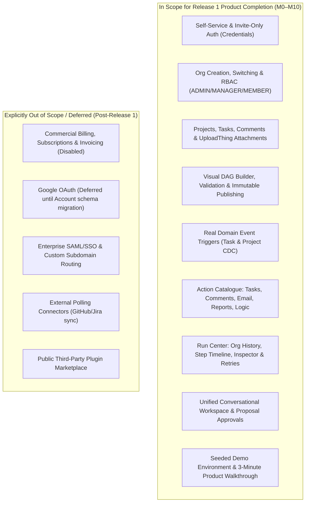
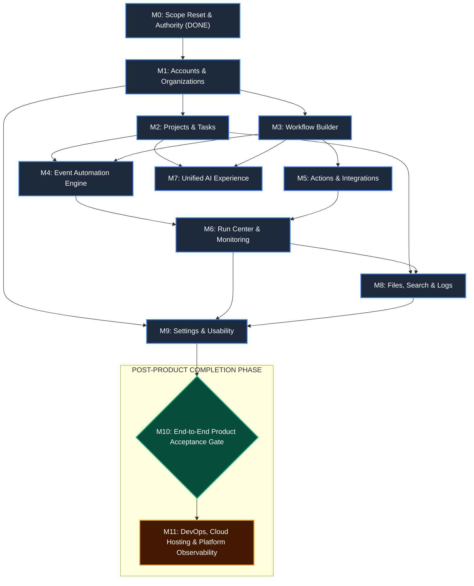

# FORGE — Authoritative Product Completion Tracker (Release 1)

```text
Status:              ACTIVE AUTHORITATIVE TRACKER
Target Outcome:      COMPLETE FORGE AS A DEMONSTRABLE PRODUCT FIRST (M0–M10)
Post-Product Scope:  DevOps, Cloud Hosting & Platform Observability (M11)
Canonical File:      forge/docs/product/PRODUCT_COMPLETION_TRACKER.md
Last Rebuilt:        2026-11-26 (Source-grounded audit against working tree)
```

> [!IMPORTANT]
> **Single Source of Truth:**
> This document supersedes all previous roadmaps, phase trackers, and issue registers. All historical trackers have been retired and archived under `forge/docs/archive/`.
> The central directive: **Complete Forge as a real, usable product first.** Work is organized strictly from M0 to M10 to achieve product completeness, with DevOps, Cloud Deployment, and Platform Observability isolated in M11 as the only remaining work post-product completion.

---

## 1. Product Vision & Explicit Scope Decisions

### 1.1 The Forge Product Promise
Forge is a multi-tenant, event-driven project execution and DAG workflow orchestration platform. It is engineered to bridge collaborative project management (projects, tasks, comments, attachments) with durable automated workflow execution (event triggers, DAG pipeline execution, saga compensations) and human-in-the-loop AI assistance.

### 1.2 The Release 1 Product Boundary
A feature must not exist in a half-built or decorative state. Every advertised feature must either function end-to-end or be explicitly disabled/marked as Planned.



### 1.3 Explicit Scope Decisions & Rationale

1. **Account Creation Policy (Self-Service + Invites):**  
   - *Decision:* Forge v1 supports **Self-Service registration** (`/signup`) for new organization founders and **Token-based invitations** (`/invite/[token]`) for joining existing teams.  
   - *Rationale:* A product cannot be adopted if the first user requires developer database seeding to obtain an account. Team members, however, join via secure invitations without open public signup confusion.
2. **Billing & Commercial Affordances (Completely Disabled for v1):**  
   - *Decision:* **Billing is strictly excluded from Release 1.** The application operates in an unrestricted "Developer Edition / Team Preview" mode.  
   - *Rationale:* Razorpay subscriptions (`create-order`, webhook) are incomplete, lacking subscription state machines, plan upgrades, cancellation, and invoice history. Leaving dead "Upgrade" buttons in `/Tasks` violates Gate G0 (Scope Truth). All billing buttons and checkout modals are removed from user navigation.
3. **Authentication Provider Boundary (Credentials Active; Google OAuth Deferred):**  
   - *Decision:* Standard email/password authentication via NextAuth Credentials is the sole active auth provider for v1. Google OAuth is temporarily disabled on `/login`.  
   - *Rationale:* The Prisma schema lacks NextAuth's `Account` and `VerificationToken` models. Attempting Google sign-in fails at runtime. Rather than shipping a broken button, it is removed until the schema is extended.
4. **Automation Trigger Set (Core Domain Events):**  
   - *Decision:* Triggers are restricted to core domain events (`task.created`, `task.updated`, `task.completed`, `project.created`) and manual execution.  
   - *Rationale:* Complex cron schedules and external polling integrations add failure modes without demonstrating core value. Domain CDC events prove reactive workflow execution end-to-end.
5. **Action Catalogue & Reversibility Taxonomy:**  
   - *Decision:* A practical catalogue of 6 actions is established: `task.create`, `task.update`, `comment.create`, `email.send`, `report.generate`, and `logic.condition`. Arbitrary `http.request` is scoped as an optional enhancement.  
   - *Rationale:* Actions are explicitly categorized by compensation semantics:
     - **Reversible:** `task.create` (deleted on rollback), `task.update` (prior values restored), `report.generate` (file deleted from storage).
     - **Irreversible / External:** `email.send` (receipt logged, manual follow-up), `comment.create` (comment tombstone appended).
     - **Stateless:** `logic.condition` (no side effects).

---

## 2. Definition of Product Complete

Forge Release 1 is **Product Complete** when and only when:

1. **Independent First-Mile Onboarding:** A new user can register at `/signup`, create an organization at `/onboarding`, and immediately arrive on a populated dashboard without developer intervention or SQL seeding.
2. **Team Collaboration:** Admins can invite team members via Resend emails; invitees accept and join with enforced roles (`ADMIN`, `MANAGER`, `MEMBER`).
3. **Usable DAG Workflow Builder:** Users visually author, connect, validate, and name workflows on the React Flow canvas with clear validation error highlights and explicit draft/publish state.
4. **End-to-End Reactive Triggers:** Creating or updating a task automatically fires the domain event dispatcher, advancing any matching active workflow into execution.
5. **Demonstrable Automation Scenarios:** The action catalogue supports three distinct real-world business flows:
   - *Scenario A (Triage):* Task Created &rarr; AI Triage Classification &rarr; Priority Update &rarr; In-App Notification.
   - *Scenario B (Digest):* Trigger &rarr; Gather Metrics &rarr; Generate Report File &rarr; Email Stakeholder via Resend.
   - *Scenario C (Escalation & Rollback):* Critical Task &rarr; Attempt Action &rarr; Failure &rarr; Saga Backward Compensation reverses side effects cleanly.
6. **Full Operator Visibility:** An organization run history page (`/runs`) displays past executions; opening a run reveals a step-by-step timeline, inputs, outputs, timestamps, and failure explanations.
7. **No-SQL Failure Recovery:** Operators can retry failed runs or cancel hung runs directly from the UI without database queries.
8. **Trustworthy AI Interface:** The AI assistant provides a unified conversational interface for project context (RAG) and workflow generation, requiring explicit human review and approval for mutations.
9. **Zero Dead Ends & Honest Scope:** Every link, button, and navigation item in the sidebar resolves to a functioning screen; mock buttons and broken upgrade CTAs are eliminated.
10. **Clean Demo Baseline:** The application runs deterministically from a clean seed (`forge-demo`) for a 3-to-5 minute live demonstration.

---

## 3. Comprehensive Architecture & Implementation Audit

### Path Trace 1: Domain Event Automation Pipeline
```text
[User creates task]
       │
       ▼
src/app/actions/Tasks/createTask.ts (Server Action)
       │ validates with Zod & checks rate limits
       ▼
src/lib/tasks/create-task.ts (createTaskInOrg)
       │ executes prisma.task.create + VectorOutboxEvent in single DB tx
       ▼
dispatchEvent("TASK_CREATED", payload) (src/lib/events/event-bus.ts)
       │ fans out to QStash queue
       ▼
src/app/api/worker/route.ts (/api/worker)
       │
       ├──► embeddingWorkerHandler (Processes vector embeddings)
       ├──► emailWorkerHandler (Sends developer notification)
       └──► [DISCONNECTED] Zero handler exists to query Workflow table and call startWorkflow()!
```
*Current Verdict:* **DISCONNECTED.** The event triggers shown on canvas nodes (`task.created`) never start workflows. Bridging this via an event dispatcher is the highest priority for M4.

---

### Path Trace 2: Action Registry to Canvas Pipeline
```text
src/lib/workflow-types/action-registry.ts (Runtime Authority)
       ├── "task.create" ──────► Registered, versioned (@1.0.0), executable
       ├── "send-email"   ──────► Implemented in core/send-email.ts, UNREGISTERED
       ├── "generate-report" ───► Implemented in core/generate-report.ts, UNREGISTERED
       └── "condition"    ──────► Implemented in logic/conditions.ts, UNREGISTERED
       │
       ▼
src/lib/workflow-types/action-capabilities.ts (Semantic Contract)
       └── Only "task.create" has defined input/output schemas
       │
       ▼
src/lib/workflow-types/registry.ts (UI Presentation)
       └── Only "task.create" is built into AVAILABLE_ACTIONS
       │
       ▼
React Flow Canvas (Sidebar & Properties Panel)
       └── Canvas only offers "Create Task"!
```
*Current Verdict:* **PARTIAL.** Three functional actions exist in the codebase but are unlinked from the registry, capability catalog, and canvas UI.

---

### Path Trace 3: Workflow Run Monitoring Pipeline
```text
startWorkflow() (src/lib/workflow/execution/trigger.ts)
       │ captures definitionSnapshot, SHA-256 hash & creates WorkflowRun
       ▼
advanceWorkflow() (src/lib/workflow/execution/evaluator.ts)
       │ writes StepRun & WorkflowOutbox atomically (F-04)
       ▼
/api/worker (handleWorkflowEvent)
       │ executes action wrapper, handles retries & saga rollback
       ▼
Pusher Realtime (private-workflow-${runId})
       │
       ├──► /org/[orgId]/runs/[runId] (WorkflowRunDashboard renders node status)
       │      └── Lacks: Input/Output inspector, error stack drawer, retry/cancel buttons
       │
       └──► /org/[orgId]/runs (Run History Index) ──► [MISSING 404]
```
*Current Verdict:* **PARTIAL.** Execution engine is robust, but operator visibility is crippled by a missing runs list route and lack of step inspection.

---

### Subsystem Implementation Matrix

| Subsystem | Source Location | Implementation State | Production Completeness Finding |
| :--- | :--- | :---: | :--- |
| **User Registration** | `src/app/login/login-form.tsx` | DECORATIVE | "Create account" button is inert. No `/signup` route exists. |
| **Onboarding Router** | `src/app/router/page.tsx` | BROKEN | Redirects 0-org users to `/onboarding` and multi-org to `/select-org`. Both routes are 404s. |
| **Org Creation** | `src/features/organizations/` | MISSING | No runtime form or action creates an organization. Only seed script can do it. |
| **Member Management** | `src/app/org/[orgId]/members/` | PARTIAL | Displays real memberships, but table action buttons ("Edit", "Remove") are inert stubs. |
| **Tasks & Projects** | `src/lib/tasks/`, `src/app/actions/` | IMPLEMENTED | Canonical writes, Zod validation, rate limiting, and project ownership checks work. |
| **Workflow Canvas** | `src/features/organizations/components/workflow/` | PARTIAL | React Flow canvas and cycle detection work. Hardcodes workflow name, uses `alert()` popups. |
| **Workflow Engine** | `src/lib/workflow/execution/` | IMPLEMENTED | Transactional outbox (F-04), definition snapshots (F-03), saga rollbacks (F-01/F-02) fully tested. |
| **Event Dispatcher** | `src/lib/events/router.ts` | DISCONNECTED | Events publish to QStash, but no worker consumer triggers `startWorkflow()`. |
| **Action Catalogue** | `src/lib/workflow-types/action-registry.ts` | PARTIAL | Only `task.create` exposed. `send-email`, `generate-report`, `conditions` need registry wiring. |
| **Run History Index** | `src/app/org/[orgId]/runs/` | MISSING | Route does not exist (404); Sidebar omits "Runs" link. |
| **Run Detail Inspector**| `WorkflowRunDashboard.tsx` | PARTIAL | Displays graph status; lacks input/output inspection drawer and retry/cancel controls. |
| **AI Assistant** | `src/app/org/[orgId]/ai/page.tsx` | PARTIAL | `ChatWorkspace` (RAG) and `WorkflowProposalPanel` stacked separately; lacks unified conversation. |
| **Execution Audit Logs**| `src/app/org/[orgId]/audit/page.tsx` | MISALIGNED | Renders code pastebin prompt instead of displaying `ExecutionAuditLog` table. |
| **Billing / Upgrades** | `src/app/org/[orgId]/Tasks/page.tsx` | BROKEN | Renders `UpgradeButton` pointing to incomplete Razorpay flow. Must be decommissioned. |

---

## 4. Addendum Reconciliation Matrix

Mapping all **19 Domains**, **10 Customer Journeys**, and **8 Release Gates** from `forge_product_completeness_addendum.md`:

### 4.1 Domains Coverage

| Addendum Domain | Title | Type | Assignment Mapping / Scope Resolution |
| :---: | :--- | :---: | :--- |
| **01** | Product contract & scope | CORE | Handled in **M0** (`FC-001`) and **M10** (`FC-038`). Explicit scope truth enforced. |
| **02** | Auth & user account lifecycle | CORE | Covered in **M1** (`FC-002`, `FC-007`). Credentials auth, signup, session revocation. |
| **03** | Organizations & membership | CORE | Covered in **M1** (`FC-003`, `FC-004`, `FC-005`, `FC-006`). Org onboarding, switching, roles. |
| **04** | Projects, tasks & collaboration | CORE | Covered in **M2** (`FC-008`, `FC-009`, `FC-010`, `FC-011`). CRUD, assignment, comments. |
| **05** | Workflow design & publishing | CORE | Covered in **M3** (`FC-012` to `FC-016`). Canvas UX, validation, draft/publish lifecycle. |
| **06** | Triggers, actions & integrations | CORE | Covered in **M4** (`FC-017` to `FC-019`) and **M5** (`FC-020` to `FC-023`). Real triggers & actions. |
| **07** | Workflow run monitoring | CORE | Covered in **M6** (`FC-024`, `FC-025`, `FC-026`). Run list, step inspection, retry/cancel. |
| **08** | AI assistant & approval UX | CONDITIONAL | Covered in **M7** (`FC-027`, `FC-028`, `FC-029`). Unified chat, proposals, approvals. |
| **09** | Files & semantic search | CONDITIONAL | Covered in **M8** (`FC-030`). UploadThing attachment lifecycle, vector cleanup. |
| **10** | Notifications & communications | CORE | Covered in **M1** (`FC-006`) and **M8** (`FC-032`). Resend email delivery, Pusher feeds. |
| **11** | Billing & subscription lifecycle| CONDITIONAL | **RESOLVED N/A FOR V1** (`FC-033`). Decommissioned in M9; free developer preview mode. |
| **12** | Navigation & interface completion| CORE | Covered in **M9** (`FC-034`, `FC-035`). Dead route removal, casing fix, empty states. |
| **13** | Security & tenant boundaries | CORE | Built into acceptance criteria of all assignments (`getOrgAccess`, SSRF defense). |
| **14** | Distributed systems correctness | CORE | Engine foundation closed (F-01 to F-04); verified in **M4** & **M6**. |
| **15** | QA & regression suite | CORE | Handled in **M10** (`FC-037`). E2E journey tests, 1,978-test regression gate. |
| **16** | Performance & capacity | CORE | Verified in **M10** (`FC-037`) and monitored in **M11** (`FC-041`). |
| **17** | Operations & observability | CORE | Separated cleanly into **M11** (`FC-039`, `FC-040`, `FC-041`, `FC-042`). |
| **18** | Docs, trust & support | CORE | Covered in **M10** (`FC-038`). Architecture docs, user guide, known issues. |
| **19** | Demo & portfolio evidence | CORE | Covered in **M10** (`FC-036`, `FC-038`). Clean seed, 3-minute video demo script. |

### 4.2 End-to-End Customer & Operator Journeys

| Journey | Description | Assigned Milestone | Verification Path |
| :---: | :--- | :---: | :--- |
| **J1** | **New Customer Onboarding** | **M1** (`FC-002`, `FC-003`) | Signup at `/signup` &rarr; name org at `/onboarding` &rarr; land on dashboard as ADMIN. |
| **J2** | **Team Collaboration** | **M1** (`FC-005`, `FC-006`) | Admin invites colleague &rarr; Resend email delivered &rarr; invitee accepts token &rarr; joins team. |
| **J3** | **Core Work Management** | **M2** (`FC-008`, `FC-009`) | Create project &rarr; create task &rarr; update status &rarr; add comment &rarr; upload file. |
| **J4** | **First Automation Execution** | **M3**, **M4**, **M5** | Author workflow &rarr; publish &rarr; create task &rarr; workflow fires automatically &rarr; action executes. |
| **J5** | **Failure & Operator Recovery** | **M5**, **M6** | Action fails &rarr; saga backward compensation triggers &rarr; operator inspects run &rarr; clicks Retry. |
| **J6** | **AI Workflow & Tool Approval** | **M7** (`FC-027`, `FC-028`) | Prompt AI to build workflow &rarr; review DAG preview &rarr; approve proposal &rarr; materialized on canvas. |
| **J7** | **Search Freshness & Deletion** | **M8** (`FC-030`) | Upload file &rarr; verify vector indexing &rarr; delete file &rarr; verify vector tombstoned from RAG. |
| **J8** | **Billing Lifecycle** | *N/A (Excluded)* | Explicitly disabled. User encounters no broken purchase flows. |
| **J9** | **Platform Incident Recovery** | **M11** (`FC-042`) | Sweeper drains stalled outbox; Redis locks prevent split-brain execution during outage. |
| **J10**| **Clean Release Deployment** | **M10**, **M11** | Fresh clone &rarr; `prisma migrate` &rarr; seed `forge-demo` &rarr; full smoke suite passes. |

### 4.3 Release Acceptance Gates (G0 — G7)

- [ ] **G0 (Scope Truth):** Public feature inventory matches code exactly. Broken Razorpay buttons removed. Dead routes (`/onboarding`, `/select-org`, `/runs`) eliminated.
- [ ] **G1 (Core Journeys):** Journeys J1 through J7 pass without developer intervention or SQL patching.
- [ ] **G2 (Data Integrity):** Outbox commits atomically with step runs; saga compensation receipts persist; zero duplicate side-effects.
- [ ] **G3 (Security & Isolation):** `getOrgAccess` protects all mutations; Pusher channels authenticated; SSRF blocked on HTTP actions.
- [ ] **G4 (Build & Tests):** Production Next.js build clean; `tsc --noEmit` clean; 1,978 tests passing.
- [ ] **G5 (Reliability & Ops):** Sweeper reclaims stalled leases; operator interventions resolve without direct DB writes.
- [ ] **G6 (Truthful Metrics):** Benchmark workloads and raw performance figures published honestly.
- [ ] **G7 (Release Sign-off):** Zero open P0 defects; documentation complete; demo environment validated.

---

## 5. Milestone Execution Roadmap



---

## 6. Detailed Capability Assignment Backlog

### Milestone M0: Product Scope and Implementation Truth

#### FC-001 | M0 | Scope Contract, Tracker Authority & Document Consolidation
- **Milestone:** M0
- **Capability:** Single authoritative documentation and backlog source.
- **Current Evidence:** Redundant overlapping trackers in `docs/architecture/workflows/` (4,375-line tracker) and `docs/architecture/agent/roadmap.md`.
- **Missing Behavior:** Single actionable backlog reflecting true source state.
- **Required Outcome:** Consolidate active planning into `forge/docs/product/PRODUCT_COMPLETION_TRACKER.md`. Archive historical documents into `forge/docs/archive/`. Update all root README links.
- **Dependencies:** None
- **Files Involved:** `README.md`, `forge/README.md`, `forge/docs/product/PRODUCT_COMPLETION_TRACKER.md`, `forge/docs/archive/`
- **Acceptance Criteria:** Exactly one active completion tracker exists. All retired paths archived. Zero broken links.
- **Tests & Verification:** Python link-audit script verifying zero active references to retired tracker paths.
- **Status:** `DONE`

---

### Milestone M1: Identity, Accounts and Organizations

#### FC-002 | M1 | Self-Service User Registration (`/signup`)
- **Milestone:** M1
- **Capability:** Self-service account creation for new users.
- **Current Evidence:** `src/app/login/login-form.tsx:106` renders an inert `<button>Create account</button>`. No `/signup` route exists.
- **Missing Behavior:** Public signup page with form validation, email uniqueness check, and secure password hashing.
- **Required Outcome:** Create `src/app/signup/page.tsx` and server action `registerUserAction`. Wire "Create account" button on `/login` to `/signup`.
- **Dependencies:** FC-001
- **Files Involved:** `src/app/signup/page.tsx`, `src/app/login/login-form.tsx`, `src/app/actions/user/registerUser.ts`
- **Acceptance Criteria:**
  - Submitting `/signup` creates a new `User` record with bcrypt-hashed password.
  - Duplicate email displays clear error alert.
  - Successful registration signs in the user or redirects to login with prefilled email.
- **Tests & Verification:** Integration test submitting registration action with valid/invalid/duplicate emails; browser test navigating `/login` &rarr; `/signup` &rarr; register &rarr; sign in.
- **Status:** `NOT_STARTED`

#### FC-003 | M1 | First-Time Organization Onboarding Flow (`/onboarding`)
- **Milestone:** M1
- **Capability:** Initial organization creation for users with 0 memberships.
- **Current Evidence:** `src/app/router/page.tsx:33` redirects users with 0 memberships to `/onboarding`, which produces a 404 error. `db.organization.create` is never called in runtime application code.
- **Missing Behavior:** Onboarding screen allowing user to input organization name, generate unique slug, and commit initial `Organization` + `Membership(ADMIN)`.
- **Required Outcome:** Create `src/app/onboarding/page.tsx` and server action `createOrganizationAction`.
- **Dependencies:** FC-002
- **Files Involved:** `src/app/onboarding/page.tsx`, `src/app/router/page.tsx`, `src/app/actions/settings/createOrg.ts`
- **Acceptance Criteria:**
  - Fresh user landing on `/router` is redirected to `/onboarding`.
  - Creating organization generates URL-safe unique slug (e.g. `acme-corp`).
  - Creates `Organization` and assigns caller as `ADMIN` in a single transaction.
  - Redirects to `/org/${slug}/dashboard`.
- **Tests & Verification:** Integration test verifying atomic transaction; E2E test verifying fresh user completes onboarding without manual DB setup.
- **Status:** `NOT_STARTED`

#### FC-004 | M1 | Multi-Organization Selector & Header Switcher (`/select-org`)
- **Milestone:** M1
- **Capability:** Organization selection and seamless switching for multi-tenant users.
- **Current Evidence:** `src/app/router/page.tsx:42` redirects multi-org users to `/select-org` (404). `src/app/org/[orgId]/layout.tsx:41` displays static text with no switcher dropdown.
- **Missing Behavior:** Organization picker page and header switcher component.
- **Required Outcome:** Create `src/app/select-org/page.tsx` listing user's memberships; add `OrgSwitcher` dropdown to top header in `OrgLayout`.
- **Dependencies:** FC-003
- **Files Involved:** `src/app/select-org/page.tsx`, `src/app/org/[orgId]/layout.tsx`, `src/features/organizations/components/OrgSwitcher.tsx`
- **Acceptance Criteria:**
  - `/select-org` lists all organizations the user belongs to with their roles.
  - Header dropdown displays current organization and allows instant switching to other organizations.
  - Switching organizations updates trusted tenant context without session reset.
- **Tests & Verification:** Create test user in two organizations; verify navigation via selector and header switcher updates URL and visible data.
- **Status:** `NOT_STARTED`

#### FC-005 | M1 | Member Role Management & Removal Controls (`/members`)
- **Milestone:** M1
- **Capability:** Real team member role modification and member removal with last-admin safeguard.
- **Current Evidence:** `src/features/organizations/components/invitation/members-table.tsx:84` renders an inert `<button>` with `<MoreHorizontal />`. No server actions exist to change roles or remove members.
- **Missing Behavior:** Interactive member action menu with role update dialog and member removal confirmation.
- **Required Outcome:** Implement `updateMemberRole` and `removeMember` server actions with strict RBAC; wire to `members-table.tsx`.
- **Dependencies:** FC-003
- **Files Involved:** `src/features/organizations/components/invitation/members-table.tsx`, `src/app/actions/user/memberActions.ts`
- **Acceptance Criteria:**
  - Admin can update member role between `ADMIN`, `MANAGER`, `MEMBER`.
  - Admin cannot remove themselves if they are the sole administrator.
  - Removed user immediately loses access to organization routes (`getOrgAccess` returns null).
- **Tests & Verification:** Role mutation test suite verifying RBAC enforcement and last-admin refusal.
- **Status:** `NOT_STARTED`

#### FC-006 | M1 | Reliable Email Delivery for Invitations via Resend
- **Milestone:** M1
- **Capability:** Automated email delivery of team invitation links.
- **Current Evidence:** `createInvitation.ts:62` creates invitation token but does not dispatch email. README line 383 notes invitation links must be copied manually.
- **Missing Behavior:** Triggering Resend email dispatch upon invitation creation.
- **Required Outcome:** Wire `createInvitation` to dispatch an invitation email containing the acceptance URL via `executeSendEmail` or worker queue.
- **Dependencies:** FC-003
- **Files Involved:** `src/app/actions/Invitations/createInvitation.ts`, `src/lib/emails/core-service.ts`
- **Acceptance Criteria:**
  - Inviting a member sends an email via Resend to the recipient address.
  - Recipient clicking the link lands on `/invite/[token]` and can accept membership.
  - UI provides "Copy Link" fallback button.
- **Tests & Verification:** Integration test asserting email service invocation with invite link parameters.
- **Status:** `NOT_STARTED`

#### FC-007 | M1 | User Profile & Account Settings Completeness
- **Milestone:** M1
- **Capability:** User profile editing and password change.
- **Current Evidence:** `src/app/org/[orgId]/user/profile/page.tsx` renders `ProfileForm`, but password change and profile photo management are incomplete.
- **Missing Behavior:** Password update flow and user preference management.
- **Required Outcome:** Complete `ProfileForm` with name update, password change (verifying current password), and account details.
- **Dependencies:** FC-002
- **Files Involved:** `src/app/org/[orgId]/user/profile/page.tsx`, `src/app/actions/user/updateUserProfile.ts`
- **Acceptance Criteria:**
  - User can update their display name.
  - User can change password with current password verification.
- **Tests & Verification:** Unit and integration tests covering password updates and hash verification.
- **Status:** `NOT_STARTED`

---

### Milestone M2: Projects and Task Management

#### FC-008 | M2 | Project Lifecycle: Edit, Archive & Delete
- **Milestone:** M2
- **Capability:** Full project lifecycle management.
- **Current Evidence:** `src/app/org/[orgId]/projects/action.ts` only implements `createProject`. Projects cannot be edited or deleted from UI.
- **Missing Behavior:** Project settings modal, rename/description editing, and safe cascading deletion.
- **Required Outcome:** Implement `updateProject` and `deleteProject` server actions (utilizing `deleteProjectTransactionally` for vector and task cleanup); add project settings menu to projects page.
- **Dependencies:** FC-003
- **Files Involved:** `src/app/org/[orgId]/projects/page.tsx`, `src/app/org/[orgId]/projects/action.ts`, `src/lib/deletion/project-deletion.ts`
- **Acceptance Criteria:**
  - Manager or Admin can rename project and update description.
  - Deleting a project triggers transactional cascade and vector cleanup outbox.
  - UI revalidates and reflects changes immediately.
- **Tests & Verification:** Test suite creating project with tasks, deleting project, and asserting clean database and outbox state.
- **Status:** `NOT_STARTED`

#### FC-009 | M2 | Interactive Task Lifecycle & Status Transitions
- **Milestone:** M2
- **Capability:** Comprehensive task detail and inline status management.
- **Current Evidence:** `src/app/org/[orgId]/projects/[projectId]/tasks/[taskId]/page.tsx` renders static fields without interactive status transitions or assignee select.
- **Missing Behavior:** Inline status dropdown (`TODO`, `IN_PROGRESS`, `DONE`), priority picker, and team member assignee selector.
- **Required Outcome:** Build interactive `TaskDetailView` with live updates via canonical `updateTaskInOrg`.
- **Dependencies:** FC-005, FC-008
- **Files Involved:** `src/app/org/[orgId]/projects/[projectId]/tasks/[taskId]/page.tsx`, `src/lib/tasks/update-task.ts`, `src/features/organizations/components/TaskDetailView.tsx`
- **Acceptance Criteria:**
  - User can change task status directly from detail view or task board.
  - Assignee selector lists all confirmed organization members.
  - Updates emit domain CDC events (`TASK_UPDATED`) for downstream automations.
- **Tests & Verification:** End-to-end browser test creating task, transitioning status to `DONE`, and verifying persisted state.
- **Status:** `NOT_STARTED`

#### FC-010 | M2 | Task Comments & Collaboration Feed
- **Milestone:** M2
- **Capability:** Threaded task discussion and activity comments.
- **Current Evidence:** `createComments.ts` exists, but comment feed in task view lacks real-time Pusher updates and markdown rendering.
- **Missing Behavior:** Polished discussion thread with timestamps, user avatars, and real-time updates.
- **Required Outcome:** Wire comment submission form in task detail view with optimistic UI updates.
- **Dependencies:** FC-009
- **Files Involved:** `src/app/actions/comments/createComments.ts`, `src/features/organizations/components/TaskComments.tsx`
- **Acceptance Criteria:**
  - User can submit comments on a task.
  - Comments display author name, avatar, and relative timestamp.
  - Tenant boundary enforced (cannot comment on other tenant's task).
- **Tests & Verification:** Integration test verifying comment creation and tenant predicate checks.
- **Status:** `NOT_STARTED`

#### FC-011 | M2 | Task Filtering, Debounced Search & Pagination Polish
- **Milestone:** M2
- **Capability:** Fast task discovery via search and filters.
- **Current Evidence:** `src/app/org/[orgId]/Tasks/page.tsx` uses uppercase `/Tasks` and lacks client-side search debouncing.
- **Missing Behavior:** Consistent lowercase `/tasks` routing, debounced text search, and clean empty states.
- **Required Outcome:** Standardize routing to `/org/[orgId]/tasks`; add 300ms debounced search bar; add filter pills for priority and assignee.
- **Dependencies:** FC-009
- **Files Involved:** `src/app/org/[orgId]/Tasks/page.tsx`, `src/features/organizations/components/Taskbox.tsx`
- **Acceptance Criteria:**
  - Both `/tasks` and legacy `/Tasks` resolve correctly.
  - Typing in search box filters tasks by title and description without page reload.
  - Clean empty state displayed when search matches 0 tasks.
- **Tests & Verification:** Browser test verifying search filtering across 10 tasks.
- **Status:** `NOT_STARTED`

---

### Milestone M3: Complete Workflow Builder

#### FC-012 | M3 | Canvas Authoring UX, Workflow Naming & Toast Notifications
- **Milestone:** M3
- **Capability:** Professional visual workflow authoring experience.
- **Current Evidence:** `WorkflowCanvas.tsx:181-195` uses browser `alert()` popups. Workflow name is hardcoded to `"My First Automation"`.
- **Missing Behavior:** Editable workflow name in header, toast notifications for save/error states, and zoom/pan controls.
- **Required Outcome:** Add inline workflow title and description input to canvas header; replace `alert()` with modern toast notifications (`sonner`); add canvas minimap/controls.
- **Dependencies:** FC-008
- **Files Involved:** `src/features/organizations/components/workflow/WorkflowCanvas.tsx`, `src/app/actions/workflows/workflow.ts`
- **Acceptance Criteria:**
  - User can name a workflow (e.g. "Lead Qualification Pipeline") before saving.
  - Save success displays non-intrusive toast and persists user-authored name.
  - Browser `alert()` dialogs completely removed from workflow builder.
- **Tests & Verification:** Browser test creating workflow, renaming title, saving, and verifying title persisted on workflows list page.
- **Status:** `NOT_STARTED`

#### FC-013 | M3 | Node Property Configuration Drawer & Variable Auto-Mapping
- **Milestone:** M3
- **Capability:** Contextual node configuration with upstream variable insertion.
- **Current Evidence:** `PropertiesPanel.tsx` allows manual string typing, but offers no variable selector to bind upstream outputs (e.g. `{{trigger.outputs.taskId}}`).
- **Missing Behavior:** "Insert Variable" dropdown button next to input fields listing referenceable upstream step outputs.
- **Required Outcome:** Enhance `PropertiesPanel.tsx` with token picker populated from `getAvailableUpstreamOutputs()`.
- **Dependencies:** FC-012
- **Files Involved:** `src/features/organizations/components/workflow/PropertiesPanel.tsx`, `src/lib/workflow/graph-ui/utils.ts`
- **Acceptance Criteria:**
  - Clicking "Insert Variable" shows available outputs from connected upstream nodes.
  - Inserting a variable formats correct `{{nodeId.outputs.field}}` template syntax.
  - Missing required inputs flag node with amber warning ring on canvas.
- **Tests & Verification:** Canvas UI test connecting Trigger to Action and asserting variable token insertion.
- **Status:** `NOT_STARTED`

#### FC-014 | M3 | Graph Validation & Actionable Error Diagnostics
- **Milestone:** M3
- **Capability:** Actionable pre-save validation for DAGs.
- **Current Evidence:** `compileWorkflow()` throws `WorkflowValidationError`, but errors are not highlighted on specific canvas nodes.
- **Missing Behavior:** Inline visual error indicators pinpointing disconnected nodes, missing required inputs, or cycles.
- **Required Outcome:** Project compilation errors onto node data (`node.data.validationError`); display actionable error badges on offending nodes.
- **Dependencies:** FC-013
- **Files Involved:** `src/features/organizations/components/workflow/WorkflowCanvas.tsx`, `src/lib/workflow/graph-ui/compiler.ts`
- **Acceptance Criteria:**
  - Attempting to save invalid graph highlights exact offending nodes in red.
  - Error banner describes specific fix required (e.g. "Action 'Create Task' is missing required field 'title'").
- **Tests & Verification:** Compiler unit tests verifying issue codes; canvas test asserting visual error display.
- **Status:** `NOT_STARTED`

#### FC-015 | M3 | Draft vs. Published State Management & Active Lifecycle
- **Milestone:** M3
- **Capability:** Explicit publish/unpublish workflow lifecycle.
- **Current Evidence:** `src/app/actions/workflows/workflow.ts:80` sets `isActive = !!eventId`. Workflows are automatically activated if any trigger is set.
- **Missing Behavior:** Explicit "Publish" / "Unpublish" toggle with validation gate.
- **Required Outcome:** Add Draft / Published state machine; workflows in Draft state cannot be ignited by event triggers.
- **Dependencies:** FC-014
- **Files Involved:** `src/app/actions/workflows/workflow.ts`, `src/features/organizations/components/workflow/WorkflowCanvas.tsx`
- **Acceptance Criteria:**
  - Saving a draft does not activate event dispatch.
  - Clicking "Publish" runs full graph validation; activates workflow only if 100% valid.
  - Active workflows display green badge on workflows list page.
- **Tests & Verification:** State transition test verifying events ignore draft workflows and execute published workflows.
- **Status:** `NOT_STARTED`

#### FC-016 | M3 | Manual Test-Run Drawer & Trigger Output Preview
- **Milestone:** M3
- **Capability:** Safe test execution directly from workflow builder.
- **Current Evidence:** API route `/api/workflow/test/[workflowId]/test-run` exists, but has no UI entry point in `WorkflowCanvas`.
- **Missing Behavior:** "Test Run" button in canvas opening slide-over drawer with editable test payload.
- **Required Outcome:** Add "Test Run" button in canvas header; open test drawer allowing user to customize mock trigger data; execute test run and link to live execution viewer.
- **Dependencies:** FC-015
- **Files Involved:** `src/features/organizations/components/workflow/WorkflowCanvas.tsx`, `src/features/organizations/components/workflow/TestRunDrawer.tsx`
- **Acceptance Criteria:**
  - Clicking "Test Run" opens drawer with prefilled sample payload.
  - Executing test creates `WorkflowRun` and displays link to run detail page.
  - Rate limits enforced on test runs.
- **Tests & Verification:** Browser test triggering test run from canvas and verifying redirect to run detail viewer.
- **Status:** `NOT_STARTED`

---

### Milestone M4: Real Event Triggers and Automation

#### FC-017 | M4 | Real Domain Event-to-Workflow Dispatch Engine
- **Milestone:** M4
- **Capability:** Reactive event-driven workflow execution.
- **Current Evidence:** `startWorkflow()` is never called by event consumers. `src/app/api/worker/route.ts` lacks handlers routing domain CDC events to workflows.
- **Missing Behavior:** Background worker handler querying active workflows matching event type and starting execution runs.
- **Required Outcome:** Implement `dispatchWorkflowsForEvent(orgId, eventType, payload)`; add worker handler in `/api/worker` processing `WORKFLOW_EVENT_TRIGGERED`.
- **Dependencies:** FC-015
- **Files Involved:** `src/lib/workflow/execution/event-dispatcher.ts`, `src/app/api/worker/route.ts`, `src/lib/events/router.ts`
- **Acceptance Criteria:**
  - Creating a task in the UI immediately executes any published workflow configured with trigger `task.created`.
  - Trigger payload (`taskId`, `projectId`, `title`, `priority`) populated into `WorkflowRun.context`.
  - Inactive/draft workflows are never triggered.
- **Tests & Verification:** Integration test emitting `TASK_CREATED` event and asserting corresponding `WorkflowRun` and `StepRun` records created.
- **Status:** `NOT_STARTED`

#### FC-018 | M4 | Task Domain Event Producers (`task.created`, `task.updated`, `task.completed`)
- **Milestone:** M4
- **Capability:** Comprehensive domain event publishing on task mutations.
- **Current Evidence:** `createTaskInOrg` emits `TASK_CREATED`. `updateTaskInOrg` emits vector sync outbox, but lacks general `TASK_UPDATED` and `TASK_COMPLETED` trigger dispatch.
- **Missing Behavior:** Emitting trigger events when task status or priority changes.
- **Required Outcome:** Update `updateTaskInOrg` to dispatch `TASK_UPDATED` (and `TASK_COMPLETED` when status transitions to `DONE`) via event bus.
- **Dependencies:** FC-017
- **Files Involved:** `src/lib/tasks/update-task.ts`, `src/lib/events/event-bus.ts`
- **Acceptance Criteria:**
  - Transitioning task to `DONE` fires `task.completed` event.
  - Changing task priority fires `task.updated` event.
  - Events include previous and new values for conditional filtering.
- **Tests & Verification:** Integration tests verifying event dispatch on task update mutations.
- **Status:** `NOT_STARTED`

#### FC-019 | M4 | Trigger Filtering, Variable Propagation & Storm Protection
- **Milestone:** M4
- **Capability:** Event filter rules and recursive loop prevention.
- **Current Evidence:** No trigger filtering in canvas. Workflow actions creating tasks can potentially trigger infinite event loops.
- **Missing Behavior:** Trigger filter configuration (e.g. "Only trigger if priority == HIGH") and execution depth guard.
- **Required Outcome:** Add trigger filter predicates in `TriggerNodeData`; add recursion counter in `WorkflowRun` context rejecting depth > 2.
- **Dependencies:** FC-018
- **Files Involved:** `src/lib/workflow/execution/event-dispatcher.ts`, `src/features/organizations/components/workflow/nodes/TriggerNode.tsx`
- **Acceptance Criteria:**
  - Workflow with filter "Priority == HIGH" ignores LOW priority task creations.
  - A workflow action creating a task cannot trigger an infinite recursive chain.
- **Tests & Verification:** Test suite injecting recursive workflow execution and asserting termination at depth limit.
- **Status:** `NOT_STARTED`

---

### Milestone M5: Actions and Integrations

#### FC-020 | M5 | Reconcile & Register Native Actions (`send-email`, `generate-report`, `conditions`)
- **Milestone:** M5
- **Capability:** Exposure of existing core actions in registry and canvas.
- **Current Evidence:** `src/lib/workflow/actions/core/send-email.ts`, `generate-report.ts`, and `conditions.ts` exist with full execution logic, but are unregistered in `action-registry.ts` and omitted from `AVAILABLE_ACTIONS`.
- **Missing Behavior:** Action capability schemas, registry version pinning (`@1.0.0`), and canvas presentation definitions.
- **Required Outcome:** Register `email.send`, `report.generate`, and `logic.condition` in `action-registry.ts` and `action-capabilities.ts`; configure widgets in `registry.ts`.
- **Dependencies:** FC-013
- **Files Involved:** `src/lib/workflow-types/action-registry.ts`, `src/lib/workflow-types/action-capabilities.ts`, `src/lib/workflow-types/registry.ts`
- **Acceptance Criteria:**
  - All 4 native actions appear in canvas sidebar and property dropdowns.
  - Workflows containing `email.send` successfully dispatch emails via Resend.
  - Workflows containing `report.generate` upload file to UploadThing and return download URL.
- **Tests & Verification:** Unit tests for action registration; integration tests executing diamond workflow with email and report steps.
- **Status:** `NOT_STARTED`

#### FC-021 | M5 | Implement & Register `task.update` & `comment.create` with Saga Compensation
- **Milestone:** M5
- **Capability:** Workflow actions for task updates and commenting with rollback semantics.
- **Current Evidence:** UI has `updateTaskInOrg` and `createComments`, but no workflow actions wrap them.
- **Missing Behavior:** Workflow action implementations for `task.update` and `comment.create` with compensation functions.
- **Required Outcome:** Create `src/lib/workflow/actions/core/update-task.ts` and `src/lib/workflow/actions/core/create-comment.ts`; define schemas; register in action registry.
- **Dependencies:** FC-020
- **Files Involved:** `src/lib/workflow/actions/core/update-task.ts`, `src/lib/workflow/actions/core/create-comment.ts`, `src/lib/workflow-types/action-registry.ts`
- **Acceptance Criteria:**
  - Workflow can update task status and priority based on upstream outputs.
  - Workflow can post automated comment on task.
  - Downstream failure triggers compensation (reverting task status to previous value).
- **Tests & Verification:** Integration test verifying forward execution and backward saga rollback restoring previous task status.
- **Status:** `NOT_STARTED`

#### FC-022 | M5 | Implement & Register SSRF-Safe `http.request` Action
- **Milestone:** M5
- **Capability:** Outgoing webhook action with private network defense.
- **Current Evidence:** No external HTTP request action exists.
- **Missing Behavior:** Outgoing HTTP request node with method, headers, JSON body, timeout, and SSRF airgap.
- **Required Outcome:** Implement `src/lib/workflow/actions/core/http-request.ts` with DNS pre-lookup blocking private IPs (`127.0.0.1`, `10.*`, `192.168.*`, `169.254.*`).
- **Dependencies:** FC-020
- **Files Involved:** `src/lib/workflow/actions/core/http-request.ts`, `src/lib/security/ssrf.ts`
- **Acceptance Criteria:**
  - Sends authenticated HTTP POST/GET requests to external URLs and captures response.
  - Requests to loopback or private cloud metadata endpoints fail immediately with security error.
  - Classified as Irreversible / External in compensation taxonomy.
- **Tests & Verification:** Security test verifying SSRF rejection on `169.254.169.254` and `localhost`; integration test to mock webhook sink.
- **Status:** `NOT_STARTED`

#### FC-023 | M5 | End-to-End Verification of 3 Real Automation Scenarios
- **Milestone:** M5
- **Capability:** Proven real-world business automations.
- **Current Evidence:** Only single isolated `task.create` has been demonstrated.
- **Missing Behavior:** End-to-end multi-step workflow verification across 3 practical scenarios.
- **Required Outcome:** Validate three complete scenarios:
  1. *Scenario 1 (Auto-Triage):* Task Created &rarr; Condition (Priority == HIGH) &rarr; Send Email Notification.
  2. *Scenario 2 (Digest & Report):* Trigger &rarr; Generate Progress Report &rarr; Upload Attachment &rarr; Post Task Comment.
  3. *Scenario 3 (Escalation & Reversal):* Task Created &rarr; Update Task Status &rarr; Intentional Failure &rarr; Saga Rollback restores original status.
- **Dependencies:** FC-017, FC-020, FC-021
- **Files Involved:** `src/tests/workflow/automation-scenarios.test.ts`
- **Acceptance Criteria:** All 3 scenarios pass deterministically with persisted database verification.
- **Tests & Verification:** Dedicated automated scenario integration test suite.
- **Status:** `NOT_STARTED`

---

### Milestone M6: Workflow Execution and Run Center

#### FC-024 | M6 | Organization-Wide Run History Index Page (`/runs`)
- **Milestone:** M6
- **Capability:** Centralized run history table for the organization.
- **Current Evidence:** `src/app/org/[orgId]/runs/page.tsx` does NOT exist (404); Sidebar (`Sidebar.tsx`) omits "Runs" link.
- **Missing Behavior:** Page listing all workflow runs across the organization with status badges and timestamps.
- **Required Outcome:** Create `src/app/org/[orgId]/runs/page.tsx`; add "Runs" item with `<Activity />` icon to `Sidebar.tsx`.
- **Dependencies:** FC-017
- **Files Involved:** `src/app/org/[orgId]/runs/page.tsx`, `src/features/organizations/components/Sidebar.tsx`, `src/features/organizations/components/RunsTable.tsx`
- **Acceptance Criteria:**
  - Clicking "Runs" in sidebar navigates to `/org/[orgId]/runs`.
  - Displays paginated table: Workflow Name, Run ID, Trigger Source, Status (`RUNNING`, `COMPLETED`, `FAILED`, `ROLLED_BACK`), Duration, Timestamp.
  - Clicking any row opens `/org/[orgId]/runs/[runId]`.
- **Tests & Verification:** Browser test navigating from sidebar to runs list and clicking into a run.
- **Status:** `NOT_STARTED`

#### FC-025 | M6 | Step Timeline & Input/Output Inspector Drawer
- **Milestone:** M6
- **Capability:** Deep execution inspection for every workflow step.
- **Current Evidence:** `WorkflowRunDashboard.tsx` lists step labels and status, but clicking a step does nothing. `StepRun.inputs`, `outputs`, and `error` cannot be inspected.
- **Missing Behavior:** Slide-over Step Inspector drawer displaying step inputs, outputs, error traces, and duration.
- **Required Outcome:** Add interactive node/step selection in `WorkflowRunDashboard`; render drawer with formatted, copyable JSON views.
- **Dependencies:** FC-024
- **Files Involved:** `src/features/organizations/components/workflow/WorkflowRunDashboard.tsx`, `src/features/organizations/components/workflow/StepInspectorDrawer.tsx`
- **Acceptance Criteria:**
  - Clicking any node opens inspector drawer.
  - Displays exact resolved input payload, output result, and execution start/end timestamps.
  - Failed steps display highlighted error message and classification.
- **Tests & Verification:** Browser test opening completed and failed runs, clicking steps, and asserting JSON inspection display.
- **Status:** `NOT_STARTED`

#### FC-026 | M6 | Operator Controls: Retry Failed Step & Cancel Run
- **Milestone:** M6
- **Capability:** Operator intervention controls directly in the UI.
- **Current Evidence:** Operators have no UI controls to retry failed runs or cancel runaway runs.
- **Missing Behavior:** "Retry Run" and "Cancel Run" action buttons with backend execution handlers.
- **Required Outcome:** Add action buttons to `WorkflowRunDashboard`; implement `retryWorkflowRun` and `cancelWorkflowRun` server actions.
- **Dependencies:** FC-025
- **Files Involved:** `src/features/organizations/components/workflow/WorkflowRunDashboard.tsx`, `src/app/actions/workflows/operatorActions.ts`
- **Acceptance Criteria:**
  - Clicking "Retry Run" on a `FAILED` or `REQUIRES_INTERVENTION` run resets step status and re-enqueues execution.
  - Clicking "Cancel Run" on a `RUNNING` run aborts in-flight deliveries and records cancellation.
  - Operators can resolve workflow failures without manual database editing.
- **Tests & Verification:** Test suite injecting failure, asserting FAILED state, triggering operator retry, and asserting COMPLETED state.
- **Status:** `NOT_STARTED`

---

### Milestone M7: Unified AI Agent Experience

#### FC-027 | M7 | Unified Conversational AI Assistant Workspace (`/ai`)
- **Milestone:** M7
- **Capability:** Cohesive conversational workspace blending RAG with agent task tools.
- **Current Evidence:** `/org/[orgId]/ai/page.tsx` stacks two completely disjoint components (`ChatWorkspace` and `WorkflowProposalPanel`) with separate interfaces and no shared context.
- **Missing Behavior:** Unified chat interface capable of answering project questions and proposing task/workflow operations in one conversation stream.
- **Required Outcome:** Redesign `/org/[orgId]/ai` into a unified chat timeline supporting streaming text, tool proposal cards, and clarification prompts.
- **Dependencies:** FC-009, FC-012
- **Files Involved:** `src/app/org/[orgId]/ai/page.tsx`, `src/features/organizations/components/ai/UnifiedChatWorkspace.tsx`
- **Acceptance Criteria:**
  - User can chat with assistant about project status and receive vector-grounded answers.
  - User can ask assistant to create tasks or workflows in the same conversational stream.
  - Streaming responses render smoothly with markdown support.
- **Tests & Verification:** Browser test conducting conversation involving both informational questions and action requests.
- **Status:** `NOT_STARTED`

#### FC-028 | M7 | Inline Tool Proposal Review, Human Approval & Clarification UX
- **Milestone:** M7
- **Capability:** Strict human-in-the-loop approval gate within conversational flow.
- **Current Evidence:** `ProposalReviewCard.tsx` and `ClarificationRequestCard.tsx` exist, but are isolated within the standalone proposal panel.
- **Missing Behavior:** Inline embedding of tool proposals, human approval/decline buttons, and clarification questions directly in chat messages.
- **Required Outcome:** Embed proposal cards and clarification forms inside the unified chat stream; enforce approval before executing state-mutating actions.
- **Dependencies:** FC-027
- **Files Involved:** `src/features/organizations/components/ai/UnifiedChatWorkspace.tsx`, `src/features/organizations/components/ai/ProposalReviewCard.tsx`
- **Acceptance Criteria:**
  - When AI suggests task creation or workflow generation, an approval card appears inline.
  - User can click "Approve" (executing write) or "Decline" (cancelling write).
  - Clarification requests prompt user for missing parameters before proceeding.
  - Invariant strictly held: Model never executes write mutations without explicit user approval.
- **Tests & Verification:** Integration test verifying proposal creation, approval, and execution handoff.
- **Status:** `NOT_STARTED`

#### FC-029 | M7 | Agent Session History & Recovery Drawer
- **Milestone:** M7
- **Capability:** Historical conversation browsing and session resumption.
- **Current Evidence:** `WorkflowProposalPanel.tsx:23` stores a single session ID in local storage. Past conversations cannot be listed or reopened.
- **Missing Behavior:** Session history sidebar listing past conversations with timestamps and recovery.
- **Required Outcome:** Add collapsible sidebar in `/ai` querying user's `AgentSession` records; clicking a session restores transcript and proposal outcomes.
- **Dependencies:** FC-027
- **Files Involved:** `src/features/organizations/components/ai/UnifiedChatWorkspace.tsx`, `src/app/actions/ai/sessionActions.ts`
- **Acceptance Criteria:**
  - User can start a "New Chat" or switch to a past session.
  - Past sessions reload full transcript, tool approvals, and outcomes.
- **Tests & Verification:** Test asserting session persistence, list querying, and state restoration.
- **Status:** `NOT_STARTED`

---

### Milestone M8: Files, Search, Notifications and Audit Experience

#### FC-030 | M8 | Attachment Deletion UX with Asynchronous Vector Tombstoning
- **Milestone:** M8
- **Capability:** Complete attachment lifecycle with vector index consistency.
- **Current Evidence:** Backend `deleteAttachmentTransactionally` exists, but task detail view lacks an interactive delete button.
- **Missing Behavior:** Delete attachment button on task detail view with confirmation dialog.
- **Required Outcome:** Add delete action to attachment list in task detail view; wire to server action verifying permissions and triggering transactional domain deletion outbox.
- **Dependencies:** FC-009
- **Files Involved:** `src/features/organizations/components/TaskDetailView.tsx`, `src/app/actions/Tasks/attachments.ts`, `src/lib/deletion/attachment-deletion.ts`
- **Acceptance Criteria:**
  - User can delete an attachment from a task.
  - Enqueues `DomainOutboxEvent` for asynchronous UploadThing file removal and Pinecone vector tombstoning.
  - Deleted file content is immediately excluded from future RAG queries.
- **Tests & Verification:** Integration test asserting attachment deletion, vector tombstone creation, and RAG retrieval exclusion.
- **Status:** `NOT_STARTED`

#### FC-031 | M8 | Organization Execution Audit Log Viewer (`/audit`)
- **Milestone:** M8
- **Capability:** Real system audit log viewer for workflow and security events.
- **Current Evidence:** `src/app/org/[orgId]/audit/page.tsx` mounts `AuditStreamingView` (code pastebin prompt), completely ignoring the database's `ExecutionAuditLog` table.
- **Missing Behavior:** Filterable data table displaying actual system execution logs, compensation receipts, and security events.
- **Required Outcome:** Rebuild `/audit` page as a system log viewer querying `ExecutionAuditLog` scoped to the organization.
- **Dependencies:** FC-024
- **Files Involved:** `src/app/org/[orgId]/audit/page.tsx`, `src/features/organizations/components/AuditLogTable.tsx`
- **Acceptance Criteria:**
  - Displays timestamped execution logs: Run ID, Step ID, Event Type, Severity (`INFO`, `WARN`, `ERROR`), Latency, and Compensation Receipts.
  - Filterable by severity and workflow.
  - Code pastebin prompt completely removed from `/audit`.
- **Tests & Verification:** Browser test running workflow with compensation and verifying audit log entry appears in `/audit`.
- **Status:** `NOT_STARTED`

#### FC-032 | M8 | In-App Notification Feed & Delivery Preferences
- **Milestone:** M8
- **Capability:** User notification center for invitations, task assignments, and workflow failures.
- **Current Evidence:** Header renders placeholder notification dot (`src/app/org/[orgId]/layout.tsx:47`). Pusher events fire, but no persistent notification drawer exists.
- **Missing Behavior:** Notification popover in top header displaying recent alerts with read/unread tracking.
- **Required Outcome:** Build `NotificationBell` component in header showing recent activity; persist notifications in database.
- **Dependencies:** FC-006, FC-026
- **Files Involved:** `src/app/org/[orgId]/layout.tsx`, `src/features/organizations/components/NotificationBell.tsx`
- **Acceptance Criteria:**
  - User receives in-app notification when assigned to a task or when an invited user joins.
  - Notifications display unread badge; clicking marks as read.
- **Tests & Verification:** Browser test triggering assignment and asserting notification receipt.
- **Status:** `NOT_STARTED`

---

### Milestone M9: Product Settings, Navigation and Usability

#### FC-033 | M9 | Decommission Broken Razorpay Checkout & Reset Commercial UX
- **Milestone:** M9
- **Capability:** Clean removal of incomplete commercial flows to satisfy Gate G0 (Scope Truth).
- **Current Evidence:** `src/app/org/[orgId]/Tasks/page.tsx:7` renders `UpgradeButton` which opens an unfinished Razorpay subscription checkout.
- **Missing Behavior:** Clean free-tier experience with no dead payment buttons.
- **Required Outcome:** Remove `UpgradeButton` from `/Tasks`; return 501 Not Implemented on `/api/razerpay/*`; display "Developer Edition (Unlimited)" badge in settings.
- **Dependencies:** FC-001
- **Files Involved:** `src/app/org/[orgId]/Tasks/page.tsx`, `src/app/api/razerpay/create-order/route.ts`, `src/app/org/[orgId]/settings/page.tsx`
- **Acceptance Criteria:**
  - Zero broken payment buttons or checkout dialogs appear in the application.
  - Settings page honestly communicates tier status as free development preview.
- **Tests & Verification:** Code audit and browser walkthrough verifying complete absence of dead checkout flows.
- **Status:** `NOT_STARTED`

#### FC-034 | M9 | Navigation Audit, Dead-End Elimination & Route Normalization
- **Milestone:** M9
- **Capability:** Flawless top-level navigation without 404s or casing bugs.
- **Current Evidence:** Sidebar uses uppercase `/Tasks` instead of `/tasks`. No link exists for Runs. Dead routes exist for `/onboarding` and `/select-org`.
- **Missing Behavior:** Normalized lowercase URLs and complete sidebar navigation.
- **Required Outcome:** Standardize all routes to lowercase (`/tasks`); add "Runs" to sidebar; verify every link in `Sidebar.tsx` resolves to an active page.
- **Dependencies:** FC-004, FC-024, FC-031
- **Files Involved:** `src/features/organizations/components/Sidebar.tsx`, `src/app/org/[orgId]/Tasks/`
- **Acceptance Criteria:**
  - Every sidebar link (Dashboard, Tasks, Projects, Workflows, Runs, AI Assistant, Members, Settings, Audit Logs) resolves cleanly.
  - Active route highlighted correctly in sidebar.
  - Zero dead navigation links across entire product surface.
- **Tests & Verification:** Automated crawler asserting HTTP 200 on every reachable internal link.
- **Status:** `NOT_STARTED`

#### FC-035 | M9 | Component State Completeness: Loading, Empty, Error & 404
- **Milestone:** M9
- **Capability:** Polished asynchronous states and graceful error boundaries.
- **Current Evidence:** Several pages lack skeleton loaders or helpful empty states when zero items exist.
- **Missing Behavior:** Consistent loading skeletons, clear empty state illustrations, and user-friendly error boundaries.
- **Required Outcome:** Add `loading.tsx` and `error.tsx` across core routes (`projects`, `tasks`, `workflows`, `runs`); build empty states with "Create your first..." CTA buttons.
- **Dependencies:** FC-034
- **Files Involved:** `src/app/org/[orgId]/projects/loading.tsx`, `src/app/org/[orgId]/workflows/loading.tsx`, `src/app/org/[orgId]/runs/loading.tsx`
- **Acceptance Criteria:**
  - Every data table shows skeleton loader during server fetches.
  - Empty tables display friendly illustration and direct CTA button.
  - Unhandled server errors render recoverable error screen with retry button.
- **Tests & Verification:** Visual audit of empty organization state and error injection tests.
- **Status:** `NOT_STARTED`

---

### Milestone M10: End-to-End Product Acceptance (Release Gate)

#### FC-036 | M10 | Seeded Demonstration Organization (`forge-demo`) & Demo Script
- **Milestone:** M10
- **Capability:** Deterministic demo environment and structured product walkthrough.
- **Current Evidence:** `prisma/seed.ts` creates empty orgs without starter workflows or varied tasks.
- **Missing Behavior:** Comprehensive seed populating ready-to-demo data and a structured 3-minute video walkthrough script.
- **Required Outcome:** Enhance `prisma/seed.ts` to create `forge-demo` containing 2 projects, 8 diverse tasks, 2 pre-configured workflows, and seeded run history; author `docs/demo-script.md`.
- **Dependencies:** FC-023, FC-024, FC-027
- **Files Involved:** `prisma/seed.ts`, `forge/docs/demo-script.md`
- **Acceptance Criteria:**
  - Running `npx prisma db seed` creates `demo@forge.com` user and `forge-demo` org.
  - Evaluator logging in immediately sees populated dashboard, active automations, and run history.
  - Demo script provides uncut 3-to-5 minute step-by-step walkthrough.
- **Tests & Verification:** Clean machine installation &rarr; run seed &rarr; follow demo script verbatim &rarr; 100% success.
- **Status:** `NOT_STARTED`

#### FC-037 | M10 | Full Customer Journey Acceptance Matrix (J1–J7) & Gate Closure (G0–G7)
- **Milestone:** M10
- **Capability:** Rigorous formal product acceptance testing.
- **Current Evidence:** Unit tests pass (1,978 tests), but full end-to-end journey tests covering live user flows have not been executed.
- **Missing Behavior:** Automated browser-level acceptance suite executing Journeys J1 through J7.
- **Required Outcome:** Author and run `src/tests/e2e/product-acceptance.test.ts` verifying all core customer journeys against real services.
- **Dependencies:** FC-002 through FC-035
- **Files Involved:** `src/tests/e2e/product-acceptance.test.ts`, `forge/docs/product/acceptance-report.md`
- **Acceptance Criteria:**
  - Journeys J1 (Signup), J2 (Invite), J3 (Tasks), J4 (Automation), J5 (Rollback), J6 (AI), and J7 (Search) pass with zero errors.
  - All 8 Release Gates (G0–G7) formally closed with attached logs.
- **Tests & Verification:** Automated Playwright/Jest E2E acceptance run against staging database.
- **Status:** `NOT_STARTED`

#### FC-038 | M10 | Release 1 Product Documentation, Quickstart & Truthful Feature Catalog
- **Milestone:** M10
- **Capability:** Authoritative public documentation reflecting the completed product.
- **Current Evidence:** Root README contains historical claims and old tracker citations.
- **Missing Behavior:** Finalized user-facing product guide, quickstart manual, and honest feature status table.
- **Required Outcome:** Update root `README.md` and author `docs/user-guide.md` documenting workflow authoring, trigger configurations, and AI assistant capabilities.
- **Dependencies:** FC-036, FC-037
- **Files Involved:** `README.md`, `forge/docs/user-guide.md`
- **Acceptance Criteria:**
  - README accurately describes all working features with zero misleading claims.
  - Step-by-step quickstart guide tested on fresh machine.
- **Tests & Verification:** Peer review of documentation against running product.
- **Status:** `NOT_STARTED`

---

## 7. The Final Phase: DevOps, Cloud & Platform Observability (M11)

> [!IMPORTANT]
> **Product Complete Exit Gate & M11 Entry Gate:**  
> **Milestone M11 commences ONLY AFTER Milestone M10 is fully closed.**  
> Forge must be 100% complete, demonstrable, and verified as a software product before cloud hosting and infrastructure engineering begin. M11 does NOT contain user-facing feature work.

### Milestone M11: DevOps, Cloud and Platform Observability

#### FC-039 | M11 | Production Cloud Architecture, Managed Infrastructure & Parity
- **Milestone:** M11
- **Capability:** Production cloud deployment environment with strict dev/staging/prod parity.
- **Scope:** 
  - Provision production Next.js runtime (Vercel Enterprise or AWS ECS/Fargate).
  - Configure managed PostgreSQL with connection pooling (Neon or AWS RDS Aurora).
  - Configure distributed Upstash Redis cluster with TLS.
  - Configure production QStash message bus and topic routing.
  - Configure production Pinecone vector index and UploadThing storage buckets.
- **Dependencies:** M10 Exit Gate
- **Status:** `NOT_STARTED`

#### FC-040 | M11 | Production CI/CD Automation & Migration Safety
- **Milestone:** M11
- **Capability:** Automated zero-downtime deployment pipeline with rollback safety.
- **Scope:**
  - Automated GitHub Actions deployment pipeline triggered on tagged release commits.
  - Pre-deployment migration checks (`prisma migrate deploy`) with rollback compatibility.
  - Immutable production container builds and asset caching.
  - Secret management via Doppler / AWS Secrets Manager (eliminating plaintext `.env`).
- **Dependencies:** FC-039
- **Status:** `NOT_STARTED`

#### FC-041 | M11 | Centralized Platform Telemetry, Distributed Tracing & Alerting
- **Milestone:** M11
- **Capability:** Production observability, performance dashboards, and incident alerting.
- **Scope:**
  - Structured JSON application logging with tenant and run ID correlation (Axiom / Datadog).
  - Distributed OpenTelemetry tracing across Next.js API, QStash workers, and database transactions.
  - Metric dashboards: workflow initiation p95 latency, queue backlog depth, worker error rates, rate limit throttles.
  - Automated Slack/PagerDuty alerts for dead-letter queue spikes, database connection exhaustion, or elevated 5xx rates.
- **Dependencies:** FC-039
- **Status:** `NOT_STARTED`

#### FC-042 | M11 | Disaster Recovery, Backup Verification & Operational Runbooks
- **Milestone:** M11
- **Capability:** Enterprise reliability, backup restoration drills, and operational runbooks.
- **Scope:**
  - Automated daily PostgreSQL snapshots with tested point-in-time recovery (PITR).
  - Disaster recovery drill documenting RTO (<30 mins) and RPO (<5 mins).
  - Comprehensive operational runbooks: dead-letter message re-drive, stuck lock reclamation, provider credential rotation, and incident escalation procedures.
- **Dependencies:** FC-040, FC-041
- **Status:** `NOT_STARTED`

---

## 8. Status & Traceability Master Matrix

| ID | Milestone | Capability / Assignment Title | Priority | Size | Status | Blockers / Prereqs |
| :--- | :---: | :--- | :---: | :---: | :---: | :--- |
| **FC-001** | **M0** | Scope Contract, Tracker Authority & Document Consolidation | P0 | M | `DONE` | None |
| **FC-002** | **M1** | Self-Service User Registration (`/signup`) | P0 | S | `NOT_STARTED` | FC-001 |
| **FC-003** | **M1** | First-Time Organization Onboarding Flow (`/onboarding`) | P0 | M | `NOT_STARTED` | FC-002 |
| **FC-004** | **M1** | Multi-Organization Selector & Header Switcher (`/select-org`) | P1 | M | `NOT_STARTED` | FC-003 |
| **FC-005** | **M1** | Member Role Management & Removal Controls (`/members`) | P1 | M | `NOT_STARTED` | FC-003 |
| **FC-006** | **M1** | Reliable Email Delivery for Invitations via Resend | P1 | S | `NOT_STARTED` | FC-003 |
| **FC-007** | **M1** | User Profile & Account Settings Completeness | P2 | S | `NOT_STARTED` | FC-002 |
| **FC-008** | **M2** | Project Lifecycle: Edit, Archive & Delete | P1 | M | `NOT_STARTED` | FC-003 |
| **FC-009** | **M2** | Interactive Task Lifecycle & Status Transitions | P0 | M | `NOT_STARTED` | FC-005, FC-008 |
| **FC-010** | **M2** | Task Comments & Collaboration Feed | P1 | S | `NOT_STARTED` | FC-009 |
| **FC-011** | **M2** | Task Filtering, Debounced Search & Pagination Polish | P2 | S | `NOT_STARTED` | FC-009 |
| **FC-012** | **M3** | Canvas Authoring UX, Workflow Naming & Toast Notifications | P0 | M | `NOT_STARTED` | FC-008 |
| **FC-013** | **M3** | Node Property Configuration Drawer & Variable Auto-Mapping | P0 | M | `NOT_STARTED` | FC-012 |
| **FC-014** | **M3** | Graph Validation & Actionable Error Diagnostics | P0 | M | `NOT_STARTED` | FC-013 |
| **FC-015** | **M3** | Draft vs. Published State Management & Active Lifecycle | P1 | S | `NOT_STARTED` | FC-014 |
| **FC-016** | **M3** | Manual Test-Run Drawer & Trigger Output Preview | P1 | M | `NOT_STARTED` | FC-015 |
| **FC-017** | **M4** | Real Domain Event-to-Workflow Dispatch Engine | P0 | L | `NOT_STARTED` | FC-015 |
| **FC-018** | **M4** | Task Domain Event Producers (`task.created`, `task.updated`, `completed`) | P0 | M | `NOT_STARTED` | FC-017 |
| **FC-019** | **M4** | Trigger Filtering, Variable Propagation & Storm Protection | P1 | M | `NOT_STARTED` | FC-018 |
| **FC-020** | **M5** | Reconcile & Register Native Actions (`send-email`, `report`, `condition`)| P0 | M | `NOT_STARTED` | FC-013 |
| **FC-021** | **M5** | Implement & Register `task.update` & `comment.create` Actions | P0 | M | `NOT_STARTED` | FC-020 |
| **FC-022** | **M5** | Implement & Register SSRF-Safe `http.request` Action | P1 | M | `NOT_STARTED` | FC-020 |
| **FC-023** | **M5** | End-to-End Verification of 3 Real Automation Scenarios | P0 | M | `NOT_STARTED` | FC-017, FC-020, FC-021 |
| **FC-024** | **M6** | Organization-Wide Run History Index Page (`/runs`) | P0 | M | `NOT_STARTED` | FC-017 |
| **FC-025** | **M6** | Step Timeline & Input/Output Inspector Drawer | P0 | M | `NOT_STARTED` | FC-024 |
| **FC-026** | **M6** | Operator Controls: Retry Failed Step & Cancel Run | P1 | M | `NOT_STARTED` | FC-025 |
| **FC-027** | **M7** | Unified Conversational AI Assistant Workspace (`/ai`) | P1 | L | `NOT_STARTED` | FC-009, FC-012 |
| **FC-028** | **M7** | Inline Tool Proposal Review, Human Approval & Clarification UX | P0 | M | `NOT_STARTED` | FC-027 |
| **FC-029** | **M7** | Agent Session History & Recovery Drawer | P2 | M | `NOT_STARTED` | FC-027 |
| **FC-030** | **M8** | Attachment Deletion UX with Asynchronous Vector Tombstoning | P2 | S | `NOT_STARTED` | FC-009 |
| **FC-031** | **M8** | Organization Execution Audit Log Viewer (`/audit`) | P1 | M | `NOT_STARTED` | FC-024 |
| **FC-032** | **M8** | In-App Notification Feed & Delivery Preferences | P2 | M | `NOT_STARTED` | FC-006, FC-026 |
| **FC-033** | **M9** | Decommission Broken Razorpay Checkout & Reset Commercial UX | P0 | S | `NOT_STARTED` | FC-001 |
| **FC-034** | **M9** | Navigation Audit, Dead-End Elimination & Route Normalization | P0 | S | `NOT_STARTED` | FC-004, FC-024, FC-031 |
| **FC-035** | **M9** | Component State Completeness: Loading, Empty, Error & 404 | P1 | M | `NOT_STARTED` | FC-034 |
| **FC-036** | **M10** | Seeded Demonstration Organization (`forge-demo`) & Demo Script | P0 | M | `NOT_STARTED` | FC-023, FC-024, FC-027 |
| **FC-037** | **M10** | Full Customer Journey Acceptance Matrix (J1–J7) & Gate Closure | P0 | L | `NOT_STARTED` | FC-002 through FC-035 |
| **FC-038** | **M10** | Release 1 Product Documentation, Quickstart & Feature Catalog | P0 | S | `NOT_STARTED` | FC-036, FC-037 |
| **FC-039** | **M11** | Production Cloud Architecture, Managed Infrastructure & Parity | P1 | XL | `NOT_STARTED` | M10 Complete Gate |
| **FC-040** | **M11** | Production CI/CD Automation & Migration Safety | P1 | L | `NOT_STARTED` | FC-039 |
| **FC-041** | **M11** | Centralized Platform Telemetry, Distributed Tracing & Alerting | P1 | L | `NOT_STARTED` | FC-039 |
| **FC-042** | **M11** | Disaster Recovery, Backup Verification & Operational Runbooks | P1 | M | `NOT_STARTED` | FC-040, FC-041 |

---

## 9. Next Action: The First Implementation Task

The first assignment to execute is:
### **`FC-002` — Self-Service User Registration (`/signup`)**
- **Direct Blocker:** Blocks `FC-003` (Organization Onboarding Flow).
- **Rationale:** No user can create an organization, build a workflow, or trigger an automation without first having an identity. Delivering `FC-002` followed immediately by `FC-003` unlocks the critical path for the entire product lifecycle without relying on local seed credentials.
