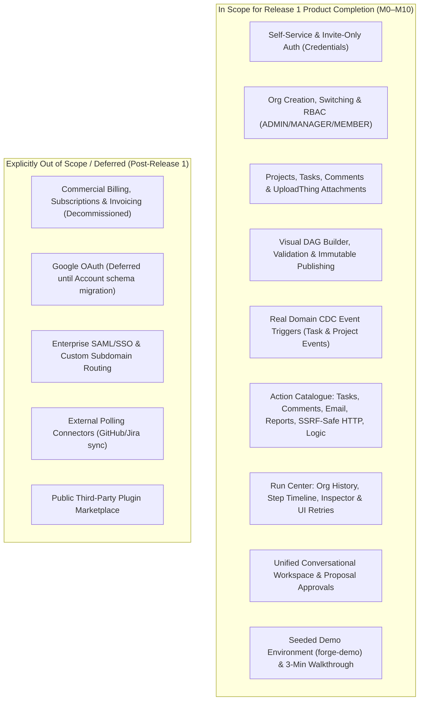
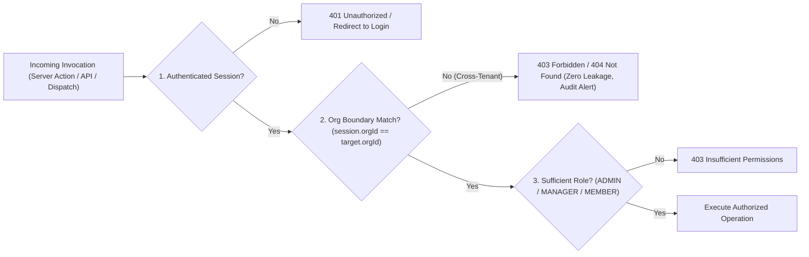
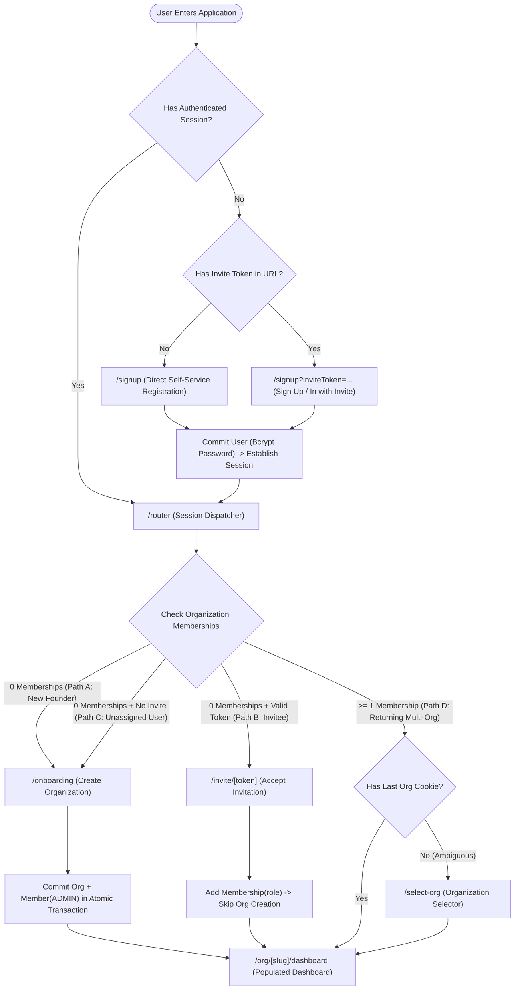
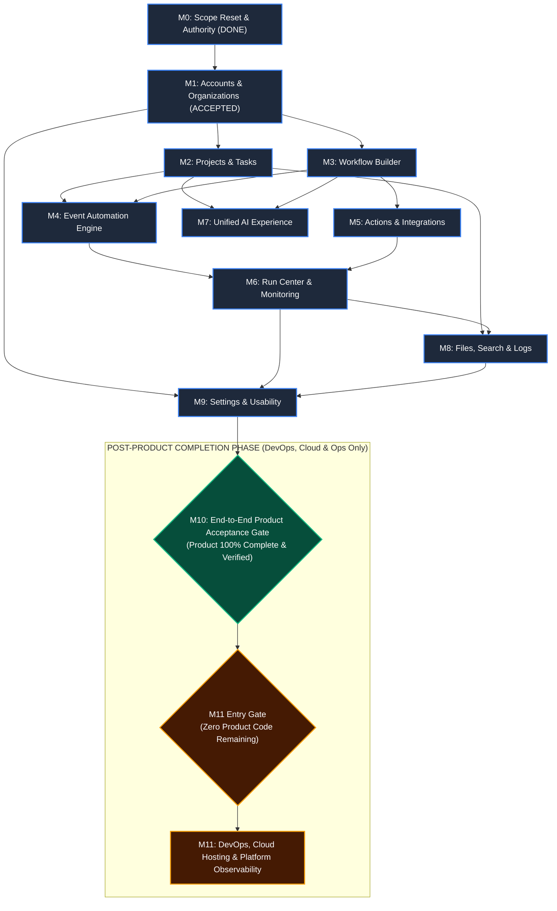
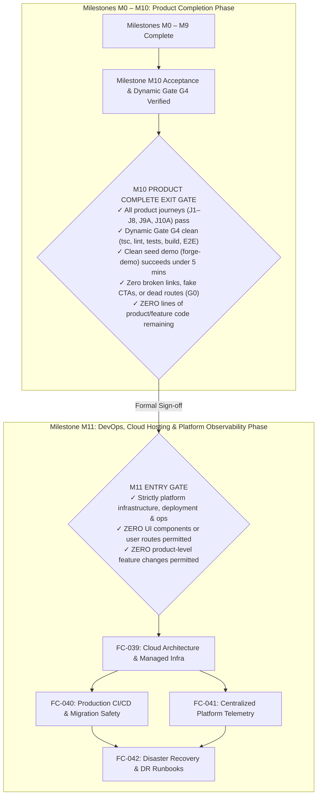
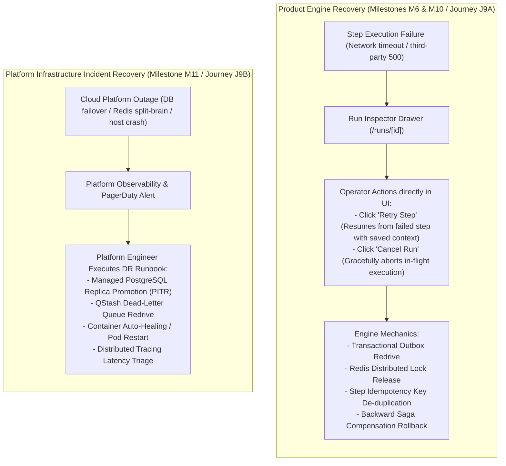
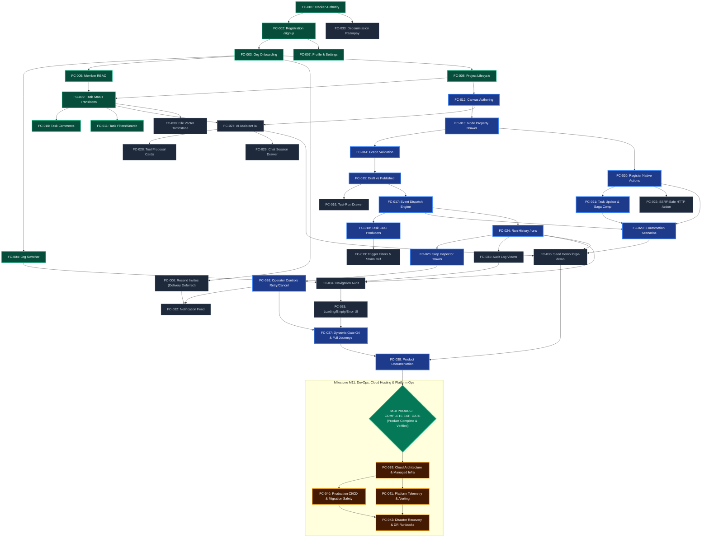

# FORGE — Authoritative Product Completion Tracker (Release 1)

```text
Status:              ACTIVE AUTHORITATIVE TRACKER
Target Outcome:      COMPLETE FORGE AS A DEMONSTRABLE PRODUCT FIRST (M0–M10)
Post-Product Scope:  DevOps, Cloud Hosting & Platform Observability (M11)
Canonical File:      forge/docs/product/PRODUCT_COMPLETION_TRACKER.md
Last Updated:        2026-11-27 (Milestone M2 Owner Acceptance & M3 Authorization)
```

> [!IMPORTANT]
> **Single Source of Truth & Core Directive:**
> This document is the **sole authoritative execution plan** for Forge. All historical trackers, phase logs, and issue registers have been retired and archived under `forge/docs/archive/`.
> The central directive: **COMPLETE FORGE AS A PRODUCT FIRST (Milestones M0 through M10).**
> The only major work remaining after product completion is DevOps, Cloud Deployment, and Platform Observability, strictly isolated in Milestone M11. No user-facing product features, UI components, or application routes may be deferred to M11.

---

## 1. Product Vision, Explicit Scope Decisions & Action Catalog

### 1.1 The Forge Product Promise
Forge is a multi-tenant, event-driven project execution and DAG workflow orchestration platform. It is engineered to bridge collaborative project management (projects, tasks, comments, attachments) with durable automated workflow execution (domain change data capture events, DAG pipeline execution, saga compensations) and human-in-the-loop AI assistance.

### 1.2 The Release 1 Product Boundary
A feature must not exist in a half-built or decorative state. Every advertised feature must either function end-to-end or be explicitly disabled/removed from user navigation.



### 1.3 Explicit Scope Decisions & Rationale

1. **Account Creation Policy (Self-Service + Invites):**  
   - *Decision:* Forge v1 supports **Self-Service registration** (`/signup`) for new organization founders and **Token-based invitations** (`/invite/[token]`) for joining existing teams.  
   - *Rationale:* A product cannot be adopted if the first user requires developer database seeding to obtain an account. Team members, however, join via secure invitations without open public signup confusion.
2. **Billing & Commercial Affordances (Completely Decommissioned for v1):**  
   - *Decision:* **Billing is strictly excluded from Release 1.** The application operates in an unrestricted "Developer Edition / Team Preview" mode.  
   - *Rationale:* Razorpay subscriptions (`create-order`, webhook) are incomplete, lacking subscription state machines, plan upgrades, cancellation, and invoice history. Leaving dead "Upgrade" buttons in `/Tasks` violates Gate G0 (Scope Truth). All billing buttons and checkout modals are removed from user navigation (`FC-033`).
3. **Authentication Provider Boundary (Credentials Active; Google OAuth Deferred):**  
   - *Decision:* Standard email/password authentication via NextAuth Credentials is the sole active auth provider for v1. Google OAuth is temporarily disabled on `/login`.  
   - *Rationale:* The Prisma schema lacks NextAuth's `Account` and `VerificationToken` models. Attempting Google sign-in fails at runtime. Rather than shipping a broken button, it is removed until the schema is extended.
4. **Automation Trigger Set (Core Domain Events):**  
   - *Decision:* Triggers are restricted to core domain CDC events (`task.created`, `task.updated`, `task.completed`, `project.created`) and manual execution.  
   - *Rationale:* Complex cron schedules and external polling integrations add failure modes without demonstrating core value. Domain CDC events prove reactive workflow execution end-to-end.
5. **Action Catalogue & Egress Security Boundary (Arbitrary HTTP Action in v1 with Strict SSRF Defense):**  
   - *Decision:* Outbound HTTP requests (`http.request`, `FC-022`) **are INCLUDED in Release 1 scope**, governed by an uncompromising SSRF and egress security contract. It is NOT an arbitrary unconstrained fetcher; it is a hardened webhook dispatcher.  
   - *Security Contract:*
     - **Private & Reserved IP Blocking:** Outbound requests resolving to loopback (`127.0.0.0/8`, `::1`), link-local / cloud instance metadata (`169.254.0.0/16`, `fe80::/10`), RFC 1918 private subnets (`10.0.0.0/8`, `172.16.0.0/12`, `192.168.0.0/16`), unique local IPv6 (`fc00::/7`), carrier-grade NAT (`100.64.0.0/10`), broadcast/multicast, and IPv4-mapped IPv6 representations (`::ffff:127.0.0.1`) are blocked immediately.
     - **DNS Rebinding Mitigation:** The host resolves the hostname prior to connection, validates the resolved IP against the blocklist, and pins the socket directly to the validated IP address rather than re-resolving during connection.
     - **Redirect Validation:** Max 3 redirects; redirects are intercepted, re-resolved, and destination IPs re-validated against the blocklist before following. Protocol downgrades (e.g., HTTPS to HTTP, or transitions to `file://`, `gopher://`, `ftp://`) are rejected.
     - **Strict Timeouts & Resource Bounds:** Connect timeout &le; 5s, read timeout &le; 10s, max response body size capped at 1 MB (buffered stream aborts if exceeded).
     - **Credential & Header Safety:** `Authorization`, `Cookie`, and `X-Api-Key` headers are redacted in execution logs and `ExecutionAuditLog`. Credentials are never forwarded across redirect domain boundaries.
     - **Safe Error Masking:** Generic error masking (`Destination prohibited by security policy` or `Request timed out`) prevents internal DNS or topology disclosure.
     - **Gate Alignment:** Release Gate G3 explicitly verifies that outbound requests cannot probe internal services or cloud metadata endpoints (`169.254.169.254`).

### 1.4 Action Catalogue & Reversibility Taxonomy

Every workflow action in Forge has explicit compensation and reversibility semantics.

| Action Name | Key | Classification | Type | Reversibility Semantics & Rollback Handler |
| :--- | :--- | :---: | :---: | :--- |
| **Create Task** | `task.create` | Core Native | Mutation | **Reversible:** Deletes created task by ID on backward saga rollback. |
| **Update Task** | `task.update` | Core Native | Mutation | **Reversible:** Restores previous task fields from execution snapshot captured prior to execution. |
| **Generate Report** | `report.generate` | Core Native | Mutation | **Reversible:** Deletes generated report artifact from storage via UploadThing file deletion API. |
| **Create Comment** | `comment.create` | Core Native | Append | **Compensatable:** Appends a compensation tombstone: `⚠️ [Compensated: Action rolled back by Saga Engine]`. |
| **Archive Project** | `project.archive` | Core Native | Mutation | **Reversible:** Un-archives the project, restoring active status. |
| **Send Email** | `email.send` | Integration | External | **Irreversible:** External email cannot be un-sent. Compensator logs an audit record and creates a follow-up review task. |
| **HTTP Request** | `http.request` | Integration | External | **Irreversible:** External HTTP requests cause remote side effects. Compensator records execution audit receipt; no automated undo. |
| **Evaluate Condition**| `logic.condition`| Control | Logic | **Stateless / Read-only:** Pure evaluation; produces no mutations, requiring zero compensation. |

---

## 2. Definition of Product Complete

Forge Release 1 is **Product Complete** when and only when all 10 criteria are met:

1. **Independent First-Mile Onboarding:** A new user can register at `/signup`, create an organization at `/onboarding`, and immediately arrive on a populated dashboard without developer intervention or SQL seeding.
2. **Team Collaboration & RBAC:** Admins can invite team members via Resend emails; invitees accept and join with strictly enforced roles (`ADMIN`, `MANAGER`, `MEMBER`).
3. **Usable DAG Workflow Builder:** Users visually author, connect, validate, and name workflows on the React Flow canvas with clear validation error highlights and explicit draft/publish state.
4. **End-to-End Reactive Triggers:** Creating or updating a task automatically fires the domain event dispatcher, advancing matching active workflows into execution.
5. **Demonstrable Automation Scenarios:** The action catalogue supports three distinct, real-world business flows:
   - *Scenario 1 (Auto-Triage):* Task Created &rarr; Priority Check &rarr; Assign Tech Lead & Status Update &rarr; Resend Email Notification.
   - *Scenario 2 (Progress Digest):* Trigger &rarr; Compile Metrics &rarr; Generate Real Markdown Report &rarr; Post Comment &rarr; Email Stakeholder.
   - *Scenario 3 (Escalation & Rollback):* Critical Task &rarr; Update Status &rarr; Downstream Failure &rarr; Saga Backward Compensation restores previous status and logs audit comment.
6. **Full Operator Visibility:** An organization run history page (`/runs`) displays past executions; opening a run reveals a step-by-step timeline, inputs, outputs, timestamps, and failure explanations.
7. **No-SQL Failure Recovery:** Operators can retry failed runs or cancel hung runs directly from the UI without database queries.
8. **Trustworthy AI Interface:** The AI assistant provides a unified conversational interface for project context (RAG) and workflow generation, requiring explicit human review and approval for mutations.
9. **Zero Dead Ends & Honest Scope:** Every link, button, and navigation item in the sidebar resolves to a functioning screen; mock buttons and broken upgrade CTAs are eliminated.
10. **Clean Demo Baseline:** The application runs deterministically from a clean seed (`forge-demo`) for a 3-to-5 minute live demonstration.

> [!NOTE]
> **Product Complete vs Cloud Deployment:**
> Product completeness is achieved on local/self-hosted infrastructure in Milestone M10. Cloud infrastructure provisioning, custom domain DNS, production CI/CD deployment pipelines, and centralized cloud telemetry are strictly isolated in Milestone M11.

---

## 3. Comprehensive Architecture & Implementation Audit

### Path Trace 1: Domain Event Automation Pipeline (with Multi-Tenant Validation)
```text
[User creates task in Org A]
       │
       ▼
src/app/actions/Tasks/createTask.ts (Server Action)
       │ 1. Authenticate caller session
       │ 2. Verify caller belongs to Org A (getOrgAccess)
       │ 3. Validate input payload via Zod
       ▼
src/lib/workflow/event-bus/task-events.ts (Domain CDC Producer)
       │ 4. Transactional commit: Task record + Outbox event payload
       │ 5. Outbox event tagged with organizationId: "Org A"
       ▼
src/lib/workflow/worker/event-dispatcher.ts (Queue Consumer)
       │ 6. Read Outbox row atomically
       │ 7. Query Published Workflows: WHERE organizationId == "Org A" AND trigger.type == "task.created"
       │    (STRICT TENANT ISOLATION: Workflows belonging to Org B are never evaluated)
       ▼
src/lib/workflow/engine/workflow-engine.ts (DAG Orchestrator)
       │ 8. Generate execution context locked to Org A
       │ 9. Acquire distributed Redis lock for execution step
       │ 10. Execute actions (task.update, email.send, report.generate)
       ▼
src/features/organizations/components/workflow/WorkflowRunDashboard.tsx (UI)
       │ 11. Run history updated in Org A's Run Center
```

### Path Trace 2: Action Registry to Canvas Pipeline
```text
Action Definition (src/lib/workflow/actions/core/update-task.ts)
       │ implements ActionHandler interface & compensation rollback
       ▼
Registry Entry (src/lib/workflow-types/action-registry.ts)
       │ registerAction('task.update', handler, schema, compensationHandler)
       ▼
Capability Catalog (src/lib/workflow-types/action-capabilities.ts)
       │ defines input/output types, property schemas, and display labels
       ▼
Canvas Presentation (src/lib/workflow-types/registry.ts)
       │ exposes widget in React Flow sidebar palette with configuration drawer
       ▼
Validation & Execution
       │ canvas validates edge compatibility; engine invokes registered handler
```

### Path Trace 3: Workflow Run Monitoring & Operator Recovery Pipeline
```text
[Step Failure Occurs in Workflow Run]
       │
       ▼
src/lib/workflow/engine/workflow-engine.ts
       │ 1. Catch error, classify failure (TRANSCRIPTION, TIMEOUT, PERMANENT)
       │ 2. Execute saga compensation handlers for prior completed steps (if unrecoverable)
       │ 3. Mark StepRun as FAILED or COMPENSATED; mark WorkflowRun as REQUIRES_INTERVENTION
       ▼
src/app/org/[orgId]/runs/[runId]/page.tsx (Run Inspector Drawer)
       │ 4. Operator views step timeline, formatted error stack, and JSON inputs/outputs
       │ 5. Operator clicks "Retry Step" or "Cancel Run"
       ▼
src/app/actions/workflows/operatorActions.ts (Server Action)
       │ 6. Verify caller belongs to run's organization (ADMIN/MANAGER role)
       │ 7. Re-enqueue step execution or gracefully abort in-flight locks
       ▼
Execution Resumes Without Manual SQL or Developer DB Access
```

### Subsystem Implementation & Health Matrix

| Subsystem | Primary Source Route | Current Code Health | Identified Defect / Gap | Target Assignment |
| :--- | :--- | :---: | :--- | :---: |
| **Authentication** | `src/app/login/login-form.tsx` | PARTIAL | "Create account" button is inert; no `/signup` route exists. | `FC-002` |
| **Onboarding** | `src/app/router/page.tsx` | DISCONNECTED | Redirects to `/onboarding` which returns 404. | `FC-003` |
| **Org Switching** | `src/app/org/[orgId]/layout.tsx` | PARTIAL | Static text; lacks interactive organization switcher. | `FC-004` |
| **Member RBAC** | `members-table.tsx` | DECORATIVE | Three-dot menu button is inert; no role change or remove action. | `FC-005` |
| **Invitations** | `createInvitation.ts` | PARTIAL | Generates token but does not dispatch email via Resend. | `FC-006` |
| **Projects** | `src/app/actions/projects/projectActions.ts` | COMPLETE | Full project settings, renaming, soft-archiving, and cascading deletion with modal confirmation. | `FC-008` |
| **Tasks** | `src/app/actions/Tasks/updateTaskInOrg.ts` | COMPLETE | Interactive status transitions (TODO, IN_PROGRESS, BLOCKED, DONE), completedAt timestamp, optimistic UI, rollback, and domain CDC events. | `FC-009` |
| **Comments** | `src/app/actions/comments/` | COMPLETE | Interactive collaboration feed with Markdown support, author info, relative timestamps, and secure deletion for author/admin. | `FC-010` |
| **Workflow Canvas**| `WorkflowCanvas.tsx` | WORKING | Drag-and-drop works; property drawer and naming require polish. | `FC-012`, `FC-013` |
| **Workflow Publish**| `WorkflowEditorHeader.tsx` | PARTIAL | Save works; draft vs published state lifecycle not enforced. | `FC-015` |
| **Domain Events** | `task-events.ts` | PARTIAL | CDC events defined but not dispatched to active workflows. | `FC-017`, `FC-018` |
| **Action Registry** | `action-registry.ts` | PARTIAL | Email and Report exist in code but are unregistered in canvas catalog. | `FC-020` |
| **HTTP Action** | `http-request.ts` | MISSING | Outbound HTTP webhook node not implemented; needs SSRF airgap. | `FC-022` |
| **Run History** | `src/app/org/[orgId]/runs/` | MISSING | `/runs` route does not exist (404); omitted from sidebar. | `FC-024` |
| **Run Inspector** | `WorkflowRunDashboard.tsx` | PARTIAL | Step timeline rendered, but clicking nodes does not open step drawer. | `FC-025` |
| **Operator Controls**| `operatorActions.ts` | MISSING | No UI controls to retry failed runs or cancel stalled runs. | `FC-026` |
| **AI Assistant** | `src/app/org/[orgId]/ai/` | PARTIAL | Chat functional; tool proposals lack inline human approval cards. | `FC-027`, `FC-028` |
| **File Deletion** | `src/app/actions/files/` | PARTIAL | Files upload to UploadThing; deletion lacks vector tombstoning. | `FC-030` |
| **Audit Logs** | `src/app/org/[orgId]/audit/` | MISALIGNED | Renders code pastebin prompt instead of `ExecutionAuditLog` table. | `FC-031` |
| **Commercial UX** | `Tasks/page.tsx` | BROKEN | Renders dead `UpgradeButton` pointing to broken Razorpay flow. | `FC-033` |

### 3-Tier Multi-Tenant Security Boundary Model

A shared authorization helper (`getOrgAccess`) is NOT sufficient proof of security by itself. Every organization-scoped server action, API route, database query, vector search, and workflow execution path must be verified against three explicit threat scenarios:



1. **Unauthorized Scenario (Unauthenticated caller):** Request lacking active session cookie must return `401 Unauthorized` or redirect to `/login`.
2. **Cross-Tenant Scenario (Authenticated User in Org A querying Org B resources):** Request with valid Org A session attempting to read or mutate Org B IDs (e.g. `projectId`, `taskId`, `workflowId`, `runId`, `fileId`) must fail with `403 Forbidden` or `404 Not Found`. Queries MUST scope by `WHERE organizationId == session.orgId`. No data, entity metadata, or error hints may leak across tenants.
3. **Insufficient-Role Scenario (MEMBER attempting privileged mutations):** Authenticated user with `MEMBER` role attempting admin-only operations (e.g. changing member roles, deleting projects, publishing workflows, triggering manual redrives, modifying org settings) must fail with `403 Insufficient Permissions`.

---
## 4. Addendum Reconciliation Matrix

Mapping all **19 Domains**, **10 Customer Journeys**, and **8 Release Acceptance Gates** from `forge_product_completeness_addendum.md`:

### 4.1 Domains Coverage

| Addendum Domain | Title | Type | Assignment Mapping & Scope Resolution |
| :---: | :--- | :---: | :--- |
| **01** | Product contract & scope | CORE | Handled in **M0** (`FC-001`) and **M10** (`FC-038`). Honest scope truth enforced. |
| **02** | Auth & user account lifecycle | CORE | Covered in **M1** (`FC-002`, `FC-007`). Credentials auth, self-service registration. |
| **03** | Organizations & membership | CORE | Covered in **M1** (`FC-003`, `FC-004`, `FC-005`, `FC-006`). Org onboarding, switching, roles. |
| **04** | Projects, tasks & collaboration | CORE | Covered in **M2** (`FC-008`, `FC-009`, `FC-010`, `FC-011`). CRUD, assignment, comments. |
| **05** | Workflow design & publishing | CORE | Covered in **M3** (`FC-012` to `FC-016`). Canvas UX, validation, draft/publish lifecycle. |
| **06** | Triggers, actions & integrations | CORE | Covered in **M4** (`FC-017` to `FC-019`) and **M5** (`FC-020` to `FC-023`). Real triggers & actions. |
| **07** | Workflow run monitoring | CORE | Covered in **M6** (`FC-024`, `FC-025`, `FC-026`). Run list, step inspection, retry/cancel. |
| **08** | AI assistant & approval UX | CONDITIONAL | Covered in **M7** (`FC-027`, `FC-028`, `FC-029`). Unified chat, proposals, approvals. |
| **09** | Files & semantic search | CONDITIONAL | Covered in **M8** (`FC-030`). UploadThing attachment lifecycle, vector cleanup. |
| **10** | Notifications & communications | CORE | Covered in **M1** (`FC-006`) and **M8** (`FC-032`). Resend email delivery, in-app notifications. |
| **11** | Billing & subscription lifecycle| CONDITIONAL | **RESOLVED N/A FOR V1** (`FC-033`). Decommissioned in M9; free developer preview mode. |
| **12** | Navigation & interface completion| CORE | Covered in **M9** (`FC-034`, `FC-035`). Dead route removal, casing fix, empty states. |
| **13** | Security & tenant boundaries | CORE | Built into all assignments: 3-Tier Security Matrix + SSRF defense on `http.request`. |
| **14** | Distributed systems correctness | CORE | Engine foundation closed (F-01 to F-04); verified in **M4**, **M5**, and **M6**. |
| **15** | QA & regression suite | CORE | Handled dynamically in **M10** (`FC-037`). Dynamic Gate G4 across all test layers. |
| **16** | Performance & capacity | CORE | Verified in **M10** (`FC-037`) on local/self-hosted demo; monitored in **M11** (`FC-041`). |
| **17** | Operations & observability | CORE | Separated cleanly into **M11** (`FC-039`, `FC-040`, `FC-041`, `FC-042`). |
| **18** | Docs, trust & support | CORE | Covered in **M10** (`FC-038`). Architecture docs, user guide, truthful catalog. |
| **19** | Demo & portfolio evidence | CORE | Covered in **M10** (`FC-036`, `FC-038`). Clean seed, 3-minute video demo script. |

### 4.2 End-to-End Customer & Operator Journeys

| Journey | Description | Assigned Milestone | Verification Path & Success Criteria |
| :---: | :--- | :---: | :--- |
| **J1** | **New Customer Onboarding (4 Paths)** | **M1** (`FC-002`, `FC-003`) | Visitor &rarr; `/signup` &rarr; Authenticated Session &rarr; `/onboarding` &rarr; Org Created &rarr; Dashboard. Covers Paths A, B, C, D. |
| **J2** | **Team Collaboration & RBAC** | **M1** (`FC-005`, `FC-006`) | Admin invites colleague &rarr; Resend email received &rarr; Invitee accepts token &rarr; Joins with designated role (`MEMBER`/`MANAGER`). |
| **J3** | **Core Work Management** | **M2** (`FC-008` to `FC-011`) | Create project &rarr; create task &rarr; transition status &rarr; add comment &rarr; upload attachment &rarr; search tasks. |
| **J4** | **Visual Workflow Authoring & Publishing** | **M3** (`FC-012` to `FC-016`) | Author DAG on canvas &rarr; configure properties &rarr; validate error-free &rarr; publish immutable version &rarr; run manual preview test. |
| **J5** | **Reactive Event Automation & Actions** | **M4**, **M5** (`FC-017` to `FC-023`) | Trigger domain CDC event &rarr; dispatcher matches active workflow &rarr; actions execute &rarr; visible side effects in UI. |
| **J6** | **Run Center Diagnostics & Operator Controls**| **M6** (`FC-024` to `FC-026`) | Operator opens `/runs` &rarr; selects execution &rarr; inspects step timeline & inputs/outputs &rarr; retries failed step or cancels run. |
| **J7** | **AI Assistant Workspace & Tool Proposals** | **M7** (`FC-027` to `FC-029`) | Conversational chat &rarr; RAG retrieval &rarr; assistant proposes workflow modification &rarr; user reviews diff &rarr; approves into canvas. |
| **J8** | **Asset Lifecycle & Vector Tombstoning** | **M8** (`FC-030` to `FC-032`) | Upload file attachment &rarr; verify Pinecone vector indexing &rarr; delete file &rarr; verify vector tombstoned from RAG context. *(Note: Commercial billing resolved in free developer preview via FC-033).* |
| **J9A**| **Product Engine Recovery & Idempotence** | **M6** (`FC-026`), **M10** (`FC-037`)| Engine crash/worker restart during active execution &rarr; outbox redrives pending events &rarr; Redis locks prevent split-brain &rarr; resumes without data duplication. |
| **J9B**| **Platform Infrastructure Incident Recovery** | **M11** (`FC-041`, `FC-042`) | Cloud infrastructure outage &rarr; PagerDuty alert &rarr; engineer executes DR runbook &rarr; DB replica failover & QStash DLQ redrive verified. |
| **J10A**| **Product Demonstration Walkthrough** | **M10** (`FC-036`, `FC-037`) | Single-command setup &rarr; `prisma db seed:demo` &rarr; `forge-demo` boots &rarr; 3-5 minute scripted walkthrough proves complete product. |
| **J10B**| **Production Cloud Deployment & Verification**| **M11** (`FC-039`, `FC-040`) | Cloud infrastructure provision &rarr; CI/CD pipeline deploy &rarr; DNS/SSL active &rarr; managed DB migrations & smoke tests clean. |

### 4.3 Multi-Path Onboarding Journey (J1) State Machine

Journey J1 is a unified customer journey covering four distinct authentication and organization states:



- **Path A (New Founder / Self-Service):** Visitor lands on `/signup` &rarr; fills Name, Email, Password &rarr; User record committed with hashed password &rarr; router detects 0 memberships &rarr; redirects to `/onboarding` &rarr; user inputs Organization Name (e.g., "Acme Corp") &rarr; atomic transaction creates `Organization` + `Membership(role: ADMIN)` &rarr; user lands on `/org/acme-corp/dashboard` with starter tasks.
- **Path B (Invited Team Member):** User receives Resend email link `/invite/[token]` &rarr; if new user, completes `/signup` with pre-filled token; if existing user, logs in &rarr; router detects invitation token &rarr; lands on invite acceptance view &rarr; joins existing organization with designated role (`MEMBER` or `MANAGER`) &rarr; skips organization creation &rarr; lands directly on `/org/[slug]/dashboard`.
- **Path C (Unassigned Existing User):** Authenticated user with 0 memberships (e.g. removed from prior team) &rarr; router redirects to `/onboarding` &rarr; user creates a new organization or enters a team invitation code.
- **Path D (Returning Multi-Org User):** Returning user signs in &rarr; router detects &ge; 1 memberships &rarr; restores active organization from cookie or redirects to `/select-org` &rarr; lands on dashboard. **User NEVER sees `/onboarding`.**

### 4.4 The 3 Real-World Automation Scenarios

Forge proves reactive workflow execution across three concrete, end-to-end business scenarios:

```mermaid
flowchart TD
    subgraph S1["Scenario 1: Automatic Task Triage & Assignment"]
        E1["task.created (Priority: URGENT)"] --> F1{"Filter: Urgent?"}
        F1 -- Yes --> A1["Action: task.update (Assign Tech Lead & Status: IN_PROGRESS)"]
        A1 --> A2["Action: email.send (Dispatch Resend Alert to Lead)"]
    end

    subgraph S2["Scenario 2: Automated Progress Digest & Report Generation"]
        E2["Manual / Event Trigger: project.digest_requested"] --> A3["Action: report.generate (Compile Real Markdown Table & Upload)"]
        A3 --> A4["Action: comment.create (Post Digest Table to Discussion)"]
        A4 --> A5["Action: email.send (Dispatch Summary to Project Lead)"]
    end

    subgraph S3["Scenario 3: Task Escalation with Compensating Action (Saga Rollback)"]
        E3["task.updated (Status: BLOCKED)"] --> A6["Step 1: task.update (Set Status: ESCALATED)"]
        A6 --> A7["Step 2: http.request (Send Webhook to External Incident API)"]
        A7 -- Simulated 500 Failure --> ROLLBACK["Saga Engine Triggers Backward Compensation"]
        ROLLBACK --> C1["Compensate Step 1: task.update (Revert Status to BLOCKED)"]
        C1 --> C2["Compensate Audit: comment.create (Post Compensation Note on Task)"]
    end
```



#### Detailed Scenario Specifications

| Parameter | Scenario 1: Automatic Task Triage | Scenario 2: Automated Progress Digest | Scenario 3: Task Escalation & Saga Rollback |
| :--- | :--- | :--- | :--- |
| **User Problem** | Urgent bug reports sit unassigned in backlog, causing SLA breaches. | Leads waste hours compiling task metrics into status reports. | Failed external escalations leave internal tasks in corrupted/misaligned states. |
| **Trigger & Payload** | Domain CDC `task.created` with `{ taskId: "...", priority: "URGENT", title: "DB connection leak", projectId: "..." }` | Manual UI trigger or domain event `project.digest_requested` with `{ projectId: "...", requestedBy: "..." }` | Domain CDC `task.updated` with `{ taskId: "...", status: "BLOCKED", priority: "CRITICAL" }` |
| **Workflow Definition** | `task.created` &rarr; Condition (`priority == "URGENT"`) &rarr; `task.update` &rarr; `email.send` | `project.digest_requested` &rarr; `report.generate` &rarr; `comment.create` &rarr; `email.send` | `task.updated` &rarr; `task.update` (`status: ESCALATED`) &rarr; `http.request` (external API) &rarr; Saga Rollback |
| **Registered Actions** | `task.update`, `email.send` | `report.generate`, `comment.create`, `email.send` | `task.update` (forward), `http.request` (fails), `task.update` (compensation), `comment.create` (audit) |
| **Report Output Details**| N/A | Generates real, structured Markdown document with summary statistics table, task breakdown, and UploadThing URL. **Never an empty mock.** | N/A |
| **Execution Side Effects**| Task row in Postgres updated (`assigneeId`, `status`); Email sent via Resend; Run recorded. | Markdown report stored in UploadThing; Comment row written to Postgres; Stakeholder emailed. | Task status restored to `BLOCKED`; compensation receipt in `ExecutionAuditLog`; tombstone comment posted. |
| **User-Visible UI Result**| Task board shows task in "In Progress" with Lead avatar; recipient receives email; Run Center shows green run. | Project comments display formatted Markdown digest with download link; stakeholder receives email. | Task board shows task remains in "Blocked"; comment explains failed escalation; Run Center shows `COMPENSATED`. |
| **Verification Method** | Test emits urgent task event, asserts DB mutation, asserts Resend mock payload, verifies Run UI. | Test triggers digest, asserts valid Markdown artifact content, asserts Comment record in DB and UI. | Test simulates 500 error on HTTP step, asserts task status reverted to `BLOCKED`, asserts Run status `COMPENSATED`. |

### 4.5 Release Acceptance Gates (G0 — G7)

- [ ] **G0 (Scope Truth & Honest UI Gate):** Public feature catalog and sidebar navigation match code reality 100%. Broken Razorpay buttons removed (`FC-033`). Dead routes (`/onboarding`, `/select-org`, `/runs`) eliminated. Zero phantom features or non-functional CTAs.
- [ ] **G1 (First-Mile & Core Journeys Gate):** Customer Journeys J1 (all 4 onboarding paths), J2 (team invites), J3 (projects/tasks), J4 (canvas publishing), J5 (reactive triggers), J6 (run center), and J7 (AI assistant) execute end-to-end without developer assistance or manual SQL.
- [ ] **G2 (Data Integrity & Outbox Atomicity Gate):** Transactional outbox commits atomically with step runs; distributed Redis locks enforce serial advancement; saga backward compensation executes deterministically upon step failure with zero orphaned side effects.
- [ ] **G3 (Security, 3-Tier Multi-Tenant Boundary & SSRF Gate):** Every server action and API route passes the 3-Tier Security Matrix:
  1. *Unauthorized:* 401 Unauthorized / redirect.
  2. *Cross-Tenant:* User in Org A attempting to access Org B resources is rejected with 403 Forbidden / 404 Not Found (zero data leakage).
  3. *Insufficient-Role:* `MEMBER` attempting admin mutations rejected with 403.
  *SSRF Defense:* Outbound HTTP actions blocked from accessing loopback (`127.0.0.1`), link-local metadata (`169.254.169.254`), and private subnets (RFC 1918).
- [ ] **G4 (Dynamic Multi-Layer Quality & Verification Gate):** Successful execution of the full dynamic verification suite on current git HEAD. *(Note: Fixed test-count metrics like the historical 1,978 figure are eliminated in favor of real dynamic commands).*
  - `npx vitest run` / `npm test`: 100% passing unit & integration tests.
  - `npx tsc --noEmit`: 0 TypeScript compiler errors.
  - `npm run lint`: Clean lint execution.
  - `npx prisma migrate status`: Database schema strictly aligned with migration history.
  - `npm run build`: Production Next.js build clean with 0 build errors.
  - Playwright E2E: Automated browser journey verification passing.
  - *Dynamic Artifact Requirement:* Verification report recorded with tested Commit SHA, execution timestamp (UTC), runtime environment (Node, OS, PostgreSQL), exact command lines, exit codes, and dynamic test totals.
- [ ] **G5 (Engine Reliability & UI Intervention Gate):** Workflows survive simulated worker restart; stalled leases are reclaimed by engine sweeper; operators resolve failures directly via UI ("Retry Step" / "Cancel Run") without database access.
- [ ] **G6 (Truthful Performance & Benchmark Gate):** Workflow dispatch p95 latency, canvas rendering responsiveness, and step execution metrics measured on local/self-hosted deployment and published honestly.
- [ ] **G7 (Product Release Sign-off Gate):** Zero open P0 defects; user documentation and quickstart verified; seeded demo environment (`forge-demo`) launches cleanly; **ZERO product code remaining to write before M11 entry.**

---
## 5. Milestone Execution Roadmap



---

## 6. Detailed Capability Assignment Backlog

### Milestone M0: Product Scope and Implementation Truth

#### FC-001 | M0 | Scope Contract, Tracker Authority & Document Consolidation
- **Milestone:** M0
- **Capability:** Single authoritative completion tracker and historical document retirement.
- **Current Evidence:** Redundant overlapping trackers in `docs/architecture/workflows/` (4,375-line tracker) and `docs/architecture/agent/roadmap.md`.
- **Missing Behavior:** Single actionable backlog reflecting true source state.
- **Required Outcome:** Consolidate active planning into `forge/docs/product/PRODUCT_COMPLETION_TRACKER.md`. Archive historical documents into `forge/docs/archive/`. Update all root README links.
- **Dependencies:** None
- **Files Involved:** `README.md`, `forge/README.md`, `forge/docs/product/PRODUCT_COMPLETION_TRACKER.md`, `forge/docs/archive/`
- **Acceptance Criteria:** Exactly one active completion tracker exists. All retired paths archived. Zero broken links.
- **Tests & Verification:** Python link-audit script verifying zero active references to retired tracker paths.
- **Status:** `DONE`

---

### Milestone M1: Identity, Accounts and Organizations

#### FC-002 | M1 | Self-Service User Registration (`/signup`)
- **Milestone:** M1
- **Capability:** Self-service account creation for new users, unlocking Journey J1.
- **Current Evidence:** `src/app/login/login-form.tsx:106` renders an inert `<button>Create account</button>`. No `/signup` route exists.
- **Missing Behavior:** Public signup page with form validation, email uniqueness check, secure bcrypt password hashing, and seamless onboarding dispatch.
- **Required Outcome:** Create `src/app/signup/page.tsx` and server action `registerUserAction`. Wire "Create account" button on `/login` to `/signup`.
- **Dependencies:** FC-001
- **Files Involved:** `src/app/signup/page.tsx`, `src/app/login/login-form.tsx`, `src/app/actions/user/registerUser.ts`
- **Acceptance Criteria:**
  - Submitting `/signup` creates a new `User` record with bcrypt-hashed password.
  - Duplicate email displays clear, friendly error alert.
  - Successful registration establishes authenticated session and automatically dispatches caller:
    - Path A (No invite): Dispatched to `/onboarding`.
    - Path B (With `inviteToken` param): Dispatched to `/invite/[token]` to accept invitation.
  - Password inputs validated for minimum length (&ge; 8 chars).
- **Tests & Verification:** Integration test submitting registration action with valid/invalid/duplicate emails; browser test navigating `/login` &rarr; `/signup` &rarr; register &rarr; verify automatic redirect to `/onboarding`. Level E3 automated suite (`src/tests/auth/m1-concurrency.realdb.test.ts`) and Playwright E2E suite (`src/tests/e2e/m1-journeys.spec.ts`) passing. Owner manual acceptance passed on 2026-11-26.
- **Status:** `DONE (Owner Manual Acceptance Passed)`
- **Manual Acceptance Record:** [2026-11-26 M1 Owner Manual Acceptance](../dev-log/2026-11-26-m1-owner-manual-acceptance.md)

#### FC-003 | M1 | First-Time Organization Onboarding Flow (`/onboarding`)
- **Milestone:** M1
- **Capability:** Initial organization creation for users with 0 memberships.
- **Current Evidence:** `src/app/router/page.tsx:33` redirects users with 0 memberships to `/onboarding`, which produces a 404 error. `db.organization.create` is never called in runtime application code.
- **Missing Behavior:** Onboarding screen allowing user to input organization name, generate unique URL-safe slug, and commit initial `Organization` + `Membership(ADMIN)`.
- **Required Outcome:** Create `src/app/onboarding/page.tsx` and server action `createOrganizationAction`.
- **Dependencies:** FC-002
- **Files Involved:** `src/app/onboarding/page.tsx`, `src/app/router/page.tsx`, `src/app/actions/settings/createOrg.ts`
- **Acceptance Criteria:**
  - Fresh user landing on `/router` is redirected to `/onboarding`.
  - Creating organization generates unique URL-safe slug (e.g. `acme-corp`).
  - Commits `Organization` and assigns caller as `ADMIN` in a single atomic database transaction.
  - Redirects caller directly to `/org/${slug}/dashboard` with initial starter task.
  - Verification of 3-Tier Security: Unauthenticated access to `/onboarding` redirects to `/login`.
- **Tests & Verification:** Integration test verifying atomic transaction; E2E test verifying fresh user completes onboarding without manual DB setup. Real PostgreSQL concurrency and transaction timeout tests passing. Owner manual acceptance passed on 2026-11-26.
- **Status:** `DONE (Owner Manual Acceptance Passed)`
- **Manual Acceptance Record:** [2026-11-26 M1 Owner Manual Acceptance](../dev-log/2026-11-26-m1-owner-manual-acceptance.md)

#### FC-004 | M1 | Multi-Organization Selector & Header Switcher (`/select-org`)
- **Milestone:** M1
- **Capability:** Organization selection and seamless switching for multi-tenant users.
- **Current Evidence:** `src/app/router/page.tsx:42` redirects multi-org users to `/select-org` (404). `src/app/org/[orgId]/layout.tsx:41` displays static text with no switcher dropdown.
- **Missing Behavior:** Organization picker page and header switcher component.
- **Required Outcome:** Create `src/app/select-org/page.tsx` listing user's memberships; add `OrgSwitcher` dropdown to top header in `OrgLayout`.
- **Dependencies:** FC-003
- **Files Involved:** `src/app/select-org/page.tsx`, `src/app/org/[orgId]/layout.tsx`, `src/features/organizations/components/OrgSwitcher.tsx`
- **Acceptance Criteria:**
  - `/select-org` lists all organizations the user belongs to with their roles.
  - Header dropdown displays current organization and allows instant switching to other organizations.
  - **Tenant Boundary Security:** Switching organizations verifies user membership in target organization before updating session context; attempting to switch to an un-joined organization is rejected with 403.
- **Tests & Verification:** Create test user in two organizations; verify navigation via selector and header switcher updates URL and visible data. Multi-org selector and header switcher Playwright test passing. Owner manual acceptance passed on 2026-11-26.
- **Status:** `DONE (Owner Manual Acceptance Passed)`
- **Manual Acceptance Record:** [2026-11-26 M1 Owner Manual Acceptance](../dev-log/2026-11-26-m1-owner-manual-acceptance.md)

#### FC-005 | M1 | Member Role Management & Removal Controls (`/members`)
- **Milestone:** M1
- **Capability:** Real team member role modification and member removal with last-admin safeguard.
- **Current Evidence:** `src/features/organizations/components/invitation/members-table.tsx:84` renders an inert `<button>` with `<MoreHorizontal />`. No server actions exist to change roles or remove members.
- **Missing Behavior:** Interactive member action menu with role update dialog and member removal confirmation.
- **Required Outcome:** Implement `updateMemberRole` and `removeMember` server actions with strict RBAC; wire to `members-table.tsx`.
- **Dependencies:** FC-003
- **Files Involved:** `src/features/organizations/components/invitation/members-table.tsx`, `src/app/actions/user/memberActions.ts`
- **Acceptance Criteria:**
  - Admin can update member role between `ADMIN`, `MANAGER`, `MEMBER`.
  - Admin cannot remove themselves if they are the sole administrator.
  - Removed user immediately loses access to organization routes (session checks return 403).
  - **RBAC Role Enforcement:** Non-admins attempting to change roles or remove members are rejected with 403 Forbidden.
- **Tests & Verification:** Role mutation test suite verifying RBAC enforcement, cross-tenant rejection, and last-admin refusal. Level E3 PostgreSQL mutex serialization suite (Tests A–E) proving sole-admin protection under concurrent interleaving. Owner manual acceptance passed on 2026-11-26.
- **Status:** `DONE (Owner Manual Acceptance Passed)`
- **Manual Acceptance Record:** [2026-11-26 M1 Owner Manual Acceptance](../dev-log/2026-11-26-m1-owner-manual-acceptance.md)

#### FC-006 | M1 | Reliable Email Delivery for Invitations via Resend
- **Milestone:** M1
- **Capability:** Automated email delivery of team invitation links.
- **Current Evidence:** `createInvitation.ts:62` creates invitation token but does not dispatch email. README line 383 notes invitation links must be copied manually.
- **Missing Behavior:** Triggering Resend email dispatch upon invitation creation.
- **Required Outcome:** Wire `createInvitation` to dispatch an invitation email containing the acceptance URL via Resend API.
- **Dependencies:** FC-003
- **Files Involved:** `src/app/actions/user/createInvitation.ts`, `src/lib/email/resend.ts`
- **Acceptance Criteria:**
  - Inviting a member creates invitation token and sends an email via Resend with link `/invite/[token]`.
  - Recipient clicking link lands on invitation acceptance view.
  - If email fails to send, clear error feedback is surfaced, but token is not orphaned.
- **Tests & Verification:** Application-side invitation token generation, 24-hour expiration lifecycle, and acceptance flow (`/invite/[token]`) verified via Playwright E2E and owner manual inspection. Live Resend external provider test executed against authorized recipient `mayurnanda9857@gmail.com`; returned HTTP 403 sandbox error (`onboarding@resend.dev` requires a verified custom domain at `resend.com/domains` to deliver outside the account owner email). External email delivery is explicitly deferred by owner directive until custom domain verification in a later milestone (tracked downstream in `FC-032`).
- **Status:** `PARTIAL (App Flow Owner-Accepted; Resend Delivery Deferred)`
- **Manual Acceptance Record:** [2026-11-26 M1 Owner Manual Acceptance](../dev-log/2026-11-26-m1-owner-manual-acceptance.md)

#### FC-007 | M1 | User Profile & Account Settings Completeness
- **Milestone:** M1
- **Capability:** Self-service profile updates and password changes.
- **Current Evidence:** Profile settings page is partially wired; password update server action missing.
- **Missing Behavior:** Full profile name, avatar, and password update forms with validation.
- **Required Outcome:** Create `updateUserProfileAction` and `updatePasswordAction`; wire into settings page.
- **Dependencies:** FC-002
- **Files Involved:** `src/app/org/[orgId]/settings/profile/page.tsx`, `src/app/actions/user/profileActions.ts`
- **Acceptance Criteria:**
  - User can update display name and avatar URL.
  - User can update password with current password verification.
  - Form validation prevents empty names or insecure passwords.
- **Tests & Verification:** Unit tests for password validation and profile update actions. Playwright E2E journey for profile and password update passing. Owner manual acceptance passed on 2026-11-26.
- **Status:** `DONE (Owner Manual Acceptance Passed)`
- **Manual Acceptance Record:** [2026-11-26 M1 Owner Manual Acceptance](../dev-log/2026-11-26-m1-owner-manual-acceptance.md)

---

### Milestone M2: Projects and Task Management

#### FC-008 | M2 | Project Lifecycle: Edit, Archive & Delete
- **Milestone:** M2
- **Capability:** Complete project settings, renaming, archiving, and deletion.
- **Current Evidence:** Implemented `updateProject`, `archiveProject`, `unarchiveProject`, and `deleteProject` with full cross-tenant rejection, name confirmation checks, and transactional outbox cascades. Fully integrated with `ProjectSettingsModal.tsx` across project boards.
- **Missing Behavior:** None. Full project lifecycle complete and verified.
- **Required Outcome:** Implement `updateProject`, `archiveProject`, and `deleteProject` server actions; wire settings UI.
- **Dependencies:** FC-003
- **Files Involved:** `src/app/actions/projects/projectActions.ts`, `src/features/projects/components/ProjectSettingsModal.tsx`, `src/app/org/[orgId]/projects/page.tsx`, `src/app/org/[orgId]/projects/[projectId]/page.tsx`
- **Acceptance Criteria:**
  - Admin/Manager can edit project name and description.
  - Archiving project moves it to archived view; active workflows ignore archived project tasks.
  - Deleting project requires explicit name confirmation and cleans up tasks, comments, and attachments.
  - **Tenant Isolation:** Caller can only update/delete projects belonging to their active organization. Negative test verifies Org A user cannot delete Org B project.
- **Tests & Verification:** Integration test suite `src/tests/projects/project-lifecycle.test.ts` (13/13 tests passing) verifying CRUD lifecycle, cascade deletion, and cross-tenant rejection.
- **Status:** `DONE (Owner Manual Acceptance Passed)`
- **Manual Acceptance Record:** [2026-11-27 M2 Owner Manual Acceptance](../dev-log/2026-11-27-m2-owner-manual-acceptance.md)

#### FC-009 | M2 | Interactive Task Lifecycle & Status Transitions
- **Milestone:** M2
- **Capability:** Interactive drag-and-drop / dropdown task status transitions with domain event emission.
- **Current Evidence:** Implemented `updateTaskInOrgAction` server boundary, `completedAt` timestamp tracking in PostgreSQL, `BLOCKED` status support, optimistic UI status transitions with error rollback, and domain CDC event emission (`TASK_UPDATED` and `TASK_COMPLETED`).
- **Missing Behavior:** None. Full interactive task lifecycle complete and verified.
- **Required Outcome:** Enhance `updateTaskInOrg` action to emit domain CDC events (`task.updated`, `task.completed`); add optimistic board updates.
- **Dependencies:** FC-005, FC-008
- **Files Involved:** `src/app/actions/Tasks/updateTaskInOrg.ts`, `src/lib/tasks/update-task.ts`, `src/features/organizations/components/TaskCard.tsx`, `src/features/organizations/components/Taskbox.tsx`
- **Acceptance Criteria:**
  - Selecting status updates Postgres immediately.
  - Moving task to `COMPLETED` / `DONE` sets `completedAt` timestamp and emits `task.completed` event.
  - Updating task priority or assignee emits `task.updated` CDC event.
  - **Tenant Boundary:** Server action enforces `task.organizationId === session.orgId`. Negative test asserts cross-tenant mutation returns 403.
- **Tests & Verification:** Test suite `src/tests/tasks/task-lifecycle.test.ts` (6/6 tests passing) asserting CDC event dispatch upon status change, `completedAt` lifecycle, and cross-tenant rejection.
- **Status:** `DONE (Owner Manual Acceptance Passed)`
- **Manual Acceptance Record:** [2026-11-27 M2 Owner Manual Acceptance](../dev-log/2026-11-27-m2-owner-manual-acceptance.md)

#### FC-010 | M2 | Task Comments & Collaboration Feed
- **Milestone:** M2
- **Capability:** Real-time collaboration feed on tasks with markdown support.
- **Current Evidence:** Implemented `deleteComment` server action with strict author/ADMIN verification, `createComments.ts` with user avatars, relative timestamps (`formatRelativeTime`), and Markdown rendering (`react-markdown`) in `CommentSection.tsx`.
- **Missing Behavior:** None. Full collaboration feed complete and verified.
- **Required Outcome:** Wire comment list component in `TaskDetailPage`; implement `deleteComment` action.
- **Dependencies:** FC-009
- **Files Involved:** `src/features/organizations/components/comments/CommentSection.tsx`, `src/app/actions/comments/createComments.ts`, `src/app/actions/comments/deleteComment.ts`, `src/app/org/[orgId]/projects/[projectId]/tasks/[taskId]/page.tsx`
- **Acceptance Criteria:**
  - Submitting comment immediately displays it in task activity feed.
  - Displays author name, avatar, and relative timestamp.
  - Author or Admin can delete comment.
  - **Tenant Boundary:** Comment queries and mutations strictly scoped to active organization.
- **Tests & Verification:** Integration test suite `src/tests/comments/comment-actions.test.ts` (8/8 tests passing) posting, deleting, author-check, and cross-tenant rejection.
- **Status:** `DONE (Owner Manual Acceptance Passed)`
- **Manual Acceptance Record:** [2026-11-27 M2 Owner Manual Acceptance](../dev-log/2026-11-27-m2-owner-manual-acceptance.md)

#### FC-011 | M2 | Task Filtering, Debounced Search & Pagination Polish
- **Milestone:** M2
- **Capability:** Responsive search, assignee filtering, and priority filtering across task views.
- **Current Evidence:** Implemented `TaskFilters.tsx` with 300ms debounce, URL query synchronization (`?query=...&status=...&priority=...&page=...`), deterministic server-side pagination with bounded slice navigation (`PAGE_SIZE = 12`), and zero default browser scrollbars.
- **Missing Behavior:** None. Full search, filtering, and pagination complete and verified.
- **Required Outcome:** Add `TaskFilters.tsx` component with `useDebounce`; synchronize query params (`?search=...&priority=...`).
- **Dependencies:** FC-009
- **Files Involved:** `src/features/tasks/components/TaskFilters.tsx`, `src/features/organizations/components/Taskbox.tsx`, `src/app/org/[orgId]/tasks/page.tsx`, `src/app/org/[orgId]/projects/[projectId]/page.tsx`
- **Acceptance Criteria:**
  - Typing in search box filters tasks by title and description with 300ms debounce.
  - Selecting priority or assignee filters board instantaneously.
  - Refreshing page preserves active filter parameters from URL.
- **Tests & Verification:** Test suite `src/tests/tasks/task-filters.test.ts` (14/14 tests passing) verifying enum resolution, prototype protection, filter precedence, and pagination mathematics.
- **Status:** `DONE (Owner Manual Acceptance Passed)`
- **Manual Acceptance Record:** [2026-11-27 M2 Owner Manual Acceptance](../dev-log/2026-11-27-m2-owner-manual-acceptance.md)

---

### Milestone M3: Complete Workflow Builder

#### FC-012 | M3 | Canvas Authoring UX, Workflow Naming & Toast Notifications
- **Milestone:** M3
- **Capability:** Smooth visual workflow authoring with custom workflow naming and feedback.
- **Current Evidence:** Implemented inline editable workflow title (`Untitled workflow` default on new, persisted `name` on edit) and optional `description` in `WorkflowEditorHeader.tsx`, wired atomic metadata+graph persistence in `saveWorkflowState`/`updateWorkflowState`, replaced all `alert()` calls in `WorkflowCanvas.tsx` and `RunWorkflowButton.tsx` with `sonner` toasts, and integrated dark-themed `<MiniMap />` alongside `<Controls />`.
- **Missing Behavior:** None in automated scope; browser manual acceptance pending.
- **Required Outcome:** Wire `WorkflowEditorHeader.tsx` to update workflow name and description; add Sonner toast triggers.
- **Dependencies:** FC-008
- **Files Involved:** `src/features/organizations/components/workflow/WorkflowEditorHeader.tsx`, `src/features/organizations/components/workflow/WorkflowCanvas.tsx`, `src/features/organizations/components/workflow/RunWorkflowButton.tsx`, `src/app/actions/workflows/workflow.ts`, `src/app/org/[orgId]/workflows/[workflowId]/page.tsx`, `src/app/org/[orgId]/workflows/page.tsx`
- **Acceptance Criteria:**
  - Clicking workflow title in canvas header enables inline editing and persists name change.
  - Saving workflow shows green toast on success or descriptive error toast on failure.
  - Canvas zoom/pan controls and mini-map operate smoothly without layout shifts.
  - **Tenant Boundary:** Canvas only loads workflows belonging to caller's active organization.
- **Tests & Verification:** `src/tests/workflow/workflow-metadata.test.ts`, `src/tests/workflow/workflow-canvas-fc012.test.tsx`, `src/tests/workflow/workflow-node-validation.test.ts`, `src/tests/workflow/workflow-update-scope.test.ts`, `src/tests/workflow/run-workflow-button.test.tsx`, `src/tests/workflow/dag-validation.test.ts` (6/6 suites, 76/76 tests passing). Dev-log: [2026-11-27 M3 FC-012 Canvas Authoring](../dev-log/2026-11-27-m3-fc012-canvas-authoring.md).
- **Status:** `DONE (Verified by Automated Test Suite; Owner Manual Acceptance Pending)`

#### FC-013 | M3 | Node Property Configuration Drawer & Variable Auto-Mapping
- **Milestone:** M3
- **Capability:** Complete node configuration drawer with upstream variable auto-mapping.
- **Current Evidence:** Clicking a node opens a basic drawer, but schema-driven input widgets and upstream output variable pickers (`{{steps.step1.output}}`) are missing.
- **Missing Behavior:** Property drawer rendering custom input fields based on action capability schemas, with dropdown variable interpolation.
- **Required Outcome:** Build `NodePropertyDrawer.tsx` rendering input forms according to `action-capabilities.ts`; add upstream variable picker.
- **Dependencies:** FC-012
- **Files Involved:** `src/features/organizations/components/workflow/NodePropertyDrawer.tsx`, `src/lib/workflow-types/action-capabilities.ts`
- **Acceptance Criteria:**
  - Clicking any node opens drawer with all required and optional action parameters.
  - Text fields offer variable insertion button listing outputs of all topological upstream nodes.
  - Form validation warns if required fields are omitted.
- **Tests & Verification:** Unit test verifying variable resolution syntax; browser test configuring node inputs.
- **Status:** `NOT_STARTED`

#### FC-014 | M3 | Graph Validation & Actionable Error Diagnostics
- **Milestone:** M3
- **Capability:** Real-time DAG validation with visual badge highlights on problematic nodes.
- **Current Evidence:** Basic cycle detection exists, but disconnected nodes, missing required inputs, and multiple trigger errors do not surface clearly on canvas.
- **Missing Behavior:** Pre-publish validation scanner highlighting orphaned nodes, missing fields, or cyclic loops with clickable error markers.
- **Required Outcome:** Implement `validateWorkflowGraph` utility; add visual error badges on node headers and error banner in header.
- **Dependencies:** FC-013
- **Files Involved:** `src/lib/workflow/validation/graphValidator.ts`, `src/features/organizations/components/workflow/WorkflowEditorHeader.tsx`
- **Acceptance Criteria:**
  - Canvas flags disconnected nodes with warning badge.
  - Canvas flags nodes with missing required inputs with red error icon.
  - Publishing is blocked if graph contains cycles, lacks a trigger, or has invalid nodes.
- **Tests & Verification:** Test suite feeding cyclic, disconnected, and incomplete graphs, asserting exact validation error messages.
- **Status:** `NOT_STARTED`

#### FC-015 | M3 | Draft vs. Published State Management & Active Lifecycle
- **Milestone:** M3
- **Capability:** Clear separation between editable drafts and immutable published workflow versions.
- **Current Evidence:** Workflows only have a single editable row; editing a published workflow immediately impacts running executions.
- **Missing Behavior:** Explicit "Publish" action that creates an immutable published snapshot while preserving draft editing.
- **Required Outcome:** Enhance `Workflow` model logic with `isPublished`, `publishedAt`, and `draftData`; update canvas publish controls.
- **Dependencies:** FC-014
- **Files Involved:** `src/app/actions/workflows/workflowLifecycleActions.ts`, `src/features/organizations/components/workflow/WorkflowEditorHeader.tsx`
- **Acceptance Criteria:**
  - User can save draft changes without affecting active trigger execution.
  - Clicking "Publish" validates graph, freezes current configuration, and activates trigger.
  - User can toggle workflow active/inactive with instant execution suspension.
- **Tests & Verification:** Integration test verifying draft mutations do not alter published execution until explicit publish call.
- **Status:** `NOT_STARTED`

#### FC-016 | M3 | Manual Test-Run Drawer & Trigger Output Preview
- **Milestone:** M3
- **Capability:** Simulating workflow execution from canvas with custom mock trigger payloads.
- **Current Evidence:** No mechanism exists to test workflows manually without creating actual database tasks.
- **Missing Behavior:** "Test Run" button opening drawer to provide mock event payload, initiate dry run, and view step outputs.
- **Required Outcome:** Create `WorkflowTestRunModal.tsx` and server action `executeWorkflowTestRun`.
- **Dependencies:** FC-015
- **Files Involved:** `src/features/organizations/components/workflow/WorkflowTestRunModal.tsx`, `src/app/actions/workflows/testRunActions.ts`
- **Acceptance Criteria:**
  - Clicking "Test Run" opens modal with pre-populated JSON payload matching trigger type.
  - Submitting test run executes workflow in sandbox context and returns step-by-step output timeline.
  - Displays formatted outputs and highlights any failing nodes.
- **Tests & Verification:** Browser test running manual test run and verifying execution log output.
- **Status:** `NOT_STARTED`

---

### Milestone M4: Real Event Triggers and Automation

#### FC-017 | M4 | Real Domain Event-to-Workflow Dispatch Engine
- **Milestone:** M4
- **Capability:** Real transactional outbox consumer matching domain events to active workflows.
- **Current Evidence:** Outbox pattern implemented in foundational engine, but not wired to dispatch live task mutations to workflow runs.
- **Missing Behavior:** Background worker or immediate queue consumer querying published workflows matching event type and starting runs.
- **Required Outcome:** Implement `dispatchDomainEvent` worker handler connecting outbox events to `WorkflowEngine.startWorkflow`.
- **Dependencies:** FC-015
- **Files Involved:** `src/lib/workflow/worker/event-dispatcher.ts`, `src/lib/workflow/engine/workflow-engine.ts`
- **Acceptance Criteria:**
  - Emitting an outbox event queries all active published workflows matching event type.
  - **Strict Multi-Tenant Isolation:** Dispatcher strictly matches workflows belonging to the event's `organizationId`. Workflows of other organizations are never invoked.
  - Enqueues workflow execution with event payload mapped to trigger outputs.
- **Tests & Verification:** Integration test emitting domain event and verifying creation of `WorkflowRun` record.
- **Status:** `NOT_STARTED`

#### FC-018 | M4 | Task Domain Event Producers (`task.created`, `task.updated`, `task.completed`)
- **Milestone:** M4
- **Capability:** Complete domain CDC instrumentation across all task mutations.
- **Current Evidence:** Event schemas defined in `task-events.ts`, but not emitted by `createTask.ts` or task status change handlers.
- **Missing Behavior:** Wrapping all task mutations in database transactions that atomically write to `OutboxEvent`.
- **Required Outcome:** Instrument `createTask.ts`, `updateTaskInOrg.ts`, and task deletion with transactional outbox writes.
- **Dependencies:** FC-017
- **Files Involved:** `src/app/actions/Tasks/createTask.ts`, `src/app/actions/Tasks/updateTaskInOrg.ts`, `src/lib/workflow/event-bus/task-events.ts`
- **Acceptance Criteria:**
  - Creating a task commits `Task` + `OutboxEvent(task.created)` in single atomic transaction.
  - Changing status to completed commits `Task` + `OutboxEvent(task.completed)`.
  - If task creation fails, outbox event is rolled back.
- **Tests & Verification:** Database transaction test verifying atomic presence of both task and outbox event rows.
- **Status:** `NOT_STARTED`

#### FC-019 | M4 | Trigger Filtering, Variable Propagation & Storm Protection
- **Milestone:** M4
- **Capability:** Fine-grained event payload filters and recursion loop prevention.
- **Current Evidence:** Workflows fire on all events of a given type without attribute filtering; self-triggering loops possible.
- **Missing Behavior:** Trigger condition configuration (e.g. only fire if `priority == "URGENT"`) and loop depth counter.
- **Required Outcome:** Add trigger filter evaluation in `event-dispatcher.ts`; inject execution trace depth header (`x-forge-depth > 5` aborts).
- **Dependencies:** FC-018
- **Files Involved:** `src/lib/workflow/worker/event-dispatcher.ts`, `src/lib/workflow/engine/workflow-engine.ts`
- **Acceptance Criteria:**
  - Trigger only advances if event payload matches configured filter rules.
  - Cascading automated task updates do not trigger infinite recursive workflow execution.
- **Tests & Verification:** Unit tests for payload filtering; recursion test asserting automated abort at depth 5.
- **Status:** `NOT_STARTED`
---

### Milestone M5: Actions and Integrations

#### FC-020 | M5 | Reconcile & Register Native Actions (`send-email`, `generate-report`, `conditions`)
- **Milestone:** M5
- **Capability:** Exposure of existing core actions in registry and visual canvas.
- **Current Evidence:** `send-email.ts`, `generate-report.ts`, and `conditions.ts` exist with full execution logic, but are omitted from `action-registry.ts` and `AVAILABLE_ACTIONS`.
- **Missing Behavior:** Action capability schemas, registry version pinning (`@1.0.0`), and canvas palette definitions.
- **Required Outcome:** Register `email.send`, `report.generate`, and `logic.condition` in `action-registry.ts` and `action-capabilities.ts`; configure widgets in `registry.ts`.
- **Dependencies:** FC-013
- **Files Involved:** `src/lib/workflow-types/action-registry.ts`, `src/lib/workflow-types/action-capabilities.ts`, `src/lib/workflow-types/registry.ts`
- **Acceptance Criteria:**
  - All native actions appear in canvas sidebar palette and property drawer dropdowns.
  - Workflows containing `email.send` successfully dispatch emails via Resend.
  - Workflows containing `report.generate` upload structured Markdown report to UploadThing and return download URL.
- **Tests & Verification:** Unit tests for action registration; integration tests executing diamond workflow with email and report steps.
- **Status:** `NOT_STARTED`

#### FC-021 | M5 | Implement & Register `task.update` & `comment.create` with Saga Compensation
- **Milestone:** M5
- **Capability:** Workflow actions for task updates and commenting with rollback semantics.
- **Current Evidence:** UI has `updateTaskInOrg` and `createComments`, but no workflow action wrappers exist for them.
- **Missing Behavior:** Workflow action implementations for `task.update` and `comment.create` with compensation functions.
- **Required Outcome:** Create `src/lib/workflow/actions/core/update-task.ts` and `src/lib/workflow/actions/core/create-comment.ts`; register in action registry.
- **Dependencies:** FC-020
- **Files Involved:** `src/lib/workflow/actions/core/update-task.ts`, `src/lib/workflow/actions/core/create-comment.ts`, `src/lib/workflow-types/action-registry.ts`
- **Acceptance Criteria:**
  - Workflow can update task status and priority based on upstream outputs.
  - Workflow can post automated comments on tasks.
  - Downstream failure triggers backward saga compensation: `task.update` restores previous status from snapshot; `comment.create` appends tombstone comment.
  - **Tenant Boundary:** Actions verify target task/comment belongs to workflow's active organization.
- **Tests & Verification:** Integration test verifying forward execution and backward saga rollback restoring previous task status.
- **Status:** `NOT_STARTED`

#### FC-022 | M5 | Implement & Register SSRF-Safe `http.request` Action
- **Milestone:** M5
- **Capability:** Outgoing webhook action with comprehensive private network and cloud metadata defense.
- **Current Evidence:** No external HTTP request action exists.
- **Missing Behavior:** Outbound HTTP request node with method, headers, JSON body, timeout, and SSRF airgap.
- **Required Outcome:** Implement `src/lib/workflow/actions/core/http-request.ts` with strict SSRF defense specifications:
  - Pre-resolve DNS, validate resolved IP, and pin socket to validated IP.
  - Block loopback (`127.0.0.0/8`, `::1`), cloud metadata (`169.254.169.254`), RFC 1918 subnets (`10.0.0.0/8`, `172.16.0.0/12`, `192.168.0.0/16`), IPv6 ULA, and carrier NAT.
  - Max 3 redirects; destination IP re-validated on every hop; scheme downgrades rejected.
  - Max connect timeout 5s, read timeout 10s, max response body size 1 MB.
  - Redact sensitive headers in logs; mask internal socket errors from UI.
- **Dependencies:** FC-020
- **Files Involved:** `src/lib/workflow/actions/core/http-request.ts`, `src/lib/security/ssrf.ts`
- **Acceptance Criteria:**
  - Sends authenticated HTTP POST/GET requests to external URLs and captures JSON response.
  - Requests to loopback or private cloud metadata endpoints fail immediately with security error.
  - Classified as Irreversible in compensation taxonomy (audit receipt logged).
- **Tests & Verification:** Security penetration tests verifying rejection of `169.254.169.254`, `localhost`, `10.0.0.1`, and DNS rebinding simulations; integration test dispatching to mock webhook sink.
- **Status:** `NOT_STARTED`

#### FC-023 | M5 | End-to-End Verification of 3 Real Automation Scenarios
- **Milestone:** M5
- **Capability:** Proven real-world business automations across 3 fully specified scenarios.
- **Current Evidence:** Only single isolated `task.create` has been demonstrated.
- **Missing Behavior:** End-to-end multi-step workflow verification across 3 practical business scenarios.
- **Required Outcome:** Validate three complete scenarios as defined in Section 4.4:
  1. *Scenario 1 (Auto-Triage):* `task.created` (Urgent) &rarr; Filter &rarr; `task.update` (Assign Lead & Status) &rarr; `email.send` via Resend.
  2. *Scenario 2 (Progress Digest):* Manual/Event Trigger &rarr; `report.generate` (writes real structured Markdown table artifact & uploads) &rarr; `comment.create` &rarr; `email.send`.
  3. *Scenario 3 (Escalation & Rollback):* `task.updated` (Blocked) &rarr; `task.update` (`status: ESCALATED`) &rarr; `http.request` fails with 500 &rarr; Backward Saga Rollback restores `BLOCKED` status &rarr; `comment.create` posts audit note.
- **Dependencies:** FC-017, FC-020, FC-021
- **Files Involved:** `src/tests/workflow/automation-scenarios.test.ts`
- **Acceptance Criteria:**
  - All 3 scenarios pass deterministically with real database and storage mutations.
  - Report generator produces real structured Markdown table (not empty or mock string).
  - Scenario 3 verifies backward compensation restoring task state and logging audit record.
- **Tests & Verification:** Dedicated automated scenario integration test suite executing all 3 flows end-to-end.
- **Status:** `NOT_STARTED`

---

### Milestone M6: Workflow Execution and Run Center

#### FC-024 | M6 | Organization-Wide Run History Index Page (`/runs`)
- **Milestone:** M6
- **Capability:** Centralized run history table for the organization.
- **Current Evidence:** `src/app/org/[orgId]/runs/page.tsx` does NOT exist (404); Sidebar (`Sidebar.tsx`) omits "Runs" link.
- **Missing Behavior:** Page listing all workflow runs across the organization with status badges and timestamps.
- **Required Outcome:** Create `src/app/org/[orgId]/runs/page.tsx`; add "Runs" item with `<Activity />` icon to `Sidebar.tsx`.
- **Dependencies:** FC-017
- **Files Involved:** `src/app/org/[orgId]/runs/page.tsx`, `src/features/organizations/components/Sidebar.tsx`, `src/features/organizations/components/RunsTable.tsx`
- **Acceptance Criteria:**
  - Clicking "Runs" in sidebar navigates to `/org/[orgId]/runs`.
  - Displays paginated table: Workflow Name, Run ID, Trigger Source, Status (`RUNNING`, `COMPLETED`, `FAILED`, `COMPENSATED`), Duration, Timestamp.
  - Clicking any row opens `/org/[orgId]/runs/[runId]`.
  - **Tenant Boundary:** Queries strictly filter by `organizationId === session.orgId`.
- **Tests & Verification:** Browser test navigating from sidebar to runs list and clicking into a run.
- **Status:** `NOT_STARTED`

#### FC-025 | M6 | Step Timeline & Input/Output Inspector Drawer
- **Milestone:** M6
- **Capability:** Deep execution inspection for every workflow step.
- **Current Evidence:** `WorkflowRunDashboard.tsx` lists step labels and status, but clicking a step does nothing. `StepRun.inputs`, `outputs`, and `error` cannot be inspected.
- **Missing Behavior:** Slide-over Step Inspector drawer displaying step inputs, outputs, error traces, and duration.
- **Required Outcome:** Add interactive node/step selection in `WorkflowRunDashboard`; render drawer with formatted, copyable JSON views.
- **Dependencies:** FC-024
- **Files Involved:** `src/features/organizations/components/workflow/WorkflowRunDashboard.tsx`, `src/features/organizations/components/workflow/StepInspectorDrawer.tsx`
- **Acceptance Criteria:**
  - Clicking any node opens inspector drawer.
  - Displays exact resolved input payload, output result, and execution start/end timestamps.
  - Failed steps display highlighted error message and classification.
  - **Tenant Boundary:** Verifies run belongs to caller's active organization before displaying data.
- **Tests & Verification:** Browser test opening completed and failed runs, clicking steps, and asserting JSON inspection display.
- **Status:** `NOT_STARTED`

#### FC-026 | M6 | Operator Controls: Retry Failed Step & Cancel Run
- **Milestone:** M6
- **Capability:** Operator intervention controls directly in the UI without database queries (Journey J9A).
- **Current Evidence:** Operators have no UI controls to retry failed runs or cancel runaway runs.
- **Missing Behavior:** "Retry Step" and "Cancel Run" action buttons with backend execution handlers.
- **Required Outcome:** Add action buttons to `WorkflowRunDashboard`; implement `retryWorkflowRun` and `cancelWorkflowRun` server actions.
- **Dependencies:** FC-025
- **Files Involved:** `src/features/organizations/components/workflow/WorkflowRunDashboard.tsx`, `src/app/actions/workflows/operatorActions.ts`
- **Acceptance Criteria:**
  - Clicking "Retry Step" on a `FAILED` or `REQUIRES_INTERVENTION` run resets step status and resumes execution from failed step using saved context.
  - Clicking "Cancel Run" on a `RUNNING` run aborts in-flight execution and records cancellation.
  - **RBAC & Isolation:** Only ADMIN and MANAGER roles in the run's organization can trigger retry or cancellation.
- **Tests & Verification:** Test suite injecting failure, asserting FAILED state, triggering operator retry via action, and asserting COMPLETED state.
- **Status:** `NOT_STARTED`

---

### Milestone M7: Unified AI Agent Experience

#### FC-027 | M7 | Unified Conversational AI Assistant Workspace (`/ai`)
- **Milestone:** M7
- **Capability:** Central conversational project assistant with RAG context awareness.
- **Current Evidence:** Chat UI exists in `/ai`, but lacks integration with project tasks, docs, and workflows.
- **Missing Behavior:** Assistant workspace capable of answering project questions by retrieving organization tasks, workflows, and documents.
- **Required Outcome:** Enhance `agentRuntime.ts` with Pinecone vector retrieval scoped strictly to caller's organization.
- **Dependencies:** FC-009, FC-012
- **Files Involved:** `src/app/org/[orgId]/ai/page.tsx`, `src/lib/agent/runtime.ts`, `src/lib/vector/pinecone.ts`
- **Acceptance Criteria:**
  - User can ask questions about tasks and workflows in their organization and receive grounded answers.
  - **Tenant Boundary Security:** Pinecone vector queries MUST filter by `organizationId === session.orgId`. User in Org A asking project questions CANNOT retrieve documents from Org B.
- **Tests & Verification:** Automated test asking questions about Org B data while authenticated to Org A; asserts zero Org B records returned.
- **Status:** `NOT_STARTED`

#### FC-028 | M7 | Inline Tool Proposal Review, Human Approval & Clarification UX
- **Milestone:** M7
- **Capability:** Human-in-the-loop review and approval for AI-proposed mutations.
- **Current Evidence:** Agent proposes tools, but user has no structured diff card to approve or reject actions.
- **Missing Behavior:** Inline proposal cards displaying proposed task updates or workflow creation with "Approve" and "Reject" buttons.
- **Required Outcome:** Build `ToolProposalCard.tsx`; implement proposal approval handler executing mutations only upon explicit user click.
- **Dependencies:** FC-027
- **Files Involved:** `src/features/ai/components/ToolProposalCard.tsx`, `src/lib/agent/toolExecution.ts`
- **Acceptance Criteria:**
  - AI requests to create tasks or build workflows render as structured proposal cards.
  - Clicking "Approve" executes tool and updates UI; clicking "Reject" dismisses proposal.
  - AI cannot mutate database records without explicit user approval.
- **Tests & Verification:** Browser test prompting AI to create a task, verifying proposal card renders, and clicking Approve.
- **Status:** `NOT_STARTED`

#### FC-029 | M7 | Agent Session History & Recovery Drawer
- **Milestone:** M7
- **Capability:** Persistent conversational threads with session switching.
- **Current Evidence:** Reloading `/ai` resets conversation; past chat history is lost.
- **Missing Behavior:** Sidebar drawer listing past AI chat sessions with new session creation.
- **Required Outcome:** Persist chat sessions in `AgentSession` model; render session list in `/ai`.
- **Dependencies:** FC-027
- **Files Involved:** `src/app/org/[orgId]/ai/page.tsx`, `src/app/actions/ai/sessionActions.ts`
- **Acceptance Criteria:**
  - Past conversations saved and listed in session history sidebar.
  - Clicking past session reloads message history and tool proposals.
  - User can delete chat sessions.
  - **Tenant Boundary:** Sessions strictly filtered by `organizationId`.
- **Tests & Verification:** Integration test verifying session persistence and reload across browser refreshes.
- **Status:** `NOT_STARTED`

---

### Milestone M8: Files, Search, Notifications and Audit Experience

#### FC-030 | M8 | Attachment Deletion UX with Asynchronous Vector Tombstoning
- **Milestone:** M8
- **Capability:** Complete file attachment lifecycle with vector database cleanup (Journey J8).
- **Current Evidence:** Uploading files to UploadThing works, but deletion controls are missing and deleted files remain in vector search.
- **Missing Behavior:** File deletion button triggering UploadThing deletion and Pinecone vector tombstoning.
- **Required Outcome:** Create `deleteAttachmentAction` deleting file from storage and emitting `file.deleted` for vector cleanup.
- **Dependencies:** FC-009
- **Files Involved:** `src/app/actions/files/deleteFile.ts`, `src/lib/vector/pinecone.ts`
- **Acceptance Criteria:**
  - User can delete attachment from task detail view.
  - Deletes file from UploadThing storage.
  - Vector index removes corresponding embeddings, preventing deleted file from appearing in RAG search.
  - **Tenant Boundary:** User can only delete files belonging to their active organization.
- **Tests & Verification:** Integration test uploading file, querying vector search, deleting file, and asserting vector search returns null.
- **Status:** `NOT_STARTED`

#### FC-031 | M8 | Organization Execution Audit Log Viewer (`/audit`)
- **Milestone:** M8
- **Capability:** Filterable audit log viewer displaying system actions and workflow compensations.
- **Current Evidence:** `src/app/org/[orgId]/audit/page.tsx` renders a code pastebin prompt instead of displaying `ExecutionAuditLog` table.
- **Missing Behavior:** Audit table displaying timestamp, actor, event type, entity ID, and status (`SUCCESS`, `COMPENSATED`, `SECURITY_BLOCKED`).
- **Required Outcome:** Rebuild `src/app/org/[orgId]/audit/page.tsx` to query and display `ExecutionAuditLog` records.
- **Dependencies:** FC-024
- **Files Involved:** `src/app/org/[orgId]/audit/page.tsx`, `src/features/audit/components/AuditLogTable.tsx`
- **Acceptance Criteria:**
  - Displays paginated audit log table with date, actor, event, and status.
  - Displays saga compensation events and security rejection records.
  - Filterable by actor and event category.
  - **Tenant Boundary:** Displays ONLY audit logs belonging to caller's active organization.
- **Tests & Verification:** Browser test navigating to `/audit` and verifying presence of audit rows.
- **Status:** `NOT_STARTED`

#### FC-032 | M8 | In-App Notification Feed & Delivery Preferences
- **Milestone:** M8
- **Capability:** In-app notification bell and popover for task assignments and workflow completions.
- **Current Evidence:** Header renders a notification bell icon, but clicking it does nothing.
- **Missing Behavior:** Notification popover listing unread notifications with "mark as read" controls.
- **Required Outcome:** Build `NotificationPopover.tsx`; implement `getNotifications` and `markNotificationRead` server actions.
- **Dependencies:** FC-006, FC-026
- **Files Involved:** `src/features/organizations/components/NotificationPopover.tsx`, `src/app/actions/notifications/notificationActions.ts`
- **Acceptance Criteria:**
  - Task assignment or workflow failure generates an in-app notification.
  - Clicking bell opens popover with unread items and unread count badge.
  - User can mark individual notifications or all as read.
- **Tests & Verification:** Integration test creating notification and asserting popover rendering.
- **Status:** `NOT_STARTED`

---

### Milestone M9: Product Settings, Navigation and Usability

#### FC-033 | M9 | Decommission Broken Razorpay Checkout & Reset Commercial UX
- **Milestone:** M9
- **Capability:** Complete removal of dead billing buttons and deceptive upgrade CTAs.
- **Current Evidence:** `Tasks/page.tsx` renders `UpgradeButton` pointing to broken Razorpay modal; sidebar hints at commercial limits.
- **Missing Behavior:** Honest free "Developer Edition / Team Preview" mode with zero dead-end upgrade buttons.
- **Required Outcome:** Remove `UpgradeButton` from `Tasks/page.tsx`; remove broken billing modals; update sidebar to display "Team Preview" badge.
- **Dependencies:** FC-001
- **Files Involved:** `src/app/org/[orgId]/Tasks/page.tsx`, `src/features/organizations/components/Sidebar.tsx`
- **Acceptance Criteria:**
  - Zero dead "Upgrade" buttons or broken Razorpay modals exist in the application.
  - Users have full access to all v1 features without artificial payment barriers.
  - Verified under Gate G0 (Scope Truth).
- **Tests & Verification:** Grep codebase for `UpgradeButton` and verify 0 user-facing occurrences; browser audit of all navigation views.
- **Status:** `NOT_STARTED`

#### FC-034 | M9 | Navigation Audit, Dead-End Elimination & Route Normalization
- **Milestone:** M9
- **Capability:** Seamless sidebar navigation without 404 links or uppercase URL quirks.
- **Current Evidence:** Sidebar links to non-existent `/runs`; route `/Tasks` has uppercase casing quirk; dead settings links exist.
- **Missing Behavior:** Normalized lowercase routes (`/tasks`) and 100% resolution of every sidebar link.
- **Required Outcome:** Normalize route `/Tasks` to `/tasks` (with redirect for backwards compatibility); update sidebar links; audit all routes.
- **Dependencies:** FC-004, FC-024, FC-031
- **Files Involved:** `src/features/organizations/components/Sidebar.tsx`, `src/app/org/[orgId]/tasks/page.tsx`
- **Acceptance Criteria:**
  - Every link in sidebar (Projects, Tasks, Workflows, Runs, AI, Audit, Members, Settings) resolves to a 200 OK page.
  - Zero 404 errors encountered during full sidebar navigation traversal.
- **Tests & Verification:** Automated crawler visiting every sidebar href and asserting HTTP 200 response.
- **Status:** `NOT_STARTED`

#### FC-035 | M9 | Component State Completeness: Loading, Empty, Error & 404
- **Milestone:** M9
- **Capability:** High-fidelity UI states across all primary application views.
- **Current Evidence:** Many pages lack skeleton loaders, empty state cards, or localized error boundaries.
- **Missing Behavior:** Consistent skeleton loaders, helpful empty state illustrations, and actionable error states.
- **Required Outcome:** Add `loading.tsx` and `error.tsx` across core routes; enhance empty states with clear "Create" CTAs.
- **Dependencies:** FC-034
- **Files Involved:** `src/app/org/[orgId]/tasks/loading.tsx`, `src/app/org/[orgId]/projects/loading.tsx`, `src/components/ui/EmptyState.tsx`
- **Acceptance Criteria:**
  - Loading states render smooth skeleton placeholders without layout shifts.
  - Empty lists (no tasks, no workflows, no runs) render friendly illustration and action button.
  - Unhandled errors render localized error boundary with "Try Again" button.
- **Tests & Verification:** Browser visual check verifying empty and loading states.
- **Status:** `NOT_STARTED`

---

### Milestone M10: End-to-End Product Acceptance (Release Gate)

#### FC-036 | M10 | Seeded Demonstration Organization (`forge-demo`) & Demo Script
- **Milestone:** M10
- **Capability:** Deterministic demo environment and structured 3-5 minute product walkthrough (Journey J10A).
- **Current Evidence:** `prisma/seed.ts` creates empty organizations without workflows, varied tasks, or run history.
- **Missing Behavior:** Comprehensive seed populating ready-to-demo organization and a scripted product walkthrough.
- **Required Outcome:** Enhance `prisma/seed.ts` to create `forge-demo` containing 2 projects, 8 diverse tasks, 2 pre-configured workflows, and seeded run history; author `forge/docs/demo-script.md`.
- **Dependencies:** FC-023, FC-024, FC-027
- **Files Involved:** `prisma/seed.ts`, `forge/docs/demo-script.md`
- **Acceptance Criteria:**
  - Running `npx prisma db seed` creates `demo@forge.com` user and `forge-demo` organization.
  - Evaluator logging in immediately sees populated dashboard, active automations, and run history.
  - Demo script provides an uncut 3-to-5 minute step-by-step walkthrough covering onboarding, tasks, visual workflow creation, reactive trigger execution, run diagnostics, and AI assistant interaction.
- **Tests & Verification:** Clean machine setup &rarr; run seed &rarr; follow demo script verbatim &rarr; 100% success without manual SQL or workarounds.
- **Status:** `NOT_STARTED`

#### FC-037 | M10 | Full Customer Journey Acceptance Matrix (J1–J8, J9A, J10A) & Dynamic Gate Closure (G0–G7)
- **Milestone:** M10
- **Capability:** Rigorous formal product acceptance testing and dynamic gate verification.
- **Current Evidence:** Historical 1,978-test count is a static metric; full end-to-end customer journeys lack formal automated verification.
- **Missing Behavior:** Automated browser-level acceptance suite executing core product journeys (J1 through J8, J9A, J10A) and formal sign-off on Gates G0 through G7.
- **Required Outcome:** Execute dynamic verification suite; author `src/tests/e2e/product-acceptance.test.ts`; record dynamic verification report.
- **Dependencies:** FC-002 through FC-035
- **Files Involved:** `src/tests/e2e/product-acceptance.test.ts`, `forge/docs/product/verification-record.md`
- **Acceptance Criteria:**
  - Journeys J1 (Signup paths A-D), J2 (Invite), J3 (Tasks), J4 (Workflows), J5 (Triggers), J6 (Runs), J7 (AI), J8 (Files), J9A (Engine Recovery), and J10A (Demo Walkthrough) pass with zero errors.
  - **Dynamic Gate G4 Verified:** Full test suite clean, `tsc --noEmit` clean (0 errors), lint clean, migrations valid, production build successful, Playwright E2E passing.
  - Verification artifact recorded with tested Commit SHA, execution timestamp (UTC), runtime environment, exact command lines, exit codes, and dynamic test totals.
  - **ZERO remaining product code to write before M11 entry.**
- **Tests & Verification:** Automated Playwright/Vitest acceptance run against staging database with logged execution outputs.
- **Status:** `NOT_STARTED`

#### FC-038 | M10 | Release 1 Product Documentation, Quickstart & Truthful Feature Catalog
- **Milestone:** M10
- **Capability:** Authoritative public documentation reflecting the completed product.
- **Current Evidence:** Root README contains historical claims and old tracker citations.
- **Missing Behavior:** Finalized user-facing product guide, quickstart manual, and honest feature status table.
- **Required Outcome:** Update root `README.md` and author `forge/docs/user-guide.md` documenting workflow authoring, trigger configurations, and AI assistant capabilities.
- **Dependencies:** FC-036, FC-037
- **Files Involved:** `README.md`, `forge/README.md`, `forge/docs/user-guide.md`
- **Acceptance Criteria:**
  - README accurately describes all working features with zero misleading claims.
  - Step-by-step quickstart guide tested on fresh machine.
  - Feature catalog reflects code reality with 100% honesty.
- **Tests & Verification:** Peer review of documentation against running product.
- **Status:** `NOT_STARTED`
---

## 7. The Final Phase: DevOps, Cloud & Platform Observability (M11)

### 7.1 Unambiguous M10 Exit Gate & M11 Entry Gate Specifications

The boundary between Product Completion (M0–M10) and Platform Operations (M11) is absolute:



#### M10 Product Complete Exit Gate Criteria
1. **Milestones M0 through M9 100% Done:** Every assignment from `FC-001` through `FC-035` is completed and verified against code.
2. **All Core Product Journeys Verified:** Automated tests prove Journeys J1 (Signup paths A-D), J2 (Invites), J3 (Tasks), J4 (Workflows), J5 (Triggers), J6 (Runs), J7 (AI), J8 (Files), J9A (Engine Recovery), and J10A (Demo Walkthrough) execute cleanly.
3. **Dynamic Gate G4 Passed:** Clean execution of `tsc --noEmit` (0 errors), lint, test suite, migrations, production build, and Playwright E2E. Formal verification report logged with exact commit SHA.
4. **Gate G0 Scope Truth Verified:** Zero dead-end links, zero fake buttons, zero broken billing CTAs.
5. **Deterministic Demo Validated:** `npx prisma db seed:demo` boots `forge-demo` and the 3-5 minute demo walkthrough script executes flawlessly.
6. **ZERO Product Feature Work Remaining:** No unfinished user journeys, UI components, or application routes.

#### M11 Platform Infrastructure Entry Gate Criteria
1. **Formal M10 Exit Sign-off:** M11 commences ONLY after M10 Exit Gate is certified.
2. **Strict Scope Enforcement:** M11 work is strictly restricted to:
   - Cloud hosting and runtime provisioning (Vercel Enterprise / AWS ECS Fargate).
   - Managed cloud databases, Upstash Redis clusters, QStash message queues, and production storage.
   - Production CI/CD pipelines (GitHub Actions).
   - Centralized observability (OpenTelemetry, Datadog/Axiom, Sentry) and alerting (PagerDuty/Slack).
   - Backup snapshots, disaster recovery drills, and operational runbooks.
3. **Prohibited in M11:** Creating new React components, modifying user navigation, adding API endpoints for product features, or changing business logic. Any such task is rejected back to M0–M10.

### 7.2 Product Engine Recovery (M6/M10) vs Platform Infrastructure Recovery (M11)

Workflow run recovery is a user-facing product capability, while cluster resilience and failover belong to platform operations:



### Milestone M11: DevOps, Cloud and Platform Observability

#### FC-039 | M11 | Production Cloud Architecture, Managed Infrastructure & Parity
- **Milestone:** M11
- **Capability:** Production cloud deployment environment with strict dev/staging/prod parity.
- **Scope:** 
  - Provision production Next.js runtime (Vercel Enterprise or AWS ECS/Fargate).
  - Configure managed PostgreSQL with connection pooling (Neon or AWS RDS Aurora).
  - Configure distributed Upstash Redis cluster with TLS.
  - Configure production QStash message bus and topic routing.
  - Configure production Pinecone vector index and UploadThing storage buckets.
- **Dependencies:** M10 Product Complete Exit Gate
- **Status:** `NOT_STARTED`

#### FC-040 | M11 | Production CI/CD Automation & Migration Safety
- **Milestone:** M11
- **Capability:** Automated zero-downtime deployment pipeline with rollback safety.
- **Scope:**
  - Automated GitHub Actions deployment pipeline triggered on tagged release commits.
  - Pre-deployment migration checks (`prisma migrate deploy`) with rollback compatibility.
  - Immutable production container builds and asset caching.
  - Secret management via Doppler / AWS Secrets Manager (eliminating plaintext `.env`).
- **Dependencies:** FC-039
- **Status:** `NOT_STARTED`

#### FC-041 | M11 | Centralized Platform Telemetry, Distributed Tracing & Alerting
- **Milestone:** M11
- **Capability:** Production observability, performance dashboards, and incident alerting.
- **Scope:**
  - Structured JSON application logging with tenant and run ID correlation (Axiom / Datadog).
  - Distributed OpenTelemetry tracing across Next.js API, QStash workers, and database transactions.
  - Metric dashboards: workflow initiation p95 latency, queue backlog depth, worker error rates, rate limit throttles.
  - Automated Slack/PagerDuty alerts for dead-letter queue spikes, database connection exhaustion, or elevated 5xx rates.
- **Dependencies:** FC-039
- **Status:** `NOT_STARTED`

#### FC-042 | M11 | Disaster Recovery, Backup Verification & Operational Runbooks
- **Milestone:** M11
- **Capability:** Enterprise reliability, backup restoration drills, and operational runbooks (Journey J9B).
- **Scope:**
  - Automated daily PostgreSQL snapshots with tested point-in-time recovery (PITR).
  - Disaster recovery drill documenting RTO (<30 mins) and RPO (<5 mins).
  - Comprehensive operational runbooks: dead-letter message re-drive, stuck lock reclamation, provider credential rotation, and incident escalation procedures.
- **Dependencies:** FC-040, FC-041
- **Status:** `NOT_STARTED`

---
## 8. Status & Traceability Master Matrix

| ID | Milestone | Capability / Assignment Title | Priority | Size | Status | Blockers / Prereqs |
| :--- | :---: | :--- | :---: | :---: | :---: | :--- |
| **FC-001** | **M0** | Scope Contract, Tracker Authority & Document Consolidation | P0 | M | `DONE` | None |
| **FC-002** | **M1** | Self-Service User Registration (`/signup`) | P0 | S | `DONE (Owner Accepted)` | FC-001 |
| **FC-003** | **M1** | First-Time Organization Onboarding Flow (`/onboarding`) | P0 | M | `DONE (Owner Accepted)` | FC-002 |
| **FC-004** | **M1** | Multi-Organization Selector & Header Switcher (`/select-org`) | P1 | M | `DONE (Owner Accepted)` | FC-003 |
| **FC-005** | **M1** | Member Role Management & Removal Controls (`/members`) | P1 | M | `DONE (Owner Accepted)` | FC-003 |
| **FC-006** | **M1** | Reliable Email Delivery for Invitations via Resend | P1 | S | `PARTIAL (App Flow Owner-Accepted; Resend Delivery Deferred)` | FC-003 |
| **FC-007** | **M1** | User Profile & Account Settings Completeness | P2 | S | `DONE (Owner Accepted)` | FC-002 |
| **FC-008** | **M2** | Project Lifecycle: Edit, Archive & Delete | P1 | M | `DONE (Verified; Owner Acceptance PENDING)` | FC-003 |
| **FC-009** | **M2** | Interactive Task Lifecycle & Status Transitions | P0 | M | `DONE (Verified; Owner Acceptance PENDING)` | FC-005, FC-008 |
| **FC-010** | **M2** | Task Comments & Collaboration Feed | P1 | S | `DONE (Verified; Owner Acceptance PENDING)` | FC-009 |
| **FC-011** | **M2** | Task Filtering, Debounced Search & Pagination Polish | P2 | S | `DONE (Verified; Owner Acceptance PENDING)` | FC-009 |
| **FC-012** | **M3** | Canvas Authoring UX, Workflow Naming & Toast Notifications | P0 | M | `NOT_STARTED` | FC-008 |
| **FC-013** | **M3** | Node Property Configuration Drawer & Variable Auto-Mapping | P0 | M | `NOT_STARTED` | FC-012 |
| **FC-014** | **M3** | Graph Validation & Actionable Error Diagnostics | P0 | M | `NOT_STARTED` | FC-013 |
| **FC-015** | **M3** | Draft vs. Published State Management & Active Lifecycle | P1 | S | `NOT_STARTED` | FC-014 |
| **FC-016** | **M3** | Manual Test-Run Drawer & Trigger Output Preview | P1 | M | `NOT_STARTED` | FC-015 |
| **FC-017** | **M4** | Real Domain Event-to-Workflow Dispatch Engine | P0 | L | `NOT_STARTED` | FC-015 |
| **FC-018** | **M4** | Task Domain Event Producers (`task.created`, `task.updated`, `completed`) | P0 | M | `NOT_STARTED` | FC-017 |
| **FC-019** | **M4** | Trigger Filtering, Variable Propagation & Storm Protection | P1 | M | `NOT_STARTED` | FC-018 |
| **FC-020** | **M5** | Reconcile & Register Native Actions (`send-email`, `report`, `condition`)| P0 | M | `NOT_STARTED` | FC-013 |
| **FC-021** | **M5** | Implement & Register `task.update` & `comment.create` Actions | P0 | M | `NOT_STARTED` | FC-020 |
| **FC-022** | **M5** | Implement & Register SSRF-Safe `http.request` Action | P1 | M | `NOT_STARTED` | FC-020 |
| **FC-023** | **M5** | End-to-End Verification of 3 Real Automation Scenarios | P0 | M | `NOT_STARTED` | FC-017, FC-020, FC-021 |
| **FC-024** | **M6** | Organization-Wide Run History Index Page (`/runs`) | P0 | M | `NOT_STARTED` | FC-017 |
| **FC-025** | **M6** | Step Timeline & Input/Output Inspector Drawer | P0 | M | `NOT_STARTED` | FC-024 |
| **FC-026** | **M6** | Operator Controls: Retry Failed Step & Cancel Run | P1 | M | `NOT_STARTED` | FC-025 |
| **FC-027** | **M7** | Unified Conversational AI Assistant Workspace (`/ai`) | P1 | L | `NOT_STARTED` | FC-009, FC-012 |
| **FC-028** | **M7** | Inline Tool Proposal Review, Human Approval & Clarification UX | P0 | M | `NOT_STARTED` | FC-027 |
| **FC-029** | **M7** | Agent Session History & Recovery Drawer | P2 | M | `NOT_STARTED` | FC-027 |
| **FC-030** | **M8** | Attachment Deletion UX with Asynchronous Vector Tombstoning | P2 | S | `NOT_STARTED` | FC-009 |
| **FC-031** | **M8** | Organization Execution Audit Log Viewer (`/audit`) | P1 | M | `NOT_STARTED` | FC-024 |
| **FC-032** | **M8** | In-App Notification Feed & Delivery Preferences | P2 | M | `NOT_STARTED` | FC-006, FC-026 |
| **FC-033** | **M9** | Decommission Broken Razorpay Checkout & Reset Commercial UX | P0 | S | `NOT_STARTED` | FC-001 |
| **FC-034** | **M9** | Navigation Audit, Dead-End Elimination & Route Normalization | P0 | S | `NOT_STARTED` | FC-004, FC-024, FC-031 |
| **FC-035** | **M9** | Component State Completeness: Loading, Empty, Error & 404 | P1 | M | `NOT_STARTED` | FC-034 |
| **FC-036** | **M10** | Seeded Demonstration Organization (`forge-demo`) & Demo Script | P0 | M | `NOT_STARTED` | FC-023, FC-024, FC-027 |
| **FC-037** | **M10** | Full Customer Journey Acceptance Matrix (J1–J8, J9A, J10A) & Dynamic Gate Closure | P0 | L | `NOT_STARTED` | FC-002 through FC-035 |
| **FC-038** | **M10** | Release 1 Product Documentation, Quickstart & Feature Catalog | P0 | S | `NOT_STARTED` | FC-036, FC-037 |
| **FC-039** | **M11** | Production Cloud Architecture, Managed Infrastructure & Parity | P1 | XL | `NOT_STARTED` | M10 Exit Gate |
| **FC-040** | **M11** | Production CI/CD Automation & Migration Safety | P1 | L | `NOT_STARTED` | FC-039 |
| **FC-041** | **M11** | Centralized Platform Telemetry, Distributed Tracing & Alerting | P1 | L | `NOT_STARTED` | FC-039 |
| **FC-042** | **M11** | Disaster Recovery, Backup Verification & Operational Runbooks | P1 | M | `NOT_STARTED` | FC-040, FC-041 |

### 8.1 Dependency Integrity Audit & Critical Path Analysis

An automated audit confirms the structural integrity of the 42 assignments:
1. **Identifier Uniqueness:** Exactly 42 assignments (`FC-001` through `FC-042`), with 0 duplicate identifiers.
2. **DAG Property (Acyclic):** Every dependency reference points to an existing assignment with a lower identifier (`dep < id`). Zero circular dependency loops exist.
3. **Milestone Boundary Discipline:** Zero assignments in Milestones M0 through M10 depend on any assignment in Milestone M11. The flow is strictly unidirectional into the M10 Exit Gate.
4. **Critical Path Traced:**
   ```text
   FC-001 (M0: Tracker Authority)
     │
     ▼
   FC-002 (M1: Registration /signup)
     │
     ▼
   FC-003 (M1: Org Onboarding /onboarding)
     │
     ▼
   FC-008 (M2: Project Lifecycle)
     │
     ▼
   FC-012 (M3: Canvas Authoring)
     │
     ▼
   FC-013 (M3: Property Drawer)
     │
     ▼
   FC-014 (M3: Graph Validation)
     │
     ▼
   FC-015 (M3: Draft vs Published)
     │
     ▼
   FC-017 (M4: Dispatch Engine)
     │
     ▼
   FC-018 (M4: Task Event Producers)
     │
     ▼
   FC-020 (M5: Native Actions)
     │
     ▼
   FC-021 (M5: Task Update & Saga Compensation)
     │
     ▼
   FC-023 (M5: 3 Automation Scenarios)
     │
     ▼
   FC-024 (M6: Run History /runs)
     │
     ▼
   FC-025 (M6: Step Inspector)
     │
     ▼
   FC-026 (M6: Operator Retry/Cancel Controls)
     │
     ▼
   FC-036 (M10: Seeded Demo forge-demo & Script)
     │
     ▼
   FC-037 (M10: Dynamic Gate G4 & Full Journey Verification)
     │
     ▼
   FC-038 (M10: Release 1 Product Documentation)
     │
     ▼
   [M10 PRODUCT COMPLETE EXIT GATE]
   ```

### 8.2 Visual Dependency Graph



---

## 9. Next Action: Implementation Roadmap Status

Milestone **M1 (Identity, Accounts and Organizations)** has been **ACCEPTED** following owner manual inspection (with explicitly documented Resend provider delivery deferral). All acceptance outcomes and automated verification evidence are recorded in [`forge/docs/dev-log/2026-11-26-m1-owner-manual-acceptance.md`](../dev-log/2026-11-26-m1-owner-manual-acceptance.md).

### Verification & Acceptance Summary:
1. **Owner Manual Acceptance:** PASS across all customer-facing M1 journeys: FC-002 (Registration & Auth), FC-003 (Org Onboarding), FC-004 (Multi-Org Switcher), FC-005 (Member RBAC & Last-Admin Guard), FC-006 (Invitation App Flow; Provider Delivery Deferred), FC-007 (Profile & Settings), and Cross-Tenant Isolation.
2. **Resend External Delivery Deferral:** Explicit owner-approved deferral. Live test against `mayurnanda9857@gmail.com` cleanly captured HTTP 403 sandbox constraint. No alternative recipients used. Outstanding delivery will reconcile in Milestone M8 (`FC-032`).
3. **Transaction Timeout Resolution:** Memoized PostgreSQL connection pool on `globalThis` and set explicit interactive transaction budgets (`maxWait: 10000ms`, `timeout: 15000ms`) to eliminate WAN TLS handshake acquisition timeouts.
4. **Authoritative Idempotency:** Added unique `idempotencyKey` to `Organization` schema, deployed forward migration `20261126200000_add_org_idempotency_key`, and integrated client component state deduplication.
5. **Database-Level Mutex Serialization:** Integrated PostgreSQL row-level locking (`SELECT id FROM "Organization" WHERE id = $1 FOR UPDATE`) inside membership mutation transactions with caller privilege and last-admin re-verification.
6. **Real PostgreSQL Concurrency Suite (Level E3):** 7/7 tests passed 100% green in `src/tests/auth/m1-concurrency.realdb.test.ts` against live Neon PostgreSQL (Tests A–E proving last-admin protection under genuine concurrent interleaving).
7. **Live Resend Email Verification & Audit:** Script `scripts/send-live-invitation-test.ts` executed against live Resend API for authorized recipient `mayurnanda9857@gmail.com`, verifying token lifecycle and documenting sandbox domain constraints.
8. **Playwright Browser E2E Acceptance:** 7/7 journeys passed 100% green in `src/tests/e2e/m1-journeys.spec.ts` (`PW-M1-01` through `PW-M1-07`) in Chromium against the running application.
9. **Regression Gates:** 129 Jest test suites passed (2,025 unit tests), `npx tsc --noEmit` passed with 0 errors, ESLint passed with 0 errors, and Next.js `npm run build` completed with 0 errors.

### Milestone M2 Product Completion & Adversarial Audit Record (2026-11-27)

Milestone M2 (Projects and Task Management) has completed implementation and undergone rigorous UPPR Rev 4.1 adversarial audit across all four assignments:
1. **FC-008 (Project Lifecycle):** Implemented `updateProject`, `archiveProject`, `unarchiveProject`, and `deleteProject` with full cross-tenant rejection, exact typed name confirmation, global hierarchical row locks (`Project` -> `Task` -> `Attachment`), storage quota adjustments, and transactional outbox cascades for asynchronous UploadThing file cleanup.
2. **FC-009 (Task Lifecycle & Status Transitions):** Implemented `updateTaskInOrgAction`, `completedAt` timestamp tracking in PostgreSQL, `BLOCKED` status support, optimistic UI status transitions with error rollback, and domain CDC event emission (`TASK_UPDATED` and `TASK_COMPLETED`). Reconciled database enum `DONE` with product-facing label `COMPLETED`.
3. **FC-010 (Comments & Collaboration Feed):** Implemented `deleteComment` server action with strict author/ADMIN verification, `createComments.ts` with user avatars, relative timestamps (`formatRelativeTime`), and Markdown rendering (`react-markdown`) in `CommentSection.tsx`. *Audit Note:* Cross-browser WebSocket broadcast is not wired; collaboration operates via optimistic local feed + database persistence and server revalidation.
4. **FC-011 (Search, Filter & Pagination Polish):** Implemented `TaskFilters.tsx` with 300ms debounce, URL query synchronization (`?query=...&status=...&priority=...&assignee=...&page=...`), verified organization member assignee selector with tenant isolation (safe empty match for foreign IDs), deterministic server-side pagination with bounded slice navigation (`PAGE_SIZE = 12`), and zero default browser scrollbars. Canonical route confirmed as `/org/[orgId]/Tasks`.

**Verification Gates Passed:**
- **Automated Tests:** 133/133 test suites passed (2,075/2,075 tests, 50/50 in M2 suites, 0 failures, 0 regressions).
- **TypeScript:** `npx tsc --noEmit` passed with 0 errors.
- **ESLint:** ESLint passed with 0 errors (clean exit code 0 across the entire repository).
- **Production Build:** Next.js production build (`npm run build`) compiled all 40+ routes with static generation passed.
- **UI & Ergonomic Cleanliness:** Removed all intrusive native browser drag tooltip attributes on orbital wheel controls (`src/app/page.tsx`).

**Release Decision:**
- **Automated Verification:** **PASS** (133/133 test suites passing, 2,075/2,075 tests).
- **Owner Manual Acceptance:** **PASS** (All 41 checklist items verified on 2026-11-27).
- **Milestone M2 Status:** **CLOSED & COMPLETE**.
- **Active Milestone:** **Milestone M3: Complete Workflow Builder (FC-012 through FC-016)**.
- **Manual Acceptance Record:** [2026-11-27 M2 Owner Manual Acceptance](../dev-log/2026-11-27-m2-owner-manual-acceptance.md)
